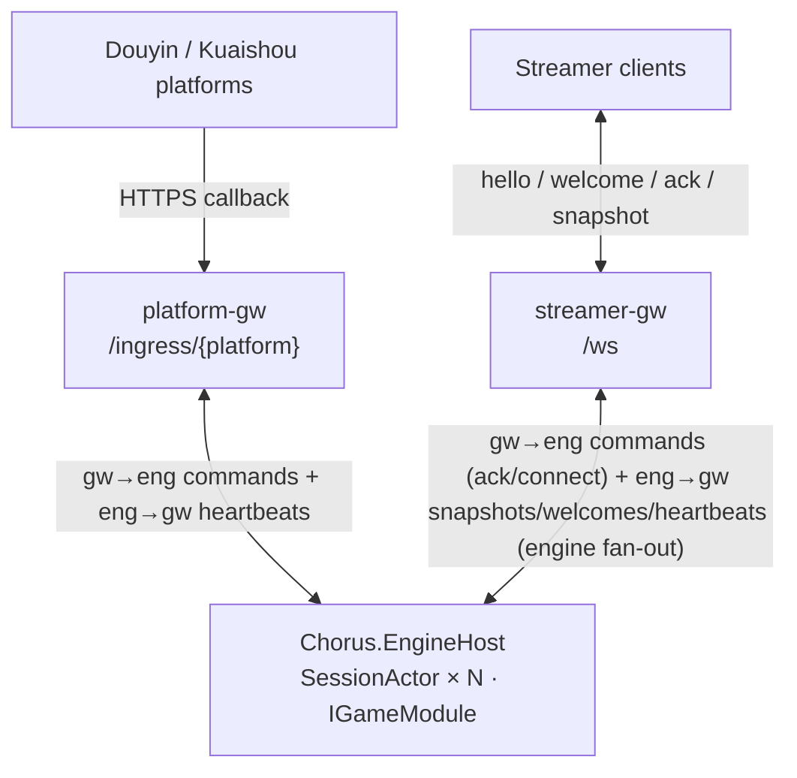

<p align="center">
  
</p>

<h1 align="center">Chorus</h1>
[](https://github.com/cuihairu/chorus/releases)

<p align="center">
  A live-stream chat/gift-driven interactive battle game framework (server-authoritative tick + state snapshots)
</p>

<p align="center">
  English | <a href="README.zh.md">简体中文</a>
</p>

<p align="center">
  <a href="https://github.com/cuihairu/chorus/actions/workflows/ci.yml"></a>
  <a href="https://github.com/cuihairu/chorus/actions/workflows/nightly.yml"></a>
  <a href="https://codecov.io/gh/cuihairu/chorus"></a>
  <a href="https://github.com/cuihairu/chorus/releases"></a>
  <a href="LICENSE"></a>
  
</p>

## Documentation (VuePress)

- Site (GitHub Pages): `https://cuihairu.github.io/chorus/`
- Source: `docs/`
- Local preview: `npm install && npm run docs:dev`
- Static build: `npm run docs:build` (output: `docs/.vuepress/dist`)

Key pages: [architecture & trade-offs](docs/architecture.md) ·
[current architecture overview](docs/design/architecture-overview.md) ·
[battle](docs/guide/battle.md) ·
[matchmaking](docs/guide/matchmaking.md) ·
[leaderboard](docs/guide/leaderboard.md) ·
[API reference](docs/reference/api.md) ·
[config reference](docs/reference/config.md) ·
[protocol reference](docs/reference/protocol.md)

## Quick Start

```bash
dotnet run --project src/Chorus.Server
```

- HTTP: port in `src/Chorus.Server/Properties/launchSettings.json` (default `http://localhost:5083`)
- WS: `ws://localhost:<serverPort>/ws`
- Metrics: `GET /sessions`; listener face counters: `GET /faces`

### Auth and deny-by-default (important)

Secure defaults are **off**; the dev config (`appsettings.Development.json`) turns them on explicitly for local runs:

- Platform callbacks: `Ingress:AllowAll=true` (unsigned callbacks accepted, ERROR log at startup). Production must use
  real signature verification per platform (`Ingress:Douyin:AppSecret`, `Ingress:Kuaishou:VerifyToken`, ...);
  with keys missing, `/ingress/{platform}` returns 401 for everything (fail-closed).
- Streamer WS: `Faces:StreamerWs:AllowAnonymous=true` (no token required). Production must set
  `Faces:StreamerWs:AuthTokens` (`token` or `token@unixMsExpiry`, `;`-separated);
  otherwise every WS connection is rejected (fail-closed).

See the [config reference](docs/reference/config.md) and [protocol reference](docs/reference/protocol.md).


## Local Test Scope

CI and local development are split three ways by change surface — a one-line doc change must not
trigger a full build.

1. **Docs only** (`*.md`, `docs/**`, images): no build. The main CI workflow's `paths-ignore`
   already skips those paths.
2. **Code**: run only the changed subset, never the full suite.
   - `dotnet test <changed csproj>`
3. **Full** (`dotnet test Chorus.sln -c Release`): only for these — `*.csproj` / `*.sln` /
   `global.json`, `.github/**`, Docker/Compose config, pre-release.

## Split Mode (Gateway + EngineHost)

```bash
dotnet run --project src/Chorus.EngineHost
dotnet run --project src/Chorus.Gateway
```

- Gateway: exposes `/ws` and `/ingress/{platform}`
- EngineHost: runs the authoritative tick + snapshots, talking to the Gateway over local IPC
  (UDS first, NamedPipe fallback)

## Architecture Overview



The single-process shape (`Chorus.Server`) puts both sides in one process with no IPC hop.
Full process topology and a component file:line index: [current architecture overview](docs/design/architecture-overview.md).
Backend/admin-facing endpoints: [API reference](docs/reference/api.md).

## Product Boundary

| Belongs in Chorus | Not Chorus's core job |
|--------|--------|
| Live platform event adapter interfaces | A full live-platform business backend |
| Event normalization, dedup and backpressure | Gift payments, revenue share, settlement |
| Session and Match mechanics | Actual game design and art content |
| Server-authoritative tick and state snapshots | A general-purpose MMO world server |
| Client connections, ACK, resync | A full streamer companion app |
| Game module extension interfaces | Forcing a dependency on a specific game engine |

The core value is not WebSocket, and not an ordinary game loop; it is turning bursty, duplicated,
delayed, out-of-order live-stream events into **ordered, bounded, observable, recoverable game input**.
Chorus stays a lightweight framework and does not grow into an account/ops/payment/editor/livestream-management platform.

## Tech Stack

- Language: C# (the default C# version for .NET 10)
- .NET: `net10.0` (TargetFramework in `src/*/*.csproj`; `global.json` pins the SDK to `10.0.401`)
- Platforms: Windows / Linux / macOS (server side); clients connect over the WebSocket protocol

## Releases and Tags

Use semantic version tags: `v0.1.0`, `v0.1.1`. Version numbers are given and triggered manually by the
maintainer. There is no scheduled or auto-triggered release: `release.yml` runs **only** when a `v*` tag is pushed
(the tag supplies the version), and creates the GitHub Release from there. Daily/nightly binaries are separate
(uploaded as artifacts, no tag), and must pass acceptance testing.

```bash
git tag v0.1.0
git push origin v0.1.0
```

## Coverage

CI generates and uploads coverage reports (see the Codecov badge / PR checks).
