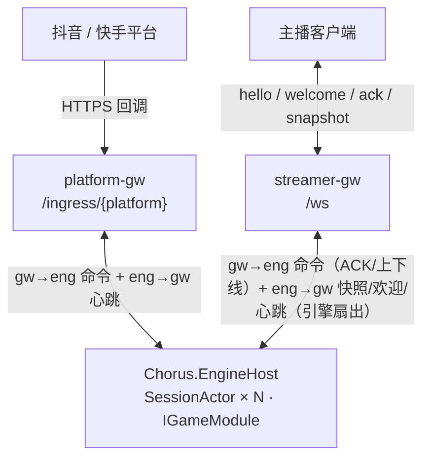

<p align="center">
  
</p>

<h1 align="center">Chorus</h1>
<p align="center">[](https://github.com/cuihairu/chorus/releases)</p>

<p align="center">
  面向直播弹幕/礼物驱动的互动对战游戏框架（服务器权威 Tick + 状态快照）
</p>

<p align="center">
  <a href="README.md">English</a> | 简体中文
</p>

<p align="center">
  <a href="https://github.com/cuihairu/chorus/actions/workflows/ci.yml"></a>
  <a href="https://github.com/cuihairu/chorus/actions/workflows/nightly.yml"></a>
  <a href="https://codecov.io/gh/cuihairu/chorus"></a>
  <a href="https://github.com/cuihairu/chorus/releases"></a>
  <a href="LICENSE"></a>
  
</p>

## 文档（VuePress）

- 站点（GitHub Pages）：`https://cuihairu.github.io/chorus/`
- 源码：`docs/`
- 本地预览：`npm install && npm run docs:dev`
- 构建静态站：`npm run docs:build`（输出：`docs/.vuepress/dist`）

重点页面：架构说明（分层与取舍） ·
当前架构总览 ·
对战 ·
匹配 ·
排行榜 ·
接口参考 ·
配置参考 ·
协议参考

## 快速开始

```bash
dotnet run --project src/Chorus.Server
```

- HTTP：端口见 `src/Chorus.Server/Properties/launchSettings.json`（默认类似 `http://localhost:5083`）
- WS：`ws://localhost:<serverPort>/ws`
- 指标：`GET /sessions`；listener face 计数：`GET /faces`

### 鉴权与默认拒绝（重要）

安全默认是**关**的，开发配置（`appsettings.Development.json`）已显式打开，方便本地直接跑：

- 平台回调：`Ingress:AllowAll=true`（未签名回调放行，启动日志打 ERROR 告警）。生产配置必须走
  各平台真实验签（抖音 `Ingress:Douyin:AppSecret`、快手 `Ingress:Kuaishou:VerifyToken` 等），
  缺密钥时 `/ingress/{platform}` 一律 401（fail-closed）。
- 主播 WS：`Faces:StreamerWs:AllowAnonymous=true`（无 token 可连）。生产配置必须给
  `Faces:StreamerWs:AuthTokens`（`token` 或 `token@unixMs过期时间`，`;` 分隔），
  否则所有 WS 连接被拒绝（fail-closed）。

详见 配置参考 与 协议参考。

## 本地测试口径

CI 与本地开发按改动面三路分流——改一行文档不该全量编译。

1. **文档改动**（`*.md`、`docs/**`、图片）：不编译。主 CI workflow 的
   `paths-ignore` 已跳过这些路径。
2. **代码改动**：只跑改动子集，不全量。
   - `dotnet test <改动 csproj>`
3. **全量**（`dotnet test Chorus.sln -c Release`）：仅以下情形触发——*.csproj / *.sln / global.json、
   `.github/**`、Docker/Compose 配置、发布前。

## 拆分模式（Gateway + EngineHost）

```bash
dotnet run --project src/Chorus.EngineHost
dotnet run --project src/Chorus.Gateway
```

- Gateway：对外提供 `/ws` 与 `/ingress/{platform}`
- EngineHost：运行权威 tick + 快照，通过本机 IPC 与 Gateway 通信（优先 UDS，失败降级 NamedPipe）

## 架构概览



单进程形态（`Chorus.Server`）把两侧装进同一进程，无 IPC 跳。完整进程拓扑与组件 file:line 索引见
当前架构总览；后台/管理端接口见接口参考。

## 产品边界

| 应该属于 Chorus | 不应该成为 Chorus 的核心职责 |
|--------|--------|
| 直播平台事件适配接口 | 完整直播平台业务后台 |
| 事件归一化、去重与背压 | 礼物支付、分成、商业结算 |
| Session 与 Match 的运行机制 | 具体游戏玩法和美术内容 |
| 服务端权威 Tick 和状态快照 | 通用 MMO 世界服务器 |
| 客户端连接、ACK、重同步 | 完整直播伴侣客户端 |
| 游戏模块扩展接口 | 强制依赖某个游戏引擎 |

核心价值不是 WebSocket，也不是普通游戏循环，而是把突发、重复、延迟、乱序的外部直播事件
转换成**有顺序、有边界、可观测、可恢复的游戏输入**。保持轻量框架定位，不扩展成账号、运营、
支付、游戏编辑器与直播管理的综合平台。

## 技术栈与支持

- 语言：C#（随 .NET 10 默认 C# 版本）
- .NET：`net10.0`（TargetFramework 见 `src/*/*.csproj`；`global.json` 锁定 SDK 到 `10.0.401`）
- 平台：Windows / Linux / macOS（服务器端），客户端以 WebSocket 协议接入

## 发布与 Tag

推荐使用语义化版本号打 tag：`v0.1.0`、`v0.1.1`。版本号由维护者手动给出并触发。
没有定时/自动触发的发版：`release.yml` **仅**在维护者推 `v*` tag 时运行（tag 即版本号），据此建 GitHub Release。
每日构建/nightly 二进制另算（上传 artifact、不打 tag），须通过验收测试。

```bash
git tag v0.1.0
git push origin v0.1.0
```

## 覆盖率

CI 会生成并上传覆盖率报告（见 Codecov badge / PR 检查）。
