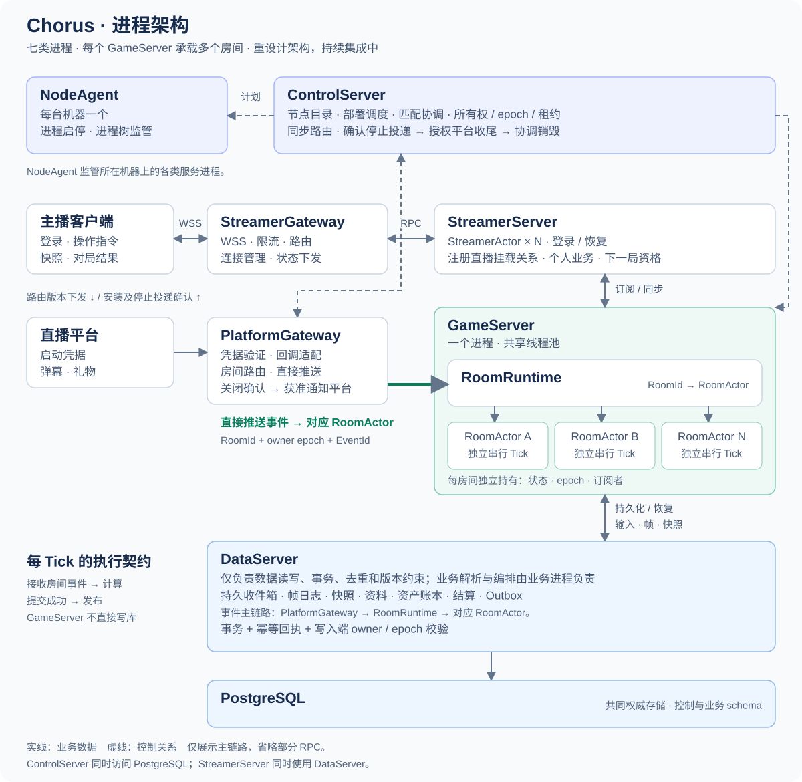

<p align="center">
  
</p>

<h1 align="center">Chorus</h1>

<p align="center">
  面向直播间弹幕/礼物事件的弹幕游戏框架——结构化玩法输入，服务器权威对局仿真与结算
</p>

<p align="center">
  <a href="README.md">English</a> | 简体中文
</p>

<p align="center">
<a href="https://github.com/cuihairu/chorus/releases"></a> <a href="https://cuihairu.github.io/chorus/zh/"></a> <a href="https://github.com/cuihairu/chorus/actions/workflows/ci.yml"></a> <a href="https://github.com/cuihairu/chorus/actions/workflows/nightly.yml"></a> <a href="https://codecov.io/gh/cuihairu/chorus"></a> <a href="https://github.com/cuihairu/chorus/releases"></a> <a href="LICENSE"></a> 
</p>

## 文档（VitePress）

**重设计方案（2026-10-25）**：[分布式直播游戏服务器完整设计](docs/architecture/architecture.md)、[验收计划](docs/architecture/redesign-acceptance.md)与 [M0 实现/证据](docs/architecture/redesign-m0-implementation.md)。M0 的 PostgreSQL schema、DataServer/ControlServer、证书边界和双系统 NodeAgent 骨架正在落地；这不代表 M0 出口已全部通过。下文仍是当前代码的使用说明。

- 站点（GitHub Pages）：`https://cuihairu.github.io/chorus/`
- 源码：`docs/`
- 本地预览：`npm install && npm run docs:dev`
- 构建静态站：`npm run docs:build`（输出：`docs/.vitepress/dist`）

重点页面：架构说明（分层与取舍） ·
当前架构总览 ·
对战 ·
匹配 ·
排行榜 ·
接口参考 ·
配置参考 ·
协议参考

## 快速开始

```bash
dotnet run --project src/Chorus.Server
```

- HTTP：端口见 `src/Chorus.Server/Properties/launchSettings.json`（默认类似 `http://localhost:5083`）
- WS：`ws://localhost:<serverPort>/ws`
- 指标：`GET /sessions`；listener face 计数：`GET /faces`

### 鉴权与默认拒绝（重要）

安全默认是**关**的，开发配置（`appsettings.Development.json`）已显式打开，方便本地直接跑：

- 平台回调：`Ingress:AllowAll=true`（未签名回调放行，启动日志打 ERROR 告警）。生产配置必须走
  各平台真实验签（抖音 `Ingress:Douyin:AppSecret`、快手 `Ingress:Kuaishou:VerifyToken` 等），
  缺密钥时 `/ingress/{platform}` 一律 401（fail-closed）。
- 主播 WS：`Faces:StreamerWs:AllowAnonymous=true`（无 token 可连）。生产配置必须给
  `Faces:StreamerWs:AuthTokens`（`token` 或 `token@unixMs过期时间`，`;` 分隔），
  否则所有 WS 连接被拒绝（fail-closed）。

详见 配置参考 与 协议参考。

## 本地测试口径

CI 与本地开发按改动面三路分流——改一行文档不该全量编译。

1. **文档改动**（`*.md`、`docs/**`、图片）：不编译。主 CI workflow 的
   `paths-ignore` 已跳过这些路径。
2. **代码改动**：只跑改动子集，不全量。
   - `dotnet test <改动 csproj>`
3. **全量**（`dotnet test Chorus.sln -c Release`）：仅以下情形触发——*.csproj / *.sln / global.json、
   `.github/**`、Docker/Compose 配置、发布前。

## 拆分模式（Gateway + EngineHost）

```bash
# 分别在独立终端运行。网关宿主的必填配置走 CHORUS_* 环境变量
# （PlatformGateway/Program.cs:11-15、StreamerGateway/Program.cs:9-13），Kestrel 监听不认 --urls。
Ipc__GatewayIds=platform-gw,streamer-gw dotnet run --project src/Chorus.EngineHost

CHORUS_CLUSTER_ID=local CHORUS_ROOT_CA_PEM=./certs/root-ca.pem CHORUS_NODE_CA_PEM=./certs/node-ca.pem \
CHORUS_TLS_CERT_PEM=./certs/gw.pem CHORUS_TLS_KEY_PEM=./certs/gw.key CHORUS_DEV_PLATFORM_ENDPOINT=http://localhost:9000 \
CHORUS_PORT=7504 CHORUS_INGRESS_PORT=5168 dotnet run --project src/Chorus.PlatformGateway

CHORUS_CLUSTER_ID=local CHORUS_ROOT_CA_PEM=./certs/root-ca.pem CHORUS_NODE_CA_PEM=./certs/node-ca.pem \
CHORUS_TLS_CERT_PEM=./certs/gw.pem CHORUS_TLS_KEY_PEM=./certs/gw.key CHORUS_TENANT_APPLICATIONS=tenant-a:app-1 \
CHORUS_PORT=7530 CHORUS_WSS_PORT=5169 dotnet run --project src/Chorus.StreamerGateway
```

- `Chorus.PlatformGateway`（平台网关）：只提供 `/ingress/{platform}`，监听 `CHORUS_INGRESS_PORT`（未设置即不开公共端口）；集群 gRPC 在 `CHORUS_PORT`（默认 `7504`）。
- `Chorus.StreamerGateway`（主播网关）：只提供 `/ws`，监听 `CHORUS_WSS_PORT`（默认 `7443`）；集群 gRPC 在 `CHORUS_PORT`（默认 `7530`）。
- 两个宿主都要求上述 TLS/证书环境面；实例身份来自进程证书，而非 `Gateway:Id`。
- 公共 IPC、控制面路由、健康检查在 `Chorus.Gateway.Runtime`；共享入口协议在 `Chorus.Gateway.Core`。
- 两个宿主独立发布、部署和扩容，不需要 `Gateway:Roles`。旧单体 `Chorus.Gateway` 宿主已移除（`48623a5`）。详见[独立网关部署](docs/guide/independent-gateways.md)。
- EngineHost：运行权威 tick + 快照，通过本机 IPC 与 Gateway 通信（优先 UDS，失败降级 NamedPipe）

## 压测工具与火焰图

`Chorus.LoadTool` 驱动观众事件入口和模拟主播 WS 客户端打向运行中的 Gateway。全部参数可用
`dotnet run --project src/Chorus.LoadTool -- --help` 查看。

CPU 火焰图是可选能力，走外部 `dotnet-trace` 工具路线（仓库不新增包引用）：

```bash
dotnet tool install -g dotnet-trace   # 未安装时装一次
dotnet run --project src/Chorus.LoadTool -- --flamegraph --duration 60
```

- `--flamegraph` 开启采集（环境变量 `CHORUS_LOAD_FLAMEGRAPH=1`）；不带该 flag 时行为与从前完全一致。
- `--flamegraph-seconds <sec>` 设置采样窗口（默认 30），自动收窄到不超过压测时长。
- `--flamegraph-dir <dir>` 设置输出目录（默认 `flamegraphs`）：生成 `loadtool_<时间戳>_<pid>.nettrace`
  与转换出的 `.speedscope.json`。
- speedscope 文件可在 <https://speedscope.app> 打开。机器上没有 `dotnet-trace` 时，工具打印安装
  指引后照常运行；采集或转换失败绝不中断压测、不改变退出码。`--driver-processes N` 时每个分片
  采集自身进程（每个分片一份产物）。

## 架构概览



七类进程角色；每个 GameServer 内由 RoomRuntime 管理多个 RoomActor，各房间独立推进 Tick。
此图展示重设计架构，网关集成及生产验收仍在推进；上文的启动示例仍对应旧版宿主。
详见[完整架构设计](docs/architecture/architecture.md)和[验收边界](docs/architecture/redesign-acceptance.md)。

## 产品边界

| 应该属于 Chorus | 不应该成为 Chorus 的核心职责 |
|--------|--------|
| 直播平台事件适配接口 | 完整直播平台业务后台 |
| 事件归一化、去重与背压 | 礼物支付、分成、商业结算 |
| Session 与 Match 的运行机制 | 具体游戏玩法和美术内容 |
| 服务端权威 Tick 和状态快照 | 通用 MMO 世界服务器 |
| 客户端连接、ACK、重同步 | 完整直播伴侣客户端 |
| 游戏模块扩展接口 | 强制依赖某个游戏引擎 |

核心价值不是 WebSocket，也不是普通游戏循环，而是把突发、重复、延迟、乱序的外部直播事件
转换成**有顺序、有边界、可观测、可恢复的游戏输入**。保持轻量框架定位，不扩展成账号、运营、
支付、游戏编辑器与直播管理的综合平台。

## 技术栈与支持

- 语言：C#（随 .NET 10 默认 C# 版本）
- .NET：`net10.0`（TargetFramework 见 `src/*/*.csproj`；`global.json` 锁定 SDK 到 `10.0.401`）
- 平台：Windows / Linux / macOS（服务器端），客户端以 WebSocket 协议接入

## 发布与 Tag

推荐使用语义化版本号打 tag：`v0.1.0`、`v0.1.1`。版本号由维护者手动给出并触发。
没有定时/自动触发的发版：`release.yml` **仅**在维护者推 `v*` tag 时运行（tag 即版本号），据此建 GitHub Release。

```bash
git tag v0.1.0
git push origin v0.1.0
```

### Nightly 构建

`nightly` workflow 每日运行（03:30 UTC），刷新滚动更新的
[`nightly` 预发布](https://github.com/cuihairu/chorus/releases/tag/nightly)，包含以下资产：

| 资产 | 内容 | 平台 |
|------|------|------|
| `chorus-nightly-linux-x64.tar.gz` | `Chorus.Server`，自包含（无需 .NET 运行时），解压后直接运行 `Chorus.Server` | Linux x64 |
| `chorus-server_<version>_amd64.deb` | `Chorus.Server`，安装到 `/opt/chorus-server` 并创建 `/usr/bin/chorus-server` 链接 | Debian/Ubuntu x64 |
| `chorus-server-0.0.0-1.nightly<date>.x86_64.rpm` | `Chorus.Server`，布局与 deb 相同 | RHEL/Fedora/openSUSE x64 |
| `chorus-nightly-windows-x64.zip` | `Chorus.Server` + `Chorus.NodeAgent`，自包含，各占一个顶层目录 | Windows x64 |
| `SHA256SUMS` | 上述全部资产的 SHA-256 校验和 | — |

说明：

- deb 与 rpm 为框架依赖包：声明依赖 `dotnet-runtime-10.0` 与 `aspnetcore-runtime-10.0`（请安装
  Microsoft 或发行版的 .NET 10 运行时包）。
- 暂无可分发的 GUI 客户端：`Chorus.Client` 是协议/RPC 库，客户端经 WebSocket 接入。
- Nightly 二进制未签名、不打 tag；依赖它之前须通过验收测试。

## 覆盖率

CI 会生成并上传覆盖率报告（见 Codecov badge / PR 检查）。
