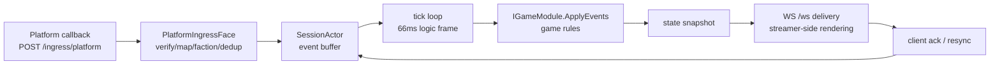

# Architecture: Layers, Decisions and Trade-offs

This page answers three questions: how Chorus is layered, **why these choices were made** (and which
alternatives were given up), and under which constraints the choices hold. Detail pages each own one
area; this is the map plus the reasoning:

- Process topology and component index: [current architecture overview](./design/architecture-overview.md)
- Component diagrams and deep dives: [architecture design](./design/architecture.md),
  [frame sync design](./design/frame-sync.md), [IPC design](./design/ipc.md),
  [process topology](./design/process-topology.md)
- Decision-by-decision records (for review): [decision log](./decisions.md)
- Capability usage: [battle](./guide/battle.md), [matchmaking](./guide/matchmaking.md),
  [leaderboard](./guide/leaderboard.md)

## Layering and module split

Bottom-up, the 13 projects fall into five layers (dependencies may only point downward):

| Layer | Projects | Responsibility |
|---|---|---|
| Protocol | `Chorus.Protocol` | Message records (`ClientHello`/`ServerSnapshot`/…), JSON serialization, protocol version policy |
| Engine | `Chorus.Engine` | Sessions and the tick loop (`SessionActor`), frame history (`FrameHistory`), matchmaking (`Matchmaking`), module contract (`Abstractions`) |
| Data | `Chorus.Data` | Leaderboard storage (`LeaderboardStore`), data command model |
| Ingest | `Chorus.Adapters.*` (platform adapters), `Chorus.Gateway.Core` (shared implementation of both faces + metrics/leaderboard HTTP) | Platform signature verification/mapping; the ingress and streamer-ws listener faces |
| Hosts and consumers | `Chorus.Server` (single process), `Chorus.Gateway` + `Chorus.EngineHost` (split), `Chorus.Messaging` (IPC), `Chorus.SampleGame` (reference game), `Chorus.Client` (client SDK), `Chorus.LoadTool` (load tool) | Process assembly and external entry points |

The data flow of one audience interaction (the single-process shape saves one IPC hop):

## Two deployment shapes, one boundary

The same code, two assemblies: `Chorus.Server` single process; `Chorus.Gateway` + `Chorus.EngineHost`
split. Both shapes **share the same pair of listener faces** (`PlatformIngressFace`,
`StreamerWsFace`, in `Chorus.Gateway.Core`); session state always lives on the engine side
(single-process `SessionManager`, split `EngineIpcService`) — the gateway holds no session state.

> Why single-process first: the smallest operational surface (one process, no IPC), and load tests
> show a single worker is enough at the several-hundred-rooms scale
> (todo.md:156: 800 rooms + 30k rps signed events, `ingested==applied==45287`, peak CPU 27.6).
> Split-mode trigger conditions and the roadmap: [process topology](./design/process-topology.md) §4.

## Data flow (the life of one event)

Split shape, with a source anchor for every step (written `file:line`, as of main):

1. A platform callback arrives at `POST /ingress/{platform}` (`src/Chorus.Gateway/Program.cs:148`,
   gated by `Gateway:Roles`).
2. `PlatformIngressFace` applies, in order: rate limiting (`:58` 429), body size cap (`:68` 413),
   fail-closed signature verification (`:76` 401), platform mapping, unknown-event rejection
   (`:93` 400), TTL dedup (`:101` 200 duplicated), faction assignment, session routing.
3. The gateway wraps the event into an `Envelope` (`gw.audienceEvent`) and sends it to the engine
   over the IPC bus (`src/Chorus.Gateway/GatewayIpcService.cs`; envelopes live in `src/Chorus.Messaging/`).
4. The engine receive loop dispatches by type (`src/Chorus.EngineHost/EngineIpcService.cs:294`) and
   writes into the target session's buffer (`SessionActor.TryIngestAudienceEventAsync`,
   `src/Chorus.Engine/Session/SessionActor.cs:190`).
5. The tick loop (`SessionActor.cs:518`) hands buffered events to the game rules every 66ms
   (`SessionConfig.cs:4`): `IGameModule.ApplyEvents`
   (`src/Chorus.Engine/Abstractions/IGameModule.cs:10`).
6. The module produces new state; the engine encodes it as a `ServerSnapshot` (one frame per tick,
   `SessionConfig.cs:6`); recent frames enter `FrameHistory` (byte cap `SessionConfig.cs:24`) for
   resync replay.
7. Snapshots travel back to the gateway over the eng→gw bus (`GatewayIpcService.cs:198`,
   dispatch `:213`), then the WS face pushes them to clients.
8. Clients ack after applying a frame; on detecting a gap they send `resync`, and the engine replays
   a window from frame history (`src/Chorus.Engine/Session/FrameHistory.cs:79`) or pushes a forced
   snapshot to realign (`SessionActor.cs:573`).

## Key decisions and the alternatives that were rejected

Each decision gets four things: the decision, the reason, the rejected alternative, the constraints
under which it holds.

### 1. Server-authoritative tick + snapshots, not lockstep

- **Decision**: the engine advances logic frames at a fixed cadence (default 66ms); clients do not
  advance game logic — they render server snapshots and align to them.
- **Reason**: audience interaction (danmaku/gifts) is a low-frequency, reorderable, droppable social
  signal, not competitive input. Lockstep (waiting for the slowest peer) lets one laggy viewer's
  client slow the whole room, while live streaming already tolerates seconds of interaction latency.
- **Rejected alternative**: lockstep (input-frequency sensitive, requires everyone-online
  semantics); client authority + server relay (cannot make authoritative calls such as leaderboards
  or anti-cheat). See [frame sync design](./design/frame-sync.md).
- **Constraints**: interaction latency must be tolerable at ≥ one tick + delivery time; a single
  room does not have competitive-grade (millisecond) adjudication needs.

### 2. Session state lives only in the engine; the gateway is stateless

- **Decision**: in both the single-process and split shapes, session and client state live only in
  the engine-side actor (`SessionActor`); the gateway only verifies, maps, dedups and forwards.
- **Reason**: both deployment shapes stay semantically identical (the same face pair shared
  byte-for-byte); when gateway replicas or multiple workers come later, there is exactly one
  consistency boundary.
- **Rejected alternative**: the gateway builds sessions locally and syncs to the engine — two
  authoritative copies, and every rule written twice in the split shape.
- **Constraints**: holds within a single worker's session capacity cap (`SessionConfig.cs:17`,
  default 200, tunable); multi-worker is the planned phase three (see "Known limits" below).

### 3. Single process first, faces split up front (not three processes from day one)

- **Decision**: listener code sinks into a shared library (faces); the process boundary is
  deferred; both shapes are available today.
- **Reason**: process splitting is an operational cost, not a feature; cut the logical boundary
  (faces) first, and let physical splitting wait for load evidence. Trigger conditions and the
  decision record: [process topology](./design/process-topology.md) §4, [decision log](./decisions.md) D5.
- **Rejected alternative**: three processes on day one (two extra latency hops and operational
  surface, no benefit before load testing); single process forever (single-point capacity ceiling,
  the ingest face cannot scale horizontally).

### 4. IPC: UDS-first length-prefixed JSON envelopes, not gRPC/shared memory

- **Decision**: a self-managed `Envelope` message bus between engine and gateway;
  `Ipc:Transport=Auto` defaults to UDS (`/tmp/chorus/*.sock`), falls back to named pipe, optional
  TCP/HTTP; the frame format = 4-byte little-endian length + JSON payload.
- **Reason**: UDS is the main path for same-machine splits (kernel-direct, no serialization
  framework overhead); JSON envelopes let the protocol records be reused directly
  (`Chorus.Protocol`'s one message set serves both WS and IPC); length prefixing is self-describing
  with no framework dependency.
- **Rejected alternative**: gRPC (an extra layer of code generation and version coupling, while
  message bodies already have record contracts); shared-memory ring buffers (best latency but high
  complexity; evaluated and deferred, see [shared memory evaluation](./design/shared-memory-transport.md)).
- **Constraints**: single machine / same pod deployments; cross-machine deployments use TCP/HTTP
  transports (latency and throughput budgets to be assessed by the deployer).
  Channel details: [IPC design](./design/ipc.md).

### 5. No database: in-memory state + a snapshot recovery seam (not persistent storage)

- **Decision**: all runtime state is in memory; a session may restore from a snapshot at birth
  (the `ISnapshotRecoverySource` seam, `src/Chorus.Engine/Abstractions/SnapshotRecovery.cs`);
  the current production assembly registers no recovery source (always null).
- **Reason**: the lifetime of a live-stream interaction session ≈ the lifetime of the stream
  itself; resuming a session across restarts is not a current requirement. Dropping the storage
  dependency simplifies the deployment surface, failure modes, and latency.
- **Rejected alternative**: built-in SQLite/Redis persistence (per-tick write amplification and
  recovery complexity, in exchange for a resume capability that is not currently needed).
  Option comparison: [snapshot restore](./design/snapshot-restore.md) (option A shipped).
- **Constraints**: process restart = session terminated (room leaderboards can be rebuilt via the
  module restore path, see [leaderboard](./guide/leaderboard.md)); products needing cross-restart
  settlement must implement it outside.

### 6. Platform ingest: fail-closed signature routing (not permissive ingest)

- **Decision**: one named verifier per platform (`Douyin`/`Kuaishou`/`Bilibili`); routing selects
  by platform name; a missing verifier or missing key is always rejected (401) with no fallback
  pass-through; `Ingress:AllowAll` is dev-only and logs loudly at startup.
- **Reason**: ingest is a public callback surface; the cost of forged events (score/board farming)
  lands directly on the game economy.
- **Rejected alternative**: accept without verification (anyone can write events); unified gateway
  verification (platform signature algorithms differ; forcing them together invites the
  shared-secret anti-pattern). Decision records D2–D4.
- **Constraints**: a new platform must bring its own verifier and mapper (template:
  [platform adapter contract](./reference/adapter-contract.md)).

### 7. Game rules converge into IGameModule (not hard-coded in the engine)

- **Decision**: the engine only understands frames and delivery; gameplay is a module registered
  by the host (`IGameModuleFactory` → `IGameModule`, four members: `Name`/`ApplyEvents`/
  `GetStateSnapshot`/`RestoreState`, `IGameModule.cs:6-24`).
- **Reason**: gameplay iterates far faster than the engine; the module boundary doubles as the
  snapshot-restore boundary and the test boundary (modules can be unit-tested without the engine;
  see `Chorus.SampleGame`).
- **Rejected alternative**: a gameplay switch inside the engine (every new game mode touches the
  engine core); scripted gameplay (hot-reload flexibility, but loses compile-time contracts and
  fail-closed restore semantics).
- How to write one and where the boundaries are: [game module](./guide/game-module.md).

### 8. Leaderboards: replace-style projection + separated queries (not live aggregation)

- **Decision**: room/match boards are projected by an engine-side module with **replace**
  semantics (`UpsertScore`, idempotent by nature); global/periodic boards use **idempotent
  deltas** (`AddDelta`, sourceId ledger dedup) and are left to an async aggregator; queries read
  independent snapshots, and a frozen board is sealed. Storage in `src/Chorus.Data/Leaderboard.cs:40`;
  read/write paths: [leaderboard](./guide/leaderboard.md).
- **Reason**: live scores already live in authoritative session state, so re-projection never
  double-counts; the delta ledger keeps replay safe.
- **Rejected alternative**: a single accumulate API (room boards double on re-projection, delta
  boards get no dedup); recomputing on every query (query cost grows linearly with participants,
  and ranks jitter under concurrent events).

## Trade-offs under the constraints

| Constraint | This architecture | Cost / where it does not apply |
|---|---|---|
| Scale | Hundreds of rooms per worker (800 rooms × 3 clients measured with zero loss, peak CPU 27.6, todo.md:156) | Multi-worker not shipped yet (phase three) |
| Interaction latency | One tick (66ms) + delivery, one snapshot per tick | Not for millisecond-grade competitive adjudication (FPS/fighting) |
| Consistency | Server-authoritative + fail-closed ingest + idempotent projection | No cross-restart session resume (no persistence) |
| Input surface | Platform callbacks + streamer WS rendering read-only; clients cannot write gameplay | Viewers cannot issue gameplay commands (a small abuse surface — both a benefit and a limit) |

In one sentence: **Chorus trades competitive-grade latency and persistence for strong authority and
operability under massive, low-frequency audience input.**
If product constraints change (persistent sessions needed, competitive input needed), the
corresponding decisions (5, 1) need to be reopened.

## Known limits and follow-ups

An honest list of limits (detailed data and fix progress in `todo.md:156`):

- **Phase-three multi-worker not shipped**: a single worker's peak CPU has been observed past the
  60% trigger line (800 rooms + 800 WS + ~1k events/s); the multi-worker routing/takeover machinery
  (`RoomAuthorityRegistry` etc.) exists as tested scaffolding, wiring awaits a decision.
- **Concurrent snapshot fan-out at the gateway**: eng→gw is a single socket + single lock with
  serial dispatch; at 2.65M snapshots, dropped frames are recovered by resync (architecture-level
  backlog).
- **Resync replay bounds**: total replay volume has no per-request cap and amplifies with the
  snapshot flood (architecture-level backlog).
- **Leaderboard `AddDelta` ledger is unbounded**: one dedup record per board per sourceId;
  long-running high-rate sources grow memory. Live projection should always use `UpsertScore`
  (see the [leaderboard](./guide/leaderboard.md) limits).
- **Matchmaking has no host wiring**: `Matchmaker` is a library capability; the product semantics
  of join/start are undecided (see the [matchmaking](./guide/matchmaking.md) limits).

## Related pages

- [Current architecture overview](./design/architecture-overview.md) (process topology and component index)
- [Architecture design](./design/architecture.md) / [frame sync design](./design/frame-sync.md) / [IPC design](./design/ipc.md)
- [Battle](./guide/battle.md) / [matchmaking](./guide/matchmaking.md) / [leaderboard](./guide/leaderboard.md)
- [Decision log](./decisions.md) / [API reference](./reference/api.md)
