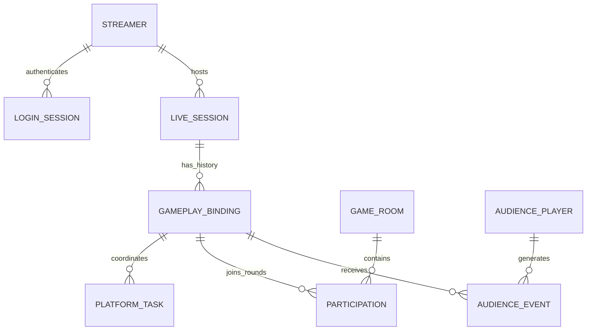
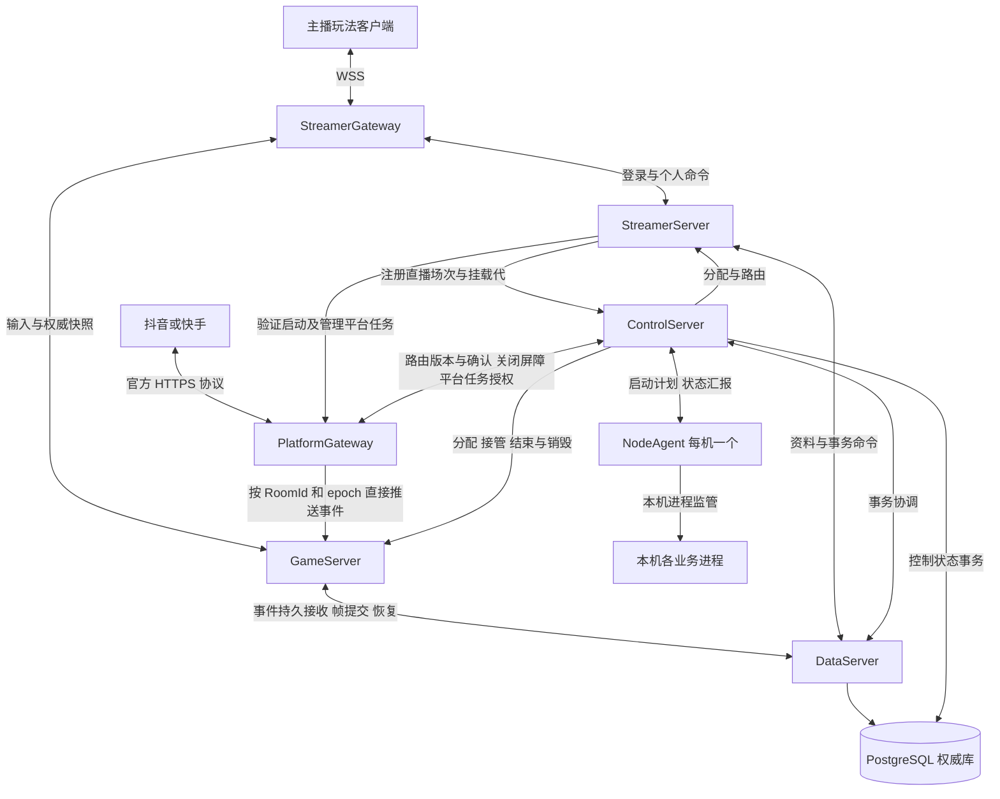

# Chorus 分布式直播游戏服务器完整设计

## 0. 文档状态与阅读入口

- 版本：重设计 1.0；日期：2026-10-25。
- 状态：完整目标方案，供审阅与实施拆解；不是当前代码能力声明，也不是生产验收通过声明。
- 需求来源：用户本轮明确要求，以及[直播玩法领域调研](../research/live-interactive-redesign-baseline.md)。不以旧实现兼容性为约束。
- 技术基线：C# / .NET 10；仓库 SDK 为 `10.0.401`。不依赖 Unity、Godot 等客户端引擎运行服务端逻辑。
- 配套：[协议与数据契约](redesign-contracts.md)、[故障与部署手册](redesign-operations.md)、[验收与实施计划](redesign-acceptance.md)、[设计决策](redesign-decisions.md)。四份附录与本文一起构成方案。
- 审查：架构一致性与实现可行性审查结果记录于验收文档；实际容量、平台联调和双系统故障测试尚未执行。

本文作为此次重设计的唯一目标架构入口。旧 `docs/design/*`、旧 ADR 和 README 继续描述旧实现或历史，不得据其覆盖本文中的新设计；旧代码是否复用需独立审计，不进行无差别重写。

## 1. 产品边界与确定的要求

Chorus 是直播互动游戏的服务端平台。主播通过平台启动玩法；观众通常通过弹幕、点赞、礼物参与；多个主播可匹配到共同对局。Chorus 承担身份、实体、实时权威逻辑、数据、节点进程监管及业务恢复。

### 1.1 用户确定的约束

1. 同一直播同时只运行一种玩法。
2. 主播可独立登录和处理个人业务，实体不依附某个游戏房间。
3. 意外离线保留一局时间，不能因为客户端断线立即中断当前局。
4. 提供开箱即用持久化功能，不只留接口。
5. 支持多节点匹配、跨机器入场和共同权威对战。
6. 自行监管节点和业务进程，区分进程重启与业务恢复。
7. 服务器支持 Linux 和 Windows，不强制 Kubernetes。
8. 不以现有代码兼容性为设计前提。

### 1.2 本方案选择的默认行为

以下为设计选择，区别于用户原话；可通过明确的配置或后续 ADR 调整。

- 同一主播同一应用只允许一个具有控制权的客户端；新登录接管，旧连接撤销。观测终端只能订阅，不获得控制权。
- 基础产品是弹幕互动；可操作嘉宾、小游戏扩展使用额外适配器，不强制普通观众登录连接。
- 同平台、同游戏、同玩法规则版本匹配；跨平台账号合并和跨平台匹配默认关闭。
- 单地域集群，跨地域容灾作为独立部署，不在第一版做跨地域实时写入。
- 默认 ContinueToEnd：断线后当前局继续，保留重连位置；本局结束后结算，不替离线主播自动排下一局。玩法可显式选择持久边界暂停或按规则终结，详见[帧同步与离线策略](../zh/design/authoritative-sync.md)；后两种策略尚待实现验收。无进行中对局时保留该玩法配置的 `OfflineGraceDuration`，默认取 `MaxRoundDuration`；无配置则玩法不得上线。
- 主动退出、明确关播、封禁与意外断线是不同原因；关播停止新匹配，对当前局采用玩法的 `OnHostUnavailable` 规则，但保留结果和可恢复状态至本局清理期限。
- 服务器故障后恢复当前局；不能恢复时执行明确的中止与补偿流程，不伪造成功结算。
- 通用的资料、资产、积分、库存、排名和奖励提供实现；平台支付、分成和退款不由 Chorus 擅自执行。

### 1.3 技术要求与原则

- 每个可变业务聚合有且只有一个合法写入所有者；epoch 必须在持久化接收端校验。
- 已确认的重要输入、结算和资产变更必须可恢复；内存收取不等于持久接收。
- 游戏对局按统一权威顺序推进，不承诺还原平台未提供的用户真实操作全序。
- 观察、期望、权威状态分开；指标不能授予所有权。
- 外部平台调用可能结果未知，不能用本地事务假装跨系统原子提交。
- 故障时宁可明确暂停，也不输出未经持久提交的权威结果。

## 2. 业务对象与身份

| 对象 | 标识与作用域 | 生命周期 / 权威来源 |
|---|---|---|
| Application | TenantId + GameId + 平台 AppId 映射 | 管理配置；游戏包与凭据隔离 |
| PlatformIdentity | Platform + AppId + OpenId | 平台验证所得，映射内部 PlayerId；不得仅用昵称或直播号 |
| Streamer | StreamerId（关联 PlayerId） | 长期主体，资料由 DataServer 保存，活跃实体由 StreamerServer 所有 |
| AudiencePlayer | PlayerId | 观众事件触发按需建立资料，不默认每人常驻 Actor |
| LiveSession | LiveSessionId + 平台直播上下文 | 一场直播；平台标识和生效时间保留，不能用主播账号替代 |
| GameplayBinding | BindingId + BindingGeneration | 本场直播的当前玩法挂载；旧挂载保留墓碑以识别迟到事件 |
| LoginSession | LoginSessionId + SessionVersion | Chorus 登录控制权，与 Socket 和平台启动 token 分开 |
| Connection | GatewayInstanceId + ConnectionId | 某一次网络连接，可丢失和重建 |
| MatchTicket | TicketId + TicketVersion | 一次匹配意图；每个挂载最多一个有效 ticket |
| GameRoom | RoomId + RoomEpoch | 一次权威游戏对局，单主播或多主播；结束后不复用 RoomId |
| Participation | RoomId + StreamerId / PlayerId | 本局位置、阵营、退出原因；阵营由玩法决定，不默认一个主播一个阵营 |
| PlatformTask | TaskId + BindingGeneration + TaskEpoch | 外部订阅、绑定、连屏、上报的期望与观察状态 |
| Process | DeploymentSlotId + ProcessInstanceId | slot 稳定，实例每次启动重新生成，PID 只用于本机观察 |
| Node | NodeId + AgentInstanceId | NodeId 安装时稳定；AgentInstanceId 每次启动改变 |

一个 LiveSession 的活跃 GameplayBinding 唯一，具体由跨 GameId 的 LiveSlot 保证，不能把游戏 ID 放进这一唯一键。LiveSlotKey 使用平台验证的规范直播场次标识；身份仍保留 AppId 作用域，不能用相同昵称猜测跨应用身份。平台未提供跨应用稳定直播标识时，适配器必须验证平台自身的互斥挂载能力或提供可信映射，未具备证据不得宣称跨应用互斥已验收。挂载保持期间可连续多局；旧局结束与新局开始使用新的 RoomId 和 RoundGeneration。多直播间共同对战由多个 Participation 关联一个 GameRoom，直播间不迁移到另一平台直播间。

核心关系：



关系图中的多挂载表示历史；数据库唯一约束限制同一直播的活跃挂载只有一个。

## 3. 系统分层与进程拓扑

### 3.1 七种部署角色，职责固定

| 角色 | 独占职责 | 不承担的职责 | 扩展方式 |
|---|---|---|---|
| NodeAgent | 本机进程启停、进程树回收、资源采样、命令去重、包安装 | 不决定实体归属，不自行跨节点恢复业务 | 每台机器一个 |
| ControlServer | 部署与节点目录、匹配及房间所有权；组合挂载和房间路由，向 Gateway 同步版本并收集确认；持久协调结束、结算执行、平台收尾授权和销毁；Admin API | 不解析平台原始事件，不执行 Tick；业务事件由 Gateway 直接投递房间 | 2+ 副本；每个协调分区有一个租约持有者 |
| StreamerGateway | 客户端 WSS 接入、限流、绑定、路由、快照扇出 | 不加载长期业务实体，不决定游戏胜负 | 按连接和发送流量扩展 |
| PlatformGateway | 平台验签与事件归一化；订阅并确认 ControlServer 路由，按 RoomId/epoch 直接推送；关闭投递、排空并确认；取得关闭屏障授权后通知平台并核对结果 | 不决定匹配或房间归属，不在路由缺失时猜测目标，不提前调用平台结束接口 | 接入无状态扩展；任务按租约分配 |
| StreamerServer | 主播 Actor、登录接管、个人业务；维护并注册平台直播场次与挂载关系；提交匹配意图，终局释放后更新下一局资格 | 不运行共同对局 Tick，不直接写数据库 | 按活跃主播和邮箱负载扩展 |
| GameServer | RoomRuntime/RoomActor；校验并接收目标房间推送、串行处理事件；权威 Tick、快照恢复；提交终局，关闭输入并按确认命令回收实体 | 不持有支付权限，不直接修改全局玩家资产 | 按 Tick、输入和状态预算扩展 |
| DataServer | 按明确请求执行资料、输入、帧、快照、资产账本、结算记录、回执与 Outbox 的读写；事务、唯一性、权限、epoch 与版本约束 | 不解析平台事件、不选择目标房间、不协调匹配/结算/销毁、不调度平台调用 | 多个无状态实例，共用同一权威数据库 |

首期不增加独立 MatchMgr、RoomMgr、StreamerMgr、RankServer 或 ConfigServer 进程。它们是现有角色中的清晰模块；只有独立容量或故障隔离证据才触发物理拆分。

职责修订（2026-10-29）：以下是目标边界。当前存储类中的事件归房、DataServer 宿主后台业务和现有拉取输入实现需按 TODO §22.9/22.10 迁移；不以旧实现反向定义进程职责。

### 3.2 逻辑模块归属

| 模块 | 宿主 | 拥有的数据与行为 | 主要依赖 |
|---|---|---|---|
| NodeRegistry / DeploymentController | ControlServer | NodeObservation、DeploymentSpec、ProcessPlan | 控制库、Agent |
| OwnershipDirectory / RoutePublisher | ControlServer | 组合挂载与房间 owner；发布路由快照/版本更新；记录 Gateway 授权和确认 | StreamerServer、控制存储、Gateway |
| RoundEndCoordinator / SettlementExecutor | ControlServer | 结束操作、投递关闭屏障、幂等奖励执行、平台任务授权、Finalize 与 Destroy 协调 | GameServer、StreamerServer、PlatformGateway、DataServer |
| MatchCoordinator | ControlServer | ticket、预留、入场提交和撤销 | DataServer、GameServer |
| LoginCoordinator / StreamerActor | StreamerServer | 登录、主播状态、直播场次与挂载关系注册、下一局资格 | 平台验证、DataServer、ControlServer |
| PlatformAdapter / EventDispatcher / TaskReconciler | PlatformGateway | 平台协议；路由安装确认、直接投递、排空确认；获授权的平台任务与结果核对 | ControlServer、GameServer、DataServer、官方 OpenAPI |
| RoomRuntime / RoomActor | GameServer | 按 RoomId 定位实体；目标事件接收、输入代校验、Tick、终局与回收 | DataServer、GameModule |
| ProfileStore / AssetStore / LedgerStore / RankingStore | DataServer | 按调用方明确请求读写资料、库存、流水、排名投影及事务约束 | PostgreSQL |
| InputStore / FrameStore / SettlementStore | DataServer | 按已确定目标保存输入、帧、快照、奖励进度、回执及幂等事务；业务调度在调用方 | PostgreSQL |
| Audit / OperatorAPI | ControlServer | 管理命令及审计；读取汇总状态 | 数据服务、控制库 |

### 3.3 通信图



节点间统一采用 TLS 上的 gRPC / Protobuf；主播使用 WSS，平台使用其官方协议。首期同机也走 TCP loopback，不把 UDS、NamedPipe 或共享内存作为正确性依赖；优化必须有独立收益证明。

DataServer 与 ControlServer 使用同一 PostgreSQL 集群的不同 schema 和数据库角色。ControlServer 可写控制目录；DataServer 写业务状态并读取、锁定相关 ownership 行以校验 epoch。跨域临界事务通过受限事务函数完成，不开放任意 SQL。两者共用一个有版本的存储契约库，GameServer、StreamerServer、网关不持有数据库写凭据。

## 4. 统一状态、所有权与控制面

### 4.1 状态不是一个混合枚举

每个进程分别报告 Lifecycle（Starting/Running/Stopping/Exited）、Readiness（Ready/NotReady）、Health（Healthy/Degraded/Failed）、Admission（Accepting/Draining）。Reachability 由观察方计算；Unreachable 不等于已死亡。

每次报告携带 NodeId、AgentInstanceId、ProcessInstanceId、ReportSequence、Version、ConfigVersion、ObservedAt、业务计数与异常原因。接收方以本地接收时间判断报告新鲜度，拒绝旧 incarnation 或回退序号；时间戳仅用于诊断。必须同时展示 ProcessReady 与 Entity/RoomRecovery 状态。

### 4.2 目录记录与租约

`Ownership(Kind, EntityId, OwnerProcessInstanceId, Epoch, LeaseUntil, Status, Version)` 是权威记录。租约与 CAS 使用数据库时间；ControlServer 负责授予和续租。初始租约 15 秒、续租间隔 5 秒，均为待压测配置。

新实例总是新 ProcessInstanceId。主动迁移或租约到期后，ControlServer 在锁住 ownership 行的事务中递增 Epoch、分配新实例，并生成有版本路由事件。旧实例即使仍运行，也不能提交旧 epoch 的数据。

所有写入均先锁定适用 ownership 行，再校验 epoch、实例、状态与租约，再改业务行；迁移事务遵循相同锁顺序。事务必须设置短 lock/statement/idle 超时，不能持锁执行网络调用。数据提交完成是权威操作生效点。

### 4.3 ControlServer 高可用

第一版不自行实现 Raft。PostgreSQL 的唯一写主库是共同仲裁点；ControlServer 副本通过控制库中的协调租约竞争调度职责，决策携带 CoordinatorTerm。每次关键修改在事务中验证当前 term，不能只在内存判断自己是 leader。

部署调度、匹配和平台任务分配使用不同协调租约，避免一次匹配阻塞全局监管。匹配分区键为 TenantId/GameId/RulesVersion/Region/PlatformPolicyId/QueueType；默认 PlatformPolicyId 对应单一平台，Reserve/Commit 都重新验证。首期可以只有一个分区，但协议包含分区身份。

控制面短暂不可用时，现有业务可在有效所有权租约内继续且仍经 DataServer 持久提交；不创建新所有权或进行新匹配。租约失效后停止权威提交并展示暂停。DataServer 不私自续租。

### 4.4 路由

ControlServer 提供版本化全量快照 + 增量 Watch，消费者断流或版本缺口时重新全量拉取。路由只包含内部终点、实例和 epoch，不包含秘密。路由过期后不盲转写请求；收到 StaleOwner 刷新后以原 CommandId 重试一次，再失败则返回可重试错误。

跨进程递送提示可丢失，持久收件箱和已提交状态不可依赖提示存在。恢复者用持久游标补扫；Watch 不是可靠日志的替代品。

### 4.5 独立房间 epoch 的 GM 测试操作（目标契约）

每个房间拥有独立的 ownership epoch；不与进程启动代、连接代、挂载代、RoundGeneration 或其他房间共享。迁移仍正常推进 epoch；另外提供保持当前 owner 不变的 `BumpRoomEpoch`，用于单独测试 fencing、路由刷新与恢复。现有 Admin 服务尚无该指令，实施见 TODO §22.11。

建议 GM 命令形态（尚非可执行 CLI）：

```text
room epoch get --tenant <tenant> --game <game> --room <room>
room epoch bump --tenant <tenant> --game <game> --room <room> --expected <old> --operation-id <id> --reason <reason>
room epoch bump --tenant <tenant> --game <game> --room <room> --expected <old> --to <larger-value> --operation-id <id> --reason <reason>
```

未给 `--to` 时取 old+1；指定值必须大于现值且不溢出。禁止将权威 epoch 调小或重置，以免历史请求重新有效。测试任意旧 epoch 的报文应由故障注入客户端构造，不修改权威存储。

ControlServer 的 GM 边界认证操作者、租户/游戏/房间范围并记录理由，随后请求数据服务执行受限事务：按既定锁序锁定该 room ownership 和 game.room，校验 expected epoch、两处当前 epoch 一致及房间处于允许操作状态；原子推进两处 epoch，保持 owner 不变，标为 Recovering 并保存幂等回执/审计证据。缺行、不一致、期望值冲突、终局已释放或越权均明确拒绝。数据服务执行明确数值更新及事务约束，不决定何时做 GM 操作。

命令提交后，旧 RoomActor 与旧路由仍持有旧 epoch，新的写入必须被数据面拒绝；不能静默更新旧 Actor 内存来绕过这个测试。ControlServer 持久记录路由变更并通知 Gateway 暂停旧版本，返回存储提交与路由确认各自的状态。响应至少包含 operation_id、room_id、owner、old_epoch、new_epoch、ownership_status 和 route_sync_status；超时后按同 OperationId 查询/重试，不再加一次。

该操作只使指定房间进入需要恢复的状态，不自动终局、不发平台结束通知、不修改其他房间。需要继续战斗时，由操作者显式调用同 owner 的恢复操作，经正常恢复和路由确认屏障重新激活。旧 epoch 的历史已提交帧和收据仍可读取；不能追加新效果。正常 epoch 验证保持启用，不提供“关闭 fencing”开关。

## 5. 主播登录、实体激活和挂载

### 5.1 正常启动

1. 客户端通过平台启动参数获得 token 或 roomCode，连接 StreamerGateway，发送 `LoginWithPlatformLaunch`；Gateway 校验大小、版本和限流。
2. PlatformGateway 使用对应直播玩法适配器调用官方验证／绑定接口，得到带应用作用域的可信主播和直播上下文。若平台验证与绑定是一个外部操作，先持久化 LoginAttempt，再执行并记录结果，以便崩溃后核对。
3. DataServer 幂等创建 PlatformIdentity 映射与 StreamerId，不接受客户端声称的主播身份作为证明。
4. ControlServer 原子查找或激活 Streamer 所有者；并发登录只能有一条有效 ownership。
5. StreamerServer 加载资料、当前挂载、未结束对局与未完成操作；进入 EntityReady。恢复失败时不发送登录成功。
6. DataServer 的 `CommitLogin` 事务校验 StreamerEpoch，增加 SessionVersion，撤销旧控制会话，绑定新 Gateway/Connection incarnation。
7. 返回 Chorus 短期 access 凭据和 resume 注册回执。resume secret 由客户端安全随机预生成并在登录请求中经 TLS 提交，服务端只保存其哈希，客户端在发送前安全保存；不依赖响应首次传回唯一的新秘密。平台启动 token 不作为永久重连凭据。
8. StreamerActor 继续或创建当前玩法挂载，写入平台任务期望状态；PlatformGateway 执行并确认。登录可成功但挂载尚未就绪，客户端分别显示 `LoginReady`、`GameplayReady`。
9. 只有实体可用、挂载有效、所需事件能力健康、未封禁、无冲突对局时允许匹配。

### 5.2 重复登录和断线

- 新登录在 `CommitLogin` 提交时取得控制权；旧会话新命令在 DataServer 接收事务校验 SessionVersion 时拒绝，不依赖踢连接通知送达。
- 接管前已持久接受的游戏命令继续按队列处理，不能因为换连接重复执行或静默撤销。
- Gateway 断开上报 `ConnectionLost` 只影响连接状态；主播 Actor、平台任务和 RoomActor 不随之删除。
- 重连使用 Chorus resume 凭据验证、轮换会话并绑定新连接；恢复原挂载、RoomId 和当前快照，不重新匹配。每次轮换有稳定 ResumeOperationId 和客户端预生成的新 secret；提交后响应丢失可重试同一操作，不再次增加 SessionVersion。精确重试的旧凭据只允许查询该轮换回执，不能再执行业务命令，详见协议附录。
- 客户端重启但丢失 resume 凭据时可重新平台登录，依身份找回当前局。原平台凭据已过期则必须由平台重新提供有效证明。
- 被封禁、主动撤销或持久会话版本不符时，resume 无效。会话期限默认 30 分钟、resume 24 小时，可配置；离线保留对局不自动延长安全授权。

### 5.3 在线状态拆分

`ConnectionState`、`LoginState`、`LiveState`、`GameplayBindingState`、`ParticipationState` 独立。由这些状态计算可匹配资格，不保存一个难以解释的总 online 布尔值。

StreamerActor 内存状态：Loading → Ready → RetainingOffline → Deactivating；任一步可进入 RecoveryFailed。资料永久存在；没有有效挂载、对局、会话及待办事务时可卸载内存实体。

## 6. 平台事件与外部任务

### 6.1 接收链路

目标链路修订（2026-10-29，用户明确要求）：平台事件由 PlatformGateway 直接推送到对应房间。现有 RoomActor/ReadInbox 拉取实现待迁移，任务见 `todo.md` §22.9；下列为目标契约，不代表实现已完成。

1. PlatformGateway 按 AppId 选择适配器验签，归一化事件并保留稳定 EventId 和必要来源证据。
2. PlatformGateway 根据直播挂载及局边界确定 RoomId，再通过所有权目录解析 GameServer 地址和 epoch；事件首次固定的局归属在重试时不变。
3. PlatformGateway 向目标 GameServer 的房间事件入口推送事件，携带 RoomId、owner epoch、EventId 和来源证据；RoomRuntime 定位对应 RoomActor。
4. 接收端校验来源、归属、容量及 epoch，通过 DataServer 持久接收并去重后确认。平台成功回执必须以持久接受成功为前提；仅放入内存队列不能确认重要事件。
5. RoomActor 串行处理已接受事件，Tick 提交原子记录输入消费、帧及效果；提交成功后发布状态。DataServer 提供持久化和恢复服务。
6. 超时保持同一 EventId 查询或重试；StaleOwner 刷新目录后重投相同房间。无有效房间、队列满或存储不可用时显式待处理/重试，不静默丢事件。重启和接管从持久未消费记录补齐，此恢复读取不替代正常直接推送主链路。

首期所有影响游戏状态的输入持久接收；纯展示数据可标记 BestEffort。点赞合并必须保留总量及明确窗口，礼物按官方订单/事件幂等语义处理，不根据“看起来相同”去重。没有稳定事件 ID 的类别必须使用经验证的批次/项标识或明示较弱保证，不能承诺严格去重。

### 6.2 挂载切换与局边界

同一直播切换玩法必须完成旧挂载关闭与本局终结处理，再提交新挂载 generation。挂载唯一约束防止两个客户端同时创建玩法。

同玩法连续对局维护 RoundGeneration 和路由历史。接收事务在同一挂载锁下保存有效路由版本；平台提供可信原始对局标识时优先使用。没有可信对局标识的事件采用明确的“首次持久接收时归局”规则：以接收事务观察到的当前输入窗口绑定，重复事件沿用第一次的归属，不按重试到达时间重新归局。该规则不能还原平台尚未送达事件的真实操作时间，不作此承诺。

Running 结束输入后进入 ClosingInput 窗口（默认 3 秒、玩法可配置），暂停创建下一局，仍接收旧局事件供结算前处置；最终结果冻结后不再改变胜负，窗口内未能应用的礼物走玩法明确的局外权益或补偿规则。窗口关闭到下局提交之间的事件也按局外规则处理。下局已开放时，无对局线索的新事件按接收规则归新局；有可信旧局线索的事件仍归旧局处置。仅来源映射冲突、挂载不明、协议信息互相矛盾等真正无法按规则分类的事件进入待核对队列，不能把所有新局正常礼物无限隔离。

平台消息时间不是权威排序凭证，不能仅凭时间戳猜测它属于哪局。已持久接受但因对局结束未处理的事件必须得到 terminal disposition（已应用、补偿、拒绝并解释），不能被 GC 清掉。ClosingInput 是挂载输入窗口状态，不表示 RoomActor 在最终帧后继续推进战斗。

### 6.3 外部任务协调

PlatformTask 保存 DesiredState、ObservedState、OperationId、TaskEpoch、Attempt、NextAttemptAt 和 LastError。PlatformGateway 仅执行自己当前持有的任务租约；控制面重分配后由新执行者核对官方状态。

外部调用先落 Outbox，调用后记录回执；超时进入 OutcomeUnknown。支持官方幂等键时复用 OperationId；支持查询时查询后决定重试；既不可幂等又不可查询的操作停止自动重试，进入人工处理。

epoch 不能取消已发往平台的旧 HTTP 请求。适配器应按挂载串行外部操作；重分配时等待旧请求截止时间、核对平台状态，再发冲突操作。不能在不支持 fencing 的平台上声称绝对单次执行。连屏失败按玩法能力配置决定拒绝开局或仅降级视频，不能伪装为游戏数据已同步。

### 6.4 开局路由与结束销毁的确认顺序（2026-10-29 修订）

本节为目标契约，尚未实现的步骤按 `todo.md` §22.10 逐项验收。业务收尾由 ControlServer 的持久结束协调器推进；StreamerServer 提供挂载事实并控制下一局资格；PlatformGateway 执行路由安装/撤销和平台调用；GameServer 管理房间执行及退出；DataServer 仅执行数据读写、事务约束和版本校验，不选择事件目标、不调度收尾或解释平台业务。

**路由来源和首次生效：** StreamerServer 在挂载提交后向 ControlServer 注册已验证的平台直播场次、BindingId 和 Generation。匹配入场关系提交且 GameServer 确认 RoomActor 已准备接收后，ControlServer 组合挂载与 `RoomId→OwnerInstance/Endpoint/Epoch` 发布路由。PlatformGateway 安装并确认路由版本后，才能直接向房间推送事件。Gateway 启动/重连须先同步快照再接续版本更新；缺失或未确认路由不能猜测玩家所在房间。

**战斗启动屏障：** PrepareRoom 仅创建待开战实体，不启动 Tick；ControlServer 在入场提交且 PlatformGateway 确认路由安装后，单独授权 GameServer 激活战斗。现有 PrepareRoom 提前激活实现需要迁移，见 FIX-END-16。

**结束的严格先后顺序：**

| 步骤 | 发起与接收 | 必须持久保存的完成证据 | 下一步门槛 |
|---|---|---|---|
| 1. 冻结结果 | RoomActor 提交最终帧与结果，通知 ControlServer | RoomId、RoundGeneration、FinalTick、ResultVersion、EndOperationId | 最终结果已提交；RoomActor 停止战斗 Tick |
| 2. 收尾输入窗口 | ControlServer 通知相关 Gateway 对该局进入 ClosingInput；GameServer 只接受收尾处置，不再改变胜负 | 路由版本、输入截止规则、已接受输入的处置进度 | 已受理的重要输入都能得到应用/补偿/明确拒绝等终态，不因停 Tick 丢失 |
| 3. 请求关闭投递 | ControlServer 持久记录 StopDelivery 命令并发送给所有相关 PlatformGateway | 精确到 BindingGeneration、RoomId、RoundGeneration 的 CloseRouteVersion 和应答者集合 | 新推送已被接收端的输入代栅栏关闭；Gateway 停止向该旧局发新事件 |
| 4. 确认内部关闭 | PlatformGateway 安装撤销路由，处理在途请求和本地待投递项，向 ControlServer 回报 DeliveryStopped | 当前 Gateway incarnation、CloseRouteVersion、结束操作 ID、截止序号/批次及排空结果 | 所有持有有效路由授权的 Gateway 均已确认；失联者须授权到期且接收端栅栏生效，在途输入有明确归宿 |
| 5. 授权平台通知 | ControlServer 校验第 4 步证据，持久写入可执行的平台结束任务，通知当前任务执行者 | 任务关联同一 EndOperationId、挂载代和已完成的内部关闭屏障 | 屏障未完成的任务不可被 PlatformGateway 执行；仅创建 pending 命令不等于获准外呼 |
| 6. 执行平台结束 | PlatformGateway 以该任务调用平台结束/解绑/结果接口，按适配器要求排序 | 平台请求操作 ID、官方响应/查询结果；不需要调用的类别记录 NotRequired 和能力依据 | 明确成功或 NotRequired 才完成平台收尾；超时为 OutcomeUnknown，不能当成功 |
| 7. 完成业务释放 | ControlServer 确认平台收尾、输入终态和结算完成后，请求 FinalizeRound；StreamerServer 更新挂载资格 | 原子释放回执：参与关系、对应房间指针、占位、容量与 ownership | 事务已提交才可开放下一局；旧结束命令不能清除新 generation |
| 8. 销毁运行实体 | ControlServer 要求 GameServer 回收对应 epoch 的 RoomActor；Gateway 清除旧局投递缓存 | DestroyRoom 幂等回执；注册表和订阅资源已释放 | 运行实体销毁完成；保留结果、账本、去重墓碑及必要路由历史 |

关闭投递与最终结果是两个边界：最终帧之后不再改变胜负，但已经持久接受的重要事件仍须收尾处置。输入关闭使用独立的输入代/路由版本，不能通过提前撤销整个 room ownership 阻断合法收尾写入。

**Gateway 确认的含义：** 已安装指定关闭版本、不再发起旧局的新推送、在途请求的未知结果已查询或转为可恢复待办、本地待投递项已有持久归宿。仅收到 RPC、消息已入内存队列或心跳健康都不构成 DeliveryStopped。网关实例集合来自有效路由授权记录，而不是“当前在线列表”；不能跳过一个离线但仍有投递资格的实例。授权过期/撤销与 GameServer 接收端栅栏共同防止旧 Gateway 恢复后继续投递。

**失败处理：** ControlServer 在任意步骤重启，读取持久结束操作并继续原步骤，保持同一业务 ID。旧版本或旧实例的确认不能解除新版本屏障。平台调用结果未知时由 PlatformGateway 查询；无查询/幂等能力则进入 NeedsAttention，不盲发重复请求。平台失败不回滚已提交胜负或已发奖励；挂载仍保持禁止新局。人工处置必须有理由和审计回执，不能静默将失败记为成功。平台主动结束/解绑回调也进入同一协调流程，不能另走一条绕过内部投递关闭的销毁路径。

同玩法换局只执行该平台要求的局级通知，不擅自解绑整场直播。玩法退出或直播结束才执行相应挂载级关闭；适配器必须区分这两类操作。平台在结束调用后仍可能重试旧事件，Gateway 保留旧归属及去重记录，按终态策略处置，不能改投新局或重新创建旧房。

## 7. 匹配、房间创建与跨节点入场

### 7.1 匹配状态机

Ticket：Queued → Reserved → Committed；可进入 Cancelled / Expired。Room：Allocated → Preparing → Running → Finishing → Settled → Closed；故障分支为 Recovering / Suspended / Aborted。

### 7.2 一次匹配事务流程

1. StreamerActor 调用 `EnqueueMatch`。DataServer 校验 session、挂载、主播资格与“无现存参与关系”，以 OperationId 幂等创建 ticket；独立匹配索引只是候选缓存。
2. MatchCoordinator 选择同版本兼容候选，调用 `ReserveMatch`。事务按 StreamerId 排序锁参与者和 tickets，同时验证 CoordinatorTerm、当前资格、PlatformPolicyId 和容量预留；写 ReservationId、ExpiresAt、RoomId、AssignedProcessInstanceId。
3. ControlServer 创建 Room ownership，调用目标 GameServer `PrepareRoom`，携带 ReservationId、配置包哈希和参与者列表。GameServer 加载规则并完成初始状态准备，但不接收有效游戏输入或发布 Running。
4. GameServer 通过 DataServer 保存初始检查点及 `Prepared` 凭证；只有相符实例/epoch 能完成。
5. `CommitMatch` 在同一数据库事务中重新校验预留、所有权、挂载资格及平台策略；提交 Room Running、全部参与关系、tickets Committed、挂载当前 Round 指针和开始 Outbox。所有参与者一起生效，不靠多次远程 RPC 实现原子入场。
6. StreamerServer 和 Gateway 收到提交事件后绑定新房间；通知丢失可查询当前参与关系。客户端收齐快照后回 ACK；慢客户端不能让其他主播无限等待。
7. 平台对局上报按适配器能力异步对账；若该能力是开局前置条件，步骤 3 的准备阶段必须拿到确认，失败则撤销预留，不能先开局再假装满足。

### 7.3 竞争和失败

- 取消和 CommitMatch 锁同一 ticket，先提交者胜出；已 Committed 的取消转为本局退出请求。
- Prepared 后协调者宕机：继任者读取 Reservation 和 Prepared 状态继续提交或撤销，不再创建第二个房间。
- 游戏进程在 CommitMatch 前死亡：撤销或重新准备；已提交后死亡：按 Room 恢复流程接管，不回到匹配队列。
- 预留到期回收包括节点容量和参与者占位。默认预留 15 秒；平台准备需要更长时间时有上限地续期，禁止永久占位。
- 开局时客户端缺席采用玩法 `StartGrace`（默认 10 秒）后离线继续/缺席规则，不能把 socket 握手当作持久入场提交。
- 多主播队伍、私密房间、邀请和机器人通过 QueuePolicy / Participant 类型扩展，不改变原子提交规则。

## 8. 权威游戏运行与客户端同步

### 8.1 执行模型

一个 GameServer 承载多个 RoomActor；每个 RoomActor 是单消费者邮箱，调度线程池运行，不为每个房间创建 OS 线程。每局只由一个合法所有者执行。

基础 Tick 50 ms（20 Hz），由玩法 manifest 固定，可配置；单调计时，禁止 Thread.Sleep 累积漂移。每轮最多补跑 2 tick，持续超预算进入降级/暂停而非无限追帧。平台时间只作元数据。

输入顺序由持久路由序号确定；RoomActor 选择本 tick 输入并在帧记录中固定最终次序与 tick 分配。平台事件可以迟到，游戏模块必须处理未选阵营先送礼等情况。游戏模块无权自行读取外部时钟或发网络请求。

### 8.2 持久帧与恢复

**选择“每 tick 持久提交帧记录 + 周期快照”，不每 tick 写完整快照。**

一次 Tick：读取持久输入 → 确定顺序 → 在候选状态执行 → 生成 FrameRecord 和 Effects → DataServer 事务校验 owner/epoch 与前帧版本，写帧记录、消费标记、幂等业务效果 Outbox → 提交成功 → 发布权威状态。

FrameRecord 包含 TickId、固定步长、输入引用与顺序、确定性随机状态/种子、模块/配置版本、状态哈希和 effect ID。失败不得对外发布候选结果；结果未知时以 CommitId 查询，已提交则继续，否则从最后确认状态恢复后重试同一批输入。

模块提供确定性 `ApplyTick`、`SerializeState`、`RestoreState` 和状态哈希。初始快照在开局前持久化；默认每 5 秒做一次提交帧对应的完整快照。恢复时加载快照并重放后续已提交 FrameRecord，逐帧校验哈希，重放不得再次触发外部副作用。离线、超时、外部查询结果等影响游戏的控制输入同样先持久化；OnHostUnavailable 不得在恢复期间重新读现实状态自行生成不同结果。

未提交帧的候选状态不具权威性，可以丢弃。若模块不满足确定性，必须声明 `FullCheckpoint` 模式，每 tick 在 CommitFrame 同一事务内保存完整候选状态、消费进度和 Effects，不走异步 PutSnapshot；预算单独验收，不能偷偷降级为不可恢复。

### 8.3 同步协议

下发 Snapshot / Delta 包含 RoomId、RoomEpoch、TickId、StateVersion、BaseVersion、ModuleVersion、ConfigHash。Gateway 只扇出已提交帧结果，订阅新 epoch 后拒绝旧 epoch；客户端也验证同样的身份和单调版本。

初入或重连先发完整快照，然后发送其后的增量；客户端 ACK 最后已应用版本，增量基线缺失则请求完整快照。Gateway 发送队列有界，允许丢弃过时中间展示帧，不能丢弃后把失效 delta 当完整状态。

逻辑持续推进，不等最慢客户端。只对慢客户端重同步；网络恢复后原房间当前快照可直接接续。协议或模块版本不支持时返回 UpgradeRequired，不反复发送客户端永远无法理解的快照。

### 8.4 游戏模块边界

GameModule 是受信任的服务端逻辑包。输入为已规范化命令和 TickContext；输出为新状态、展示变化、声明式持久效果及本局结果。不得直接调用数据库、平台、系统时间、随机全局对象或跨房间可变静态变量。

模块异常隔离到房间；托管代码中无法安全终止的死循环由进程 watchdog 终止整个 GameServer 并恢复其房间。高风险或高负载玩法可配置专属进程；首期不声称在同一 .NET 进程内实现不可信代码沙箱。

## 9. 开箱即用的数据能力

### 9.1 默认实现

| 功能 | 交付内容 | 一致性 |
|---|---|---|
| 主播/观众资料 | 默认表、加载、版本更新、扩展字段、迁移工具 | 乐观版本检查；关键字段命令化更新 |
| 积分、货币、库存 | 增减、余额约束、库存约束、流水和操作查询 | 单事务账本 + 幂等 OperationId |
| 奖励 | RewardGrant、幂等领取、失败重试 | 资产变更与奖励回执同事务 |
| 对局 | 快照、帧日志、输入、结算、查询 | ownership fencing + 连续提交版本 |
| 排行榜 | 周期榜、游戏榜、主播/玩家榜及查询 | 从已提交流水增量投影；显示投影延迟 |
| 扩展游戏数据 | 有版本 JSON/二进制块与 schema version | CAS 更新，禁止任意覆盖系统账户字段 |
| 运维 | SQL 迁移、备份恢复指引、诊断、失败任务重放 | 所有管理变更审计 |

默认 PostgreSQL provider；本机开发提供可运行初始化脚本和单节点配置，不强制 Docker。首期不增加第二套 SQLite 正确性实现。小型部署和 HA 部署使用相同逻辑契约，区别在数据库冗余。

### 9.2 保存策略

普通资料脏字段默认 5 秒合并保存，明确标为可丢最近周期的非关键展示字段；任何对用户返回持久成功的命令都必须先提交。资产、奖励、对局结果和重要事件不依赖定时刷盘。

数据写入服务收到请求后校验权限、所有权或 effect 来源、期望版本与幂等键。ProfileActor 的脏字段不能覆盖后台资产结算，字段所有权必须分开。交易命令由 DataServer 串行化相关账户行，跨玩家操作按账户 ID 排序加锁。

### 9.3 结算

RoomActor 最后一帧在事务中写 `RoundResult + SettlementIntent` 并进入 Finishing。业务结算执行者按 `RoomId + SettlementVersion` 请求 DataServer 幂等保存奖励及账本效果，执行者归属在整改任务中统一迁出 DataServer 宿主。

小局可同事务结算全部奖励；大批观众采用固定、不可变奖励清单，每个 RewardGrant 独立幂等。只在全部完成或有明确终止处置后把 Settlement 标记 Complete。客户端可以看到 ResultCommitted 和 SettlementPending 的区别。

结算中崩溃只重试未完成 grant，不能再次给全体发奖。排行榜消费已提交账本，平台榜上报经 Outbox；平台上报失败不会把内部胜负或资产回滚。

`FinalizeRound` 由 ControlServer 的持久结束协调器在 §6.4 内部投递关闭屏障、平台收尾、输入终态及结算条件完成后发起。DataServer 按明确请求，在事务中校验持久屏障凭据、结果版本和对象 generation，原子设置 Settled、关闭 participation、清除仍指向旧房间的挂载指针、释放容量及 ownership，并返回回执；不由 DataServer 主动解释或推进业务步骤。平台结束任务在 FinalizeRound **之前**获准执行，FinalizeRound 不再生成首次平台结束命令。

原子释放成功后，StreamerServer 才开放下一局资格，GameServer 再回收旧 RoomActor。平台失败/未知时保持 AwaitingPlatformClose；进程故障不影响 ControlServer 从持久结束操作重试。结果、流水、去重和未完成补偿记录不随 Actor 销毁删除。

### 9.4 存储容量与归档

帧日志按时间分区，但不能按时间直接删除仍被恢复依赖的数据。活跃房间至少保留最近两个有效快照及其后的连续帧；仅在新快照持久化并验证、无恢复读者依赖后清理前缀。已结算对局原始事件/帧默认保留 7 天用于排障，账号与资产流水默认 180 天在线后归档，实际保留策略按应用配置及适用要求确定。

去重墓碑必须覆盖平台重试/补拉最大窗口和内部重放窗口；未知窗口时不能以短 TTL 宣称不重复结算。磁盘达到阈值限制新匹配并告警，禁止清除未处理重要输入腾空间。

## 10. 集群监管、自举与恢复

### 10.1 自举顺序

1. PostgreSQL 由受控数据库运维或系统服务启动；不依赖 Chorus 调度。首期数据库故障切换由明确手册执行。
2. Linux systemd / Windows Service 启动 NodeAgent。
3. NodeAgent 从本地签名 bootstrap manifest 拉起固定 ControlServer 与 DataServer seed slots；这两个角色的启动不依赖在线控制面。
4. ControlServer 连通数据库，获取协调租约，核对节点与期望部署；DataServer 完成存储契约版本检查后 Ready。
5. 控制面下发普通角色部署计划，Agent 启动进程；进程注册并完成依赖检查和业务恢复。
6. Streamer/Platform Gateway 只有在认证、数据接收、路由依赖可用后才打开相应业务 readiness。

bootstrap manifest 不在控制面失联期间随意替换；离线升级需运维签名操作。本地只维护 bootstrap slots 和已经持久接收的计划，不擅自扩容或恢复其他节点实体。

### 10.2 进程闭环

ControlServer 持有 DeploymentSpec（角色、版本、配置、数量、OS、资源、亲和性、健康和重启策略）。计划携带 PlanGeneration、SlotId、CommandId 和到期时间。

NodeAgent 幂等执行 EnsureRunning / Drain / Stop，先把命令写本机日志再执行，并报告实际进程实例。重复指令不能再拉一份。PID 必须与启动时间和实例标识一起核对，防止 PID 重用误杀。

默认异常退出退避 1/2/4/8/16/30 秒，10 分钟内超过 5 次进入 Quarantined；控制面可替换节点或隔离错误版本。Agent 重启时从本机日志核对子进程，无法安全认领则回收后重建；新业务进程只能重新注册领取权威所有权。

### 10.3 房间跨节点恢复

1. 观察到异常只能标记 Suspected；明确退出或租约过期触发恢复决策。
2. 控制面事务递增 RoomEpoch、选择兼容包的健康进程，设置 Recovering。
3. 新 GameServer 加载快照、重放帧、校验状态哈希，恢复未消费输入和计时器。恢复必须保留故障前业务阶段：Running 才继续 Tick；Preparing 交给匹配准备恢复；Finishing 只恢复结果/结算与输入收尾，不重启战斗；Settled/Closed 由数据服务完成收尾，不再分配游戏执行 owner。
4. 新实例提交 RecoveryReady，更新可服务路由；Gateway 通知客户端 ResyncRequired 并发送新 epoch 完整快照。
5. 旧实例恢复后提交被 DataServer 拒绝，主动卸载；未能卸载时 Agent 回收。无需等旧进程“确认死亡”才进行数据库 fencing。
6. 快照损坏、包缺失、重放不一致，分别显示 RoomRecoveryFailed 原因，保留证据并尝试上一有效快照；连续失败进入 Suspended，按本局故障策略中止和补偿。

Streamer 恢复同样先递增 epoch，再加载资料与持久未完成流程；Gateway 连接可以继续存在，但业务暂停直到实体恢复。匹配状态和平台任务都从持久状态恢复，而非向客户端询问“你刚才在哪”。

### 10.4 数据库边界

推荐生产使用 PostgreSQL 主库 + 同步备库，关键提交要求同步 WAL 持久化；仅一个可写主库。首期不自动晋升数据库，人工切换前必须隔离旧主并验证备库满足已确认数据的恢复条件。不能以 Chorus 两个控制副本冒充数据库多数派。

数据库失去可用写路径时，不确认新重要输入、不开新局、暂停权威帧与资产命令。平台重试有界，因此监控必须暴露平台侧潜在遗漏；没有官方补拉证据时不能承诺上游全过程零丢失。RPO 0 仅适用于 Chorus 已持久确认且在承诺存储故障范围内的数据。

## 11. 预算、扩容与降级

以下是首轮验收模型，不是用户规模要求或已测容量：100 个活跃房间、200 个主播控制连接、20 Hz、总计 1,000 条持久输入/秒，单热点房间 500 条/秒持续 60 秒。房间完整快照 p95 64 KiB、最大 1 MiB，常规帧记录 p95 4 KiB。

- 粗算帧提交量：100 × 20 = 2,000 次/秒；若帧均 4 KiB，原始帧数据约 8 MiB/秒，不含 WAL/索引和副本。必须测量，不能沿用旧固定 TB 估计。
- 完整快照每 5 秒一次，100 房间约 20 次/秒；恢复一般重放至多约 100 帧，快照失败后窗口会扩大并告警。
- 正常 Tick 计算 p99 ≤20 ms、持久提交 p99 ≤20 ms、总耗时 p99 ≤50 ms 是目标；跨数据库同步延迟必须计入。
- 增加 GameServer 只扩展计算，不能消除数据库瓶颈。首期不分库；达到瓶颈时先批量提交独立房间事务、调整帧编码与容量，再用 ADR 设计分片事务边界。
- 调度按 CPU、内存、Tick p99、可靠输入积压、模块包和恢复能力准入。CPU >70% 持续或 Tick 超预算时停止新分配；阈值经测试调优。
- 输入邮箱、发送队列、快照大小和每 tick 事件预算均有硬上限。可靠事件积压不丢弃，触发节流、暂停新匹配和必要的房间暂停；展示事件可丢并计数。
- 剩余容量至少能吸收一个指定故障域的负载；不满足 N+1 就明确降低可用性承诺。

## 12. 安全、运营与可观测性

外网仅暴露平台 callback、主播 WSS 和受访问控制的 Admin API。内部 mTLS，证书绑定角色、集群和 ProcessInstanceId；租约不能替代身份认证。首次安装通过受控引导工具离线签发节点身份和受限节点签发资格，之后动态注册可使用一次性引导凭据。NodeAgent 可凭受限资格为本机 manifest 允许的角色和新 ProcessInstanceId 签发短期进程证书；接收端验证节点授权范围、ClusterId、角色与实例，不只验证证书链。这样 Control/Data seed 首次启动无需先访问在线 Control 发证。节点 CA 权限受根签名策略约束，撤销/续期有审计；具体流程见部署附录。

平台 AppSecret 只进入 PlatformGateway 的受限秘密配置；access token 不写日志；启动 token、resume token 和原始敏感事件字段按最小保留处理。数据库角色隔离，管理者不能通过普通业务 API 任意加币。

内置 Admin API + 最小管理页面，展示节点、进程、主播、挂载、匹配、对局、平台任务和数据待办。提供排空、版本发布、重试恢复、解除隔离、暂停匹配、查询操作结果等命令；全部有 RequestId、操作者、理由、影响范围和审计。

核心关联字段：TraceId、OperationId、StreamerId、BindingId/Generation、RoomId/Epoch、ProcessInstanceId。日志可包含这些 ID，指标标签不使用每个玩家/房间 ID 以免基数爆炸。

告警至少包括平台绑定漂移、重要输入等待时间、持久化错误、Tick 超预算、重放哈希失败、旧 epoch 拒绝、反复重启、磁盘压力、同步备库不可用、结算积压。/metrics 只提供观察，不执行业务接管。

## 13. 升级、配置与兼容性

- 游戏包不可变，以 GameId、ModuleVersion、ConfigHash、StateSchemaVersion 标识；当前局钉住版本到结束。
- 新包先在小比例新房间生效；旧房间自然排空。现有房间迁移必须能加载原包，不在恢复时强行升级 schema。
- 配置区分即时运维参数和开局锁定玩法参数；一次对局的数值与随机规则不能被全局热配置悄悄改变。
- StreamerServer 排空时提交资料与流程状态，再由控制面切换 epoch；Gateway 排空时停止新连接，并让客户端携 resume 凭据重连其他节点。
- 数据库迁移单独执行，使用 expand/contract 顺序；进程启动只检查兼容性，不由每个实例并发改表。
- 协议支持当前及前一小版本；不兼容变更提升 major。NodeAgent 拒绝 OS/架构不匹配或哈希不符的包。
- 故障回滚只回滚未承载新 schema 数据的程序版本；已经产生不兼容数据时禁止盲降级。

## 14. 需求追踪、旧决策处理与交付边界

完整 TR-ID、故障验收和实施顺序见[验收与实施计划](redesign-acceptance.md)。基础决策已经写入[设计决策](redesign-decisions.md)，不把“之后再决定谁保存数据、谁拥有房间”留给实施者。

旧决策中保留 .NET、权威 Tick、慢端重同步、原子去重与 PostgreSQL 思路；替换静态 WebSocket token 作为完整登录、假平台消息契约、按每 tick 写完整 checkpoint 的唯一恢复方式，以及控制面承载全部热数据路径的设计。

本方案尚需验证而非猜测的内容：两平台应用权限与专属验签完整参数、真实重试/补拉边界；代表玩法恢复契约；双 OS 包与进程树监管；数据库同步与独立机器故障；容量与恢复 SLO。这些是实施验收项，不是等待用户解释业务常识的前置问卷。

## 15. 官方依据

- [领域调研与官方平台资料](../research/live-interactive-redesign-baseline.md)：平台启动身份、绑定、事件与可选嘉宾能力。
- [PostgreSQL 16 显式锁](https://www.postgresql.org/docs/16/explicit-locking.html)：事务行锁作为临界状态变更基础。
- [PostgreSQL 16 同步复制](https://www.postgresql.org/docs/16/warm-standby.html)、[WAL 配置](https://www.postgresql.org/docs/16/runtime-config-wal.html)：同步持久化承诺与可用性代价。本文的租约和 fencing 为 Chorus 设计，不是数据库自动提供的业务能力。
- [.NET gRPC 平台支持](https://learn.microsoft.com/en-us/aspnet/core/grpc/supported-platforms?view=aspnetcore-10.0)：采用 Kestrel 原生 HTTP/2 gRPC，部署时验证具体 OS 和 TLS 组合。
- [Windows Service](https://learn.microsoft.com/en-us/aspnet/core/host-and-deploy/windows-service?view=aspnetcore-10.0)、[Linux systemd 托管](https://learn.microsoft.com/en-us/aspnet/core/host-and-deploy/linux-nginx?view=aspnetcore-10.0)：只用于 Agent 自举及基础设施托管，业务恢复仍由 Chorus 完成。
