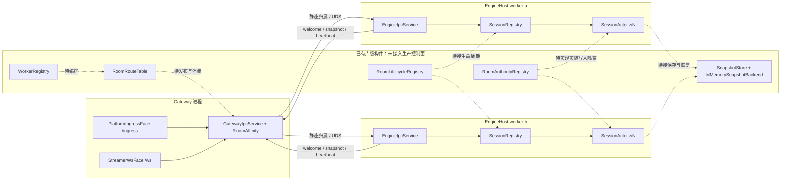

# 房间管理与横向扩展架构审查（2026-10-18）

> 整体分层方向合理。HTTP 控制面、持久 Room 目录、多 Worker 分配/路由、epoch fencing、checkpoint 恢复和迁移状态流已接线；生产容量、独立跨机部署与网络分区故障闭环仍未验收，因此当前不能据此承诺生产规模或自动故障接管。
>
> 本文以生产调用链为准，区分控制面接线、数据面能力与测试证据。实施任务统一登记在仓库根目录 `todo.md` §19；本文为审查结果和建议，未完成事项不代表已实现。2026-10-18 的追加复核见第 7 节。

## 1. 架构判断与能力边界

Gateway 负责平台入口和客户端连接，Engine 承载权威状态，`IGameModule` 承载游戏规则，这个方向合理。每个房间由一个 `SessionActor` 串行推进，适合将不同房间分配给不同 Worker；单个热点房间仍受一个 Actor 的处理能力限制。单体与拆分模式复用入口逻辑，可以保留现有分层逐步演进。

| 能力 | 当前结论 | 证据与边界 |
|---|---|---|
| 单机多房间 | 已实现 | `SessionRegistry` + `SessionActor`；达到容量时拒绝创建新 Actor，不淘汰现有房间，见 R01 |
| 固定集合的多 Worker 路由 | 已接线，生产环境未验收 | 控制面 Room 目录为新房间稳定分配 Worker；Gateway 使用 owner/epoch 路由，EngineHost 校验输入与 tick。跨机部署和长时间负载仍未验收 |
| TCP/HTTP 通信 | 端点配置已实现 | Worker/Gateway 可分别配置 advertised endpoint 与 listen host；真实跨机网络路径仍未验收，见 R04 |
| 集群唯一权威 | 控制面 fencing 已接线 | HTTP 控制面租约与 SQLite/PostgreSQL 事务拒绝旧 epoch 的 tick / commit；分区期间实际 Actor 停止、发布边界和共享数据库高可用仍需验证，见 R03 |
| 房间生命周期 | 控制面状态流已接线 | RoomControlStore 管理 Waiting/Active/Migrating/Recovering/Idle/Destroyed 等状态；平台开播/下播事件不会自动改变房间状态 |
| 持久化与恢复 | 控制面 checkpoint 闭环已接线 | SQLite/PostgreSQL checkpoint 与 tick fenced commit、ControlCheckpointRestorer 恢复已接线；生产 PostgreSQL 同步复制与容量尚未验收 |
| 多 Gateway 事件可靠性 | 共享控制面范围内已实现 | 控制面持久 inbox/receipt 与事务提交确认已接线；不代表多个 ControlHost 间高可用 |
| Worker 故障检测 | 按节点 lease 判定 | routing snapshot 区分 Worker 实例与 heartbeat lease；网络分区下旧进程恢复测试仍待独立环境 |
| 动态扩缩容、迁移与自动接管 | 迁移状态流已接线；生产接管未验收 | 新房间容量分配、Move/Handoff/Ready/Abort 与控制路由快照已实现；跨机故障恢复、分区测试和容量门槛仍未形成生产验收闭环 |

## 2. 当前生产路径与未接线构件

本节记录最初审查时的同机 UDS 静态路由。2026-10-18 新增控制面接线后，具体现状以第 7 节为准；此图保留为未接入控制面前的拓扑基线。

| 图中组件 | 源码入口（审查时行号） |
|---|---|
| PlatformIngressFace / StreamerWsFace | `src/Chorus.Gateway.Core/Faces/PlatformIngressFace.cs:21`、`src/Chorus.Gateway.Core/Faces/StreamerWsFace.cs:54` |
| GatewayIpcService / RoomAffinity | `src/Chorus.Gateway/GatewayIpcService.cs:153`、`src/Chorus.Engine/Routing/RoomAffinity.cs:20` |
| EngineIpcService / SessionRegistry / SessionActor | `src/Chorus.EngineHost/EngineIpcService.cs:109`、`src/Chorus.Engine/Session/SessionRegistry.cs:15`、`src/Chorus.Engine/Session/SessionActor.cs:9` |
| WorkerRegistry / RoomRouteTable | `src/Chorus.Engine/Routing/WorkerRegistry.cs:22`、`src/Chorus.Engine/Routing/RoomAffinity.cs:53` |
| RoomAuthorityRegistry / RoomLifecycleRegistry | `src/Chorus.Engine/Routing/RoomAuthorityRegistry.cs:35`、`src/Chorus.Engine/Routing/RoomLifecycle.cs:151` |
| SnapshotStore / InMemorySnapshotBackend | `src/Chorus.Data/StateSnapshot.cs:102`、`src/Chorus.Data/StateSnapshot.cs:74` |

## 3. 初审问题处置状态（R01–R09）

下列问题来自较早的静态审查。旧版问题描述仍保留在 Git 历史中；当前状态以本节、实现及 `todo.md` §19 为准，避免把已修复缺陷误报为现存风险。

| 审查项 | 当前状态 | 实现结论与剩余边界 |
|---|---|---|
| R01 容量淘汰丢状态 | 已关闭，ROOM-01 | 容量满拒绝新 Actor；可选空房清扫默认关闭。 |
| R02 扩容重映射存量房间 | 已关闭，ROOM-03；迁移验收见 ROOM-09 | ControlHost 原子分配稳定 owner，新节点承接新房间；在线迁移有状态流，但真实分区路由收敛仍待 ROOM-07/09。 |
| R03 旧 owner 未被 fencing | 部分关闭，ROOM-06/07 | 每 tick durable commit 校验 lease、实例、epoch、连续 tick；真实独立进程网络分区与 ControlHost 重启注入仍未完成。 |
| R04 节点端点不可独立配置 | 已关闭，ROOM-04 | Worker/Gateway listen 与 advertised endpoint 分开配置；本机独立 TCP 端点已测，远端主机仍待 ROOM-12。 |
| R05 生命周期未接入生产 | 已关闭，ROOM-02 | 睡眠、恢复、迁移、关闭等准入及控制循环已接入；分区恢复验收依赖 ROOM-07/09。 |
| R06 恢复和快照缺少原子持久化 | 已关闭，ROOM-06（存储容量除外） | SQLite/PostgreSQL checkpoint 与 tick 在同一事务并带 fencing；恢复校验已接线。生产容量/同步复制保留为 ROOM-11。 |
| R07 跨 Gateway 去重/确认不完整 | 已关闭，ROOM-08 | 可靠 inbox、持久 receipt、确认与 checkpoint 消费事务化；一致性边界是当前共享的单 ControlHost 权威。 |
| R08 Worker 健康与连接归属不完整 | 已关闭，ROOM-05 | 节点实例 lease、连接租约/generation、drain 已实现；跨机失联行为仍待 ROOM-12。 |
| R09 全量路由查询压热路径 | 已关闭，ROOM-10 | 周期 routing snapshot 替代逐消息控制面查询，过期 fail-closed；tick checkpoint 仍同步写控制面，其容量属于 ROOM-11。 |

## 4. 当前扩展模型与验收边界

此架构扩展的是**房间数量**：每个房间同一时刻由一个 Worker 上的 `SessionActor` 权威推进；ControlHost 固定新房间归属，增加 Worker 后主要承接新房间。单个热点房间不会因增加 Worker 自动拆分，必须由该 Worker 的单房间 Actor 能力承载。节点 drain 阻止新分配并保留存量房间；迁移是显式的冻结、handoff、目标恢复/ready 流程，不是改变 Worker 列表就能完成的再均衡。

当前控制权威由一个 ControlHost 提供；SQLite 保留开发与单机默认，ROOM-11 已按用户授权选定 PostgreSQL 16+ 主库/同步备库用于多 Worker 生产拓扑。首版容量目标和硬件预算见 [存储决策](room-control-storage.md)。PostgreSQL provider 和 ControlHost 配置已接入，但本机容量门槛未通过，真实多机负载、同步复制和故障切换也未验收，因此目前不能宣称生产 HA 或线性扩展。实现重放前不降低 checkpoint 频率。

自动故障接管的安全前提是旧 owner 在网络隔离但进程仍运行时也无法成功 durable commit，并且路由/连接状态能在新 owner ready 后收敛。现有 fencing 和迁移状态流有本机 HTTP/SQLite 与 Actor 级测试证据；尚缺独立机器、可控网络分区、进程暂停/恢复及 ControlHost 重启组合测试。ROOM-07、ROOM-09、ROOM-12 是验证门槛，不应被文档或单机测试标成已通过。

## 5. 验证证据与限制

当前代码能力和已执行门禁按 `todo.md` §19 的 ROOM-01～ROOM-12 记录。本机单测、HTTP 测试宿主和多个本地 TCP 端点能验证状态机、fencing、持久事务与端点路由；它们不能代替独立主机上的网络分区、旧进程恢复、ControlHost 重启或生产容量压测。历史测试命令与当时结果可从 Git 历史查阅，不作为本轮新增验收证据。

独立主机验收的前置条件、故障注入顺序、逐门通过条件和证据模板见[多机房间验收手册](room-multihost-acceptance.md)。该手册是准备材料，不构成任何门禁已通过的证据。

## 6. 实施顺序

已完成的工程顺序为：容量保护（ROOM-01）→ 稳定分房间及生命周期/节点接线（ROOM-02～ROOM-05）→ 持久恢复、事件确认及权威状态流（ROOM-06～ROOM-09）→ 控制面路由热路径（ROOM-10）。ROOM-11 的后端、初始 SLO 和预算已代决，provider 的 PostgreSQL 集成测试已通过；生产容量基线仍待完成。ROOM-07/09/12 仍需要独立主机网络故障注入。详细验收条件以根目录 `todo.md` §19 为准。

## 7. 2026-10-19 控制面接线与存储复核

当前实现将控制面部署为单独的 `Chorus.ControlHost` HTTP 服务，SQLite WAL 文件只由该进程本机访问；Worker 和 Gateway 通过带共享密钥的 HTTP API 注册、续租、查询目录及登记连接。新房间分配在 SQLite 写事务中完成，`RoomId → WorkerId + WorkerInstance + Epoch` 作为稳定归属；扩容后存量房间不自动搬迁，新房间会分配给有容量的健康 Worker。入口发送带 `AuthorityEpoch` 的 IPC，EngineHost 的 tick commit 在共享控制面核对 Worker lease、实例、epoch 和连续 tick；迁移先进入 Migrating 冻结 commit，handoff 后 epoch 递增并进入 Recovering。关键实现位于 `src/Chorus.Control/RoomControlStore.cs`、`src/Chorus.Control/ControlDatabase.cs`、`src/Chorus.EngineHost/EngineControl.cs`、`src/Chorus.Gateway/GatewayControl.cs` 和 `src/Chorus.ControlHost/Program.cs`。

容量准入已改为满载拒绝新 Actor，不再以 LRU 悄悄销毁房间；可选的空房间清扫默认关闭。控制面待处理事件、去重回执和 checkpoint 已从房间目录 JSON 拆到独立关系表，事件按 `(room_id,event_key)` 建唯一索引，待处理数/回执数用事务内计数维护。SQLite 保留开发/单机默认，PostgreSQL provider 已接入；房间 checkpoint 与可靠事件写入通过房间行锁降低并发冲突。

### 生产容量边界

ROOM-11 已选定 PostgreSQL 16+ 主库与独立物理机同步备库；SQLite 仍是开发/单机默认。当前本机单 PostgreSQL 容量试跑未达基线，尚无同步备库或独立故障域证据。`SessionActor` 每 tick 提交 checkpoint，并与输入确认置于同一事务；在本次 100 房试跑中测得 878.2 checkpoint/s、120.5 durable events/s，checkpoint p95 145.59ms，未满足 ROOM-11 门槛。该试跑不能证明生产容量。不能简单降低 checkpoint 频率：当前没有快照后的确定性事件重放，降低频率会扩大已确认事件对应的状态丢失窗口。

此前发现的逐快照 HTTP 查询已改为控制面一次性返回节点、房间和连接的 routing snapshot；Worker 周期刷新并原子替换本地快照，Gateway 收包路径只读本地 epoch/state 快照，快照超过 1.5 秒即 fail-closed。新连接时 Worker 会主动刷新路由，避免初始欢迎消息因订阅缓存未建立而丢失。该实现消除了每条输出对控制面 API 的读取，但迁移/epoch 更新在节点间是周期传播，仍须通过多机迁移测试确认可接受的传播窗口；完整验收见 `todo.md` §19 ROOM-10/ROOM-12。

**验收结论：** 本地定向测试覆盖容量拒绝、房间分配稳定、事件去重、连接代次、checkpoint fencing 和迁移状态转换；没有执行真实多主机网络分区、控制面重启恢复或容量压测。固定归属和旧 epoch commit 拒绝有代码路径，跨机安全扩展及生产吞吐仍为未验收。
