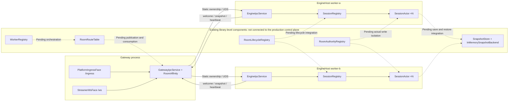

# Room Management and Horizontal Scaling Architecture Review (2026-10-18)

> The overall layering direction is sound. The HTTP control plane, durable room catalog, multi-Worker assignment/routing, epoch fencing, checkpoint recovery, and migration state flow are wired; production capacity, independent cross-machine deployment, and the network-partition failure-handling loop have not been accepted, so we cannot currently promise production scale or automatic failover on this basis.
>
> This document follows the production call chain and distinguishes control-plane wiring, data-plane capabilities, and test evidence. Implementation work is tracked in root `todo.md` §19; this document is a review result and recommendations, and unfinished items do not imply implementation. See Section 7 for the follow-up review on 2026-10-18.

## 1. Architecture Assessment and Capability Boundaries

Gateway handles platform ingress and client connections, Engine carries authoritative state, and `IGameModule` carries game rules; this direction is sound. Each room is advanced serially by one `SessionActor`, which makes it suitable to distribute rooms across Workers; a single hot room remains limited by one Actor's processing capacity. Monolithic and split modes reuse ingress logic, so the existing layering can evolve incrementally.

| Capability | Current conclusion | Evidence and boundaries |
|---|---|---|
| Multiple rooms on one host | Implemented | `SessionRegistry` + `SessionActor`; at capacity, new Actors are rejected instead of evicting existing rooms, see R01 |
| Routing across a fixed set of Workers | Wired, not accepted in production | The control-plane room catalog stably assigns Workers to new rooms; Gateway routes by owner/epoch and EngineHost validates input and ticks. Cross-host deployment and long-running load remain unaccepted |
| TCP/HTTP communication | Endpoint configuration implemented | Worker and Gateway can configure advertised endpoints and listen hosts separately; the real cross-host network path remains unaccepted, see R04 |
| Cluster-wide single authority | Control-plane fencing wired | The HTTP control-plane lease and SQLite/PostgreSQL transactions reject ticks/commits from old epochs; actual Actor shutdown during partitions, publish boundaries, and shared-database high availability still need verification, see R03 |
| Room lifecycle | Control-plane state flow wired | RoomControlStore manages states such as Waiting/Active/Migrating/Recovering/Idle/Destroyed; platform stream-start/stream-end events do not automatically change room state |
| Durability and recovery | Control-plane checkpoint loop wired | SQLite/PostgreSQL checkpoints, tick-fenced commits, and ControlCheckpointRestorer recovery are wired; production PostgreSQL synchronous replication and capacity remain unaccepted |
| Multi-Gateway event reliability | Implemented within a shared control plane | The control plane's durable inbox/receipt and transactional commit acknowledgement are wired; this does not imply high availability across multiple ControlHosts |
| Worker failure detection | Determined by per-node lease | The routing snapshot distinguishes Worker instances from heartbeat leases; recovery of an old process during a network partition still needs an independent environment |
| Dynamic scaling, migration, and automatic takeover | Migration state flow wired; production takeover unaccepted | Capacity-based assignment for new rooms, Move/Handoff/Ready/Abort, and control routing snapshots are implemented; cross-host failure recovery, partition tests, and capacity gates have not yet formed a production acceptance loop |

## 2. Current Production Path and Unwired Components

This section records the same-host UDS static routing from the initial review. After the control-plane wiring added on 2026-10-18, Section 7 is authoritative for the current state; this diagram is retained as the topology baseline before control-plane integration.

| Component in diagram | Source entry point (line numbers at review time) |
|---|---|
| PlatformIngressFace / StreamerWsFace | `src/Chorus.Gateway.Core/Faces/PlatformIngressFace.cs:21`, `src/Chorus.Gateway.Core/Faces/StreamerWsFace.cs:54` |
| GatewayIpcService / RoomAffinity | `src/Chorus.Gateway/GatewayIpcService.cs:153`, `src/Chorus.Engine/Routing/RoomAffinity.cs:20` |
| EngineIpcService / SessionRegistry / SessionActor | `src/Chorus.EngineHost/EngineIpcService.cs:109`, `src/Chorus.Engine/Session/SessionRegistry.cs:15`, `src/Chorus.Engine/Session/SessionActor.cs:9` |
| WorkerRegistry / RoomRouteTable | `src/Chorus.Engine/Routing/WorkerRegistry.cs:22`, `src/Chorus.Engine/Routing/RoomAffinity.cs:53` |
| RoomAuthorityRegistry / RoomLifecycleRegistry | `src/Chorus.Engine/Routing/RoomAuthorityRegistry.cs:35`, `src/Chorus.Engine/Routing/RoomLifecycle.cs:151` |
| SnapshotStore / InMemorySnapshotBackend | `src/Chorus.Data/StateSnapshot.cs:102`, `src/Chorus.Data/StateSnapshot.cs:74` |

## 3. Status of Initial Review Issues (R01–R09)

The following issues come from an earlier static review. The older issue descriptions remain in Git history; current status is governed by this section, the implementation, and `todo.md` §19, to avoid reporting fixed defects as existing risks.

| Review item | Current status | Implementation conclusion and remaining boundaries |
|---|---|---|
| R01 Capacity eviction loses state | Closed, ROOM-01 | Reject new Actors when full; optional empty-room sweeping is disabled by default. |
| R02 Scaling remaps existing rooms | Closed, ROOM-03; migration acceptance in ROOM-09 | ControlHost atomically assigns a stable owner, and new nodes take new rooms; online migration has a state flow, but real partition route convergence still depends on ROOM-07/09. |
| R03 Old owner is not fenced | Partially closed, ROOM-06/07 | Every tick's durable commit validates the lease, instance, epoch, and consecutive tick; fault injection for real independent-process network partitions and ControlHost restarts remains incomplete. |
| R04 Node endpoints cannot be configured independently | Closed, ROOM-04 | Worker/Gateway listen and advertised endpoints are configured separately; a local independent TCP endpoint has been tested, while remote hosts still await ROOM-12. |
| R05 Lifecycle is not integrated into production | Closed, ROOM-02 | Admission and control loops for sleep, recovery, migration, and shutdown are integrated; partition recovery acceptance depends on ROOM-07/09. |
| R06 Recovery and snapshots lack atomic durability | Closed, ROOM-06 (except storage capacity) | SQLite/PostgreSQL checkpoints and ticks share a transaction with fencing; recovery validation is wired. Production capacity/synchronous replication remains ROOM-11. |
| R07 Cross-Gateway deduplication/acknowledgement is incomplete | Closed, ROOM-08 | The reliable inbox, durable receipts, acknowledgements, and checkpoint consumption are transactional; the consistency boundary is the currently shared single ControlHost authority. |
| R08 Worker health and connection ownership are incomplete | Closed, ROOM-05 | Node-instance leases, connection leases/generations, and drain are implemented; cross-host disconnection behavior still awaits ROOM-12. |
| R09 Full routing queries overload the hot path | Closed, ROOM-10 | Periodic routing snapshots replace per-message control-plane queries and fail closed when stale; tick checkpoints still write synchronously to the control plane, whose capacity belongs to ROOM-11. |

## 4. Current Scaling Model and Acceptance Boundaries

This architecture scales the **number of rooms**: at any moment, each room is authoritatively advanced by the `SessionActor` on one Worker; ControlHost fixes ownership for new rooms, and adding Workers mainly takes on new rooms. A single hot room does not split automatically when Workers are added; it must be carried by the single-room Actor capacity of its Worker. Node drain blocks new assignments and retains existing rooms; migration is an explicit freeze, handoff, and target recover/ready flow, not a rebalance that completes merely by changing the Worker list.

Control authority is currently provided by one ControlHost; SQLite remains the development and single-host default. With user authorization, ROOM-11 selected a PostgreSQL 16+ primary/synchronous standby for the multi-Worker production topology. First-version capacity targets and the hardware budget are in [storage decision](room-control-storage.md). The PostgreSQL provider and ControlHost configuration are integrated, but the local capacity gate has not passed, and real multi-host load, synchronous replication, and failover have not been accepted; therefore production HA or linear scaling cannot be claimed at present. Checkpoint frequency will not be reduced before replay is implemented.

The safety precondition for automatic failover is that an old owner cannot successfully perform a durable commit even when its network is isolated while its process is still running, and that routing/connection state converges after the new owner is ready. Existing fencing and migration state flow have local HTTP/SQLite and Actor-level test evidence; independent machines, controllable network partitions, process pause/resume, and ControlHost restart combinations are still missing. ROOM-07, ROOM-09, and ROOM-12 are verification gates and must not be marked passed by documentation or single-host tests.

## 5. Verification Evidence and Limits

Current code capabilities and executed gates are recorded in `todo.md` §19 as ROOM-01 through ROOM-12. Local unit tests, the HTTP test host, and multiple local TCP endpoints can verify state machines, fencing, durable transactions, and endpoint routing; they cannot replace network partitions on independent hosts, old-process recovery, ControlHost restart, or production capacity load testing. Historical test commands and results at the time can be reviewed in Git history and are not new acceptance evidence for this round.

Prerequisites for independent-host acceptance, fault-injection order, per-gate pass conditions, and the evidence template are in the [multihost room acceptance manual](room-multihost-acceptance.md). That manual is preparation material and does not constitute evidence that any gate has passed.

## 6. Implementation Order

The completed engineering order is: capacity protection (ROOM-01) → stable room assignment and lifecycle/node wiring (ROOM-02–ROOM-05) → durable recovery, event acknowledgement, and authoritative state flow (ROOM-06–ROOM-09) → control-plane routing hot path (ROOM-10). ROOM-11's backend, initial SLO, and budget were proxy-decided, and the provider's PostgreSQL integration test has passed; the production capacity baseline remains outstanding. ROOM-07/09/12 still require independent-host network fault injection. Detailed acceptance conditions are governed by root `todo.md` §19.

## 7. 2026-10-19 Control-Plane Wiring and Storage Review

The current implementation deploys the control plane as a separate `Chorus.ControlHost` HTTP service, and the SQLite WAL file is accessed only locally by that process; Workers and Gateways register, renew leases, query the catalog, and register connections through a shared-secret HTTP API. New-room assignment is completed in a SQLite write transaction, with `RoomId → WorkerId + WorkerInstance + Epoch` as the stable ownership record; existing rooms are not automatically migrated after scaling, and new rooms are assigned to healthy Workers with capacity. Ingress sends IPC carrying `AuthorityEpoch`, and EngineHost's tick commit checks the Worker lease, instance, epoch, and consecutive tick against the shared control plane; migration first enters Migrating and freezes commits, then after handoff the epoch increments and the room enters Recovering. Key implementations are in `src/Chorus.Control/RoomControlStore.cs`, `src/Chorus.Control/ControlDatabase.cs`, `src/Chorus.EngineHost/EngineControl.cs`, `src/Chorus.Gateway/GatewayControl.cs`, and `src/Chorus.ControlHost/Program.cs`.

Capacity admission now rejects new Actors at full load instead of silently destroying rooms via LRU; optional empty-room sweeping is disabled by default. Control-plane pending events, deduplication receipts, and checkpoints have been split from the room catalog JSON into separate relational tables, events have a unique index on `(room_id,event_key)`, and pending/receipt counts are maintained transactionally. SQLite remains the development/single-host default and the PostgreSQL provider is integrated; room checkpoints and reliable event writes use room row locks to reduce concurrent conflicts.

### Production Capacity Boundary

ROOM-11 selected a PostgreSQL 16+ primary and a synchronous standby on an independent physical machine; SQLite remains the development/single-host default. The current single local PostgreSQL capacity trial did not meet the baseline, and there is still no evidence from a synchronous standby or independent failure domain. `SessionActor` commits a checkpoint every tick and places it in the same transaction as input acknowledgement; in this 100-room trial, measurements were 878.2 checkpoints/s, 120.5 durable events/s, and checkpoint p95 145.59 ms, which did not meet the ROOM-11 threshold. That trial cannot prove production capacity. Checkpoint frequency cannot simply be reduced: there is currently no deterministic event replay after a snapshot, and lowering the frequency would widen the state-loss window for acknowledged events.

The previously identified per-snapshot HTTP query has been replaced by a control-plane routing snapshot that returns nodes, rooms, and connections in one call; Workers periodically refresh and atomically replace their local snapshot, and the Gateway receive path reads only the local epoch/state snapshot and fails closed after 1.5 seconds. On a new connection, the Worker actively refreshes routing to avoid losing the initial welcome message because the subscription cache has not yet been established. This implementation eliminates control-plane API reads for every output, but migration/epoch updates propagate periodically between nodes; multi-host migration tests must still confirm an acceptable propagation window; see `todo.md` §19 ROOM-10/ROOM-12 for full acceptance.

**Acceptance conclusion:** Local targeted tests cover capacity rejection, stable room assignment, event deduplication, connection generations, checkpoint fencing, and migration state transitions; no real multi-host network partitions, control-plane restart recovery, or capacity load test was performed. Stable ownership and rejection of old-epoch commits have code paths, but cross-host safe scaling and production throughput remain unaccepted.
