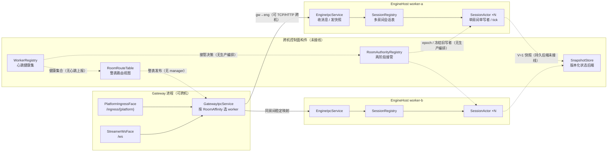

# 跨机多房间架构核对（2026-10-18）

> 结论先说：**跨机多 worker 的数据面已经具备**——Gateway 可按稳定房间亲和路由到多个
> EngineHost，EngineHost 可把快照回给多个网关；**跨机控制面和故障接管还没有生产接线**。
> WorkerRegistry、RoomRouteTable、RoomAuthorityRegistry、SnapshotStore 是可组合的控制面构件，
> 目前分别由单测/端到端测试驱动，没有 RoomManager 进程，也没有服务发现、心跳上报、路由表
> 发布或持久快照后端。因此本文画的是“代码能证明的现状”，不是把目标设计伪装成已上线能力。

## 1. 当前架构图

图中实线是生产路径；虚线是代码存在但未接入生产路径的构件。`(未实现)` 只出现在虚线侧；
实线侧每个节点都是当前可部署组件。

### 路由与寻址

- 每个 `SessionActor` 以 `sessionId` 为房间键；多 worker 时 Gateway 读取
  `Ipc:WorkerIds`，用 FNV-1a + 排序 worker 集合得到稳定亲和：
  `src/Chorus.Gateway/GatewayIpcService.cs:70`、`src/Chorus.Gateway/GatewayIpcService.cs:153`。
- 对同一个房间，worker 集合不变则路由不变；扩缩容会改变集合，因此生产上需要整表路由
  和权威接管，而不是让新旧网关长期各自静态散列。
- Gateway 侧按 worker 建 `gw→eng` 客户端通道，按房间亲和选择通道：
  `src/Chorus.Gateway/GatewayIpcService.cs:168`。

### 跨机通信

- 数据面可使用 TCP 或 HTTP transport，不局限于同机 UDS/NamedPipe；配置入口见
  `src/Chorus.Gateway/GatewayIpcService.cs:56` 和 `src/Chorus.EngineHost/EngineIpcService.cs:67`。
- EngineHost 到多个网关的反向通道由 `Ipc:GatewayIds` 扇出：
  `src/Chorus.EngineHost/EngineIpcService.cs:84`、`src/Chorus.EngineHost/EngineIpcService.cs:92`。
- 心跳让 Gateway 的 `/ready` 能检测 worker 静默；生产仍需外部重启策略，Gateway 当前不自动接管：
  `src/Chorus.EngineHost/EngineIpcService.cs:146`。

### 状态同步

- 正常客户端路径不复制房间状态：`SessionActor` 产生 `ServerSnapshot`，经 EngineHost IPC
  发布给 Gateway，再由 `/ws` 下发；ACK/重同步沿反方向回到同一房间 actor。
- 快照恢复契约已存在：EngineHost 创建 actor 前先调用恢复器，恢复失败则拒绝会话启动：
  `src/Chorus.EngineHost/EngineIpcService.cs:175`。
- `IGameModule.RestoreState`、`SnapshotStore`、`InMemorySnapshotBackend` 已实现，但 EngineHost
  DI 当前没有注册持久化后端，默认 `ISnapshotRecoverySource` 为 null，等价于全新启动：
  `src/Chorus.EngineHost/EngineIpcService.cs:40`。

## 2. 组件核对表

| 组件 | 状态 | 代码证据 / 差异 |
|---|---|---|
| Gateway `/ingress` 与 `/ws` 门面 | 已实现 | `src/Chorus.Gateway/Program.cs:146`、`src/Chorus.Gateway/Program.cs:153`；可按角色拆成 platform-gw / streamer-gw |
| Gateway 多 worker 路由 | 已实现（静态配置） | `Ipc:WorkerIds` 解析 `src/Chorus.Gateway/GatewayIpcService.cs:70`；`RouteWorker` `:153`；发布选择 `:168` |
| 房间亲和算法 | 已实现 | `src/Chorus.Engine/Routing/RoomAffinity.cs:12`；同一 worker 集合稳定，集合变化后需要重路由 |
| EngineHost 多房间表 | 已实现 | `src/Chorus.Engine/Session/SessionRegistry.cs:15`；容量、空闲清扫、启动失败路径在位 |
| 单房间权威 actor | 已实现 | `src/Chorus.Engine/Session/SessionActor.cs:9`；房间内单写者 + tick / 快照 / ACK / resync |
| gw→eng / eng→gw IPC | 已实现 | 服务端创建 `src/Chorus.EngineHost/EngineIpcService.cs:111`；多网关扇出 `:92`；Gateway 通道在 `GatewayIpcService` |
| TCP / HTTP 跨机 transport | 已实现（库级） | `src/Chorus.Messaging/Transports/TcpMessageBus.cs:8`、`src/Chorus.Messaging/Transports/HttpMessageBus.cs:7`；部署需显式配置地址/端口 |
| Worker 健康注册表 | 部分 | `src/Chorus.Engine/Routing/WorkerRegistry.cs:22` 有注册/心跳/过期健康集；无生产心跳上报，也没有从 Gateway 接入 |
| RoomRouteTable | 部分 | `src/Chorus.Engine/Routing/RoomAffinity.cs:53` 有整表读取；`Replace` 存在但测试未覆盖，且无 manager 发布与 Gateway 消费 |
| 房间权威 / 两阶段接管 | 部分 | `src/Chorus.Engine/Routing/RoomAuthorityRegistry.cs:35`；`WorkerTakeoverEndToEndTests` 覆盖冻结、epoch、中止/完成，但无生产编排 |
| 快照持久化与恢复 | 部分 | `SnapshotStore` / 校验在 `src/Chorus.Data/StateSnapshot.cs:59`、`:102`；恢复入口在 `GameModuleRestorer`；无持久后端注册与生产写入链路 |
| RoomManager 进程 | 未实现 | 生产代码无该类；当前也无需画成独立节点，阶段三触发后再接线 |
| 服务发现 / 自动扩缩容 | 未实现 | `WorkerIds`、`GatewayIds` 均为静态配置 |
| 生产故障自动切换 | 未实现 | 只有 `/ready` 静默检测和接管构件测试；没有决策器、路由收敛、数据迁移编排 |

## 3. 图与代码差异记录

1. 目标设计常把 RoomManager 画成独立调度节点。以代码为准：当前没有 RoomManager 进程，
   真实路由来自 Gateway 静态 `WorkerIds` + `RoomAffinity`，因此图中 RoomManager 不画实线。
2. `RoomRouteTable` 虽然存在，但生产路由并没有读取它；Gateway 直接调用 `RoomAffinity.Assign`。
   图中将其放在虚线控制面，而不是冒充已接线路由表。
3. `SnapshotStore` 不是自动复制的共享状态服务；它是本地版本化存储缝，当前唯一后端是
   `InMemorySnapshotBackend`，重启后不保留数据。跨机接管需要先接持久后端和恢复源。
4. `WorkerRegistry` 的“不健康”只影响 `SortedWorkerIds()` 视图，不会自动删除 worker，也不会
   触发 `RoomAuthorityRegistry`。这两者之间的编排只存在于测试，不存在生产服务。
5. 多 worker 测试已证明静态亲和数据面可用，但生产跨机还差 TLS/鉴权、地址配置、进程守护、
   监控告警与容量触发数据；这些属于部署决策，当前代码没有内置自动完成。

## 4. 结论

- **数据面**：静态多 worker / 多网关可部署，房间路由具备确定性和双向消息能力。
- **控制面**：健康、整表路由、权威切换、快照恢复的底层构件分别存在，但未组合进生产进程。
- **下一步若启用真跨机弹性**：先补持久快照后端与恢复源，再接 WorkerRegistry 心跳上报、
  RoomRouteTable 整表发布，最后由 RoomAuthorityRegistry 执行冻结旧写者、恢复完成、epoch
  递增的两阶段切换。顺序不能倒：没有可恢复状态之前，自动切换只会制造双写或丢状态风险。
