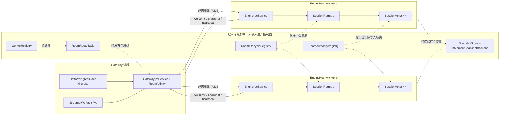

# 房间管理与横向扩展架构审查（2026-10-18）

> 整体分层方向合理。HTTP 控制面、持久 Room 目录、多 Worker 分配/路由、epoch fencing、checkpoint 恢复和迁移状态流已接线；生产容量、独立跨机部署与网络分区故障闭环仍未验收，因此当前不能据此承诺生产规模或自动故障接管。
>
> 本文以生产调用链为准，区分控制面接线、数据面能力与测试证据。实施任务统一登记在仓库根目录 `todo.md` §19；本文为审查结果和建议，未完成事项不代表已实现。2026-10-18 的追加复核见第 7 节。

## 1. 架构判断与能力边界

Gateway 负责平台入口和客户端连接，Engine 承载权威状态，`IGameModule` 承载游戏规则，这个方向合理。每个房间由一个 `SessionActor` 串行推进，适合将不同房间分配给不同 Worker；单个热点房间仍受一个 Actor 的处理能力限制。单体与拆分模式复用入口逻辑，可以保留现有分层逐步演进。

| 能力 | 当前结论 | 证据与边界 |
|---|---|---|
| 单机多房间 | 已实现 | `SessionRegistry` + `SessionActor`；达到容量时拒绝创建新 Actor，不淘汰现有房间，见 R01 |
| 固定集合的多 Worker 路由 | 已接线，生产环境未验收 | 控制面 Room 目录为新房间稳定分配 Worker；Gateway 使用 owner/epoch 路由，EngineHost 校验输入与 tick。跨机部署和长时间负载仍未验收 |
| TCP/HTTP 通信 | 端点配置已实现 | Worker/Gateway 可分别配置 advertised endpoint 与 listen host；真实跨机网络路径仍未验收，见 R04 |
| 集群唯一权威 | 控制面 fencing 已接线 | HTTP 控制面租约与 SQLite 事务拒绝旧 epoch 的 tick / commit；分区期间实际 Actor 停止、发布边界和共享数据库高可用仍需验证，见 R03 |
| 房间生命周期 | 控制面状态流已接线 | RoomControlStore 管理 Waiting/Active/Migrating/Recovering/Idle/Destroyed 等状态；平台开播/下播事件不会自动改变房间状态 |
| 持久化与恢复 | 单机权威闭环已实现 | SQLite checkpoint 与 tick fenced commit、ControlCheckpointRestorer 恢复已接线；SQLite 仍是单 ControlHost 本机单写者，不代表 HA |
| 多 Gateway 事件可靠性 | 共享控制面范围内已实现 | 控制面持久 inbox/receipt 与事务提交确认已接线；不代表多个 ControlHost 间高可用 |
| Worker 故障检测 | 按节点 lease 判定 | routing snapshot 区分 Worker 实例与 heartbeat lease；网络分区下旧进程恢复测试仍待独立环境 |
| 动态扩缩容、迁移与自动接管 | 迁移状态流已接线；生产接管未验收 | 新房间容量分配、Move/Handoff/Ready/Abort 与控制路由快照已实现；跨机故障恢复、分区测试和容量门槛仍未形成生产验收闭环 |

## 2. 当前生产路径与未接线构件

本节记录最初审查时的同机 UDS 静态路由。2026-10-18 新增控制面接线后，具体现状以第 7 节为准；此图保留为未接入控制面前的拓扑基线。



| 图中组件 | 源码入口（审查时行号） |
|---|---|
| PlatformIngressFace / StreamerWsFace | `src/Chorus.Gateway.Core/Faces/PlatformIngressFace.cs:21`、`src/Chorus.Gateway.Core/Faces/StreamerWsFace.cs:54` |
| GatewayIpcService / RoomAffinity | `src/Chorus.Gateway/GatewayIpcService.cs:153`、`src/Chorus.Engine/Routing/RoomAffinity.cs:20` |
| EngineIpcService / SessionRegistry / SessionActor | `src/Chorus.EngineHost/EngineIpcService.cs:109`、`src/Chorus.Engine/Session/SessionRegistry.cs:15`、`src/Chorus.Engine/Session/SessionActor.cs:9` |
| WorkerRegistry / RoomRouteTable | `src/Chorus.Engine/Routing/WorkerRegistry.cs:22`、`src/Chorus.Engine/Routing/RoomAffinity.cs:53` |
| RoomAuthorityRegistry / RoomLifecycleRegistry | `src/Chorus.Engine/Routing/RoomAuthorityRegistry.cs:35`、`src/Chorus.Engine/Routing/RoomLifecycle.cs:151` |
| SnapshotStore / InMemorySnapshotBackend | `src/Chorus.Data/StateSnapshot.cs:102`、`src/Chorus.Data/StateSnapshot.cs:74` |

## 3. 已确认问题

优先级表示能力所需的修复顺序：P0 为房间正确性和安全扩容前置条件，P1 为跨机及可靠性闭环，P2 为扩展效率。以下代码行为已经静态核实；故障影响按给定场景推导，未冒充真实跨机故障实验。

### R01：容量淘汰会丢失权威房间状态（P0）

`SessionRegistry.GetOrCreate` 达到 `MaxSessions` 后直接调用 `EvictIdlestLocked`，不检查受害房间是否仍有客户端，也没有保存或迁移状态（`src/Chorus.Engine/Session/SessionRegistry.cs:93`、`:137`）。Actor 随后被销毁；相同房间再来事件会创建全新 Actor，现有客户端不会自动挂到新 Actor。空闲清扫也只移除运行实例，没有与业务生命周期、状态保存组合。

建议区分业务 Room、Worker 上的 Actor 和客户端 Connection。容量不足时拒绝新分配或选择其他 Worker；释放运行实例须经过明确的关闭条件或保存/恢复流程。还需处理淘汰后新 Actor 构造失败时的清理路径，防止已移出表的旧 Actor 无人释放。

### R02：扩容改变存量房间归属，滚动更新可能产生双实例（P0）

`RoomAffinity.Assign` 使用排序后的 Worker 集合和 `hash(roomId) % workerCount`（`src/Chorus.Engine/Routing/RoomAffinity.cs:20`）。Gateway 直接计算归属，不消费 `RoomRouteTable`（`src/Chorus.Gateway/GatewayIpcService.cs:153`）。增加 Worker 会重映射大量房间；新旧 Gateway 配置不同期间，同一房间可能被送到两个 Worker，两端都会按消息创建 Actor。

建议由统一房间目录记录 `RoomId → WorkerId + Epoch + State`。首次创建原子分配，扩容优先承接新房间，存量归属保持稳定；迁移单独编排。目录更新应有版本和过期路由响应，Gateway 能刷新/重试。一致性哈希只减少重映射，无法替代迁移与权威隔离。

### R03：权威注册表没有隔离真实旧写者（P0）

`TryBeginTakeover` 只更新进程内记录（`src/Chorus.Engine/Routing/RoomAuthorityRegistry.cs:88`）。生产 `EngineIpcService` 接受连接、事件时不校验 owner/epoch，Actor tick 也没有租约约束；IPC `Envelope` 不含 epoch（`src/Chorus.EngineHost/EngineIpcService.cs:214`、`:295`；`src/Chorus.Messaging/Envelope.cs:10`）。

建议在输入、tick、持久化和对外快照边界落实 epoch/租约检查，明确旧节点暂停、失联和恢复后的行为。健康超时只能触发观察与决策，不能证明旧进程已经停止。控制面必须有共享的原子权威来源，并考虑自身重启和并发决策；无需预先指定独立 RoomManager 进程。

### R04：多节点 TCP/HTTP 地址没有分别配置（P1）

Gateway 为每个 Worker 建通道时只替换 `WorkerId`（`src/Chorus.Gateway/GatewayIpcService.cs:208`）；`IpcEndpointBuilder.Build` 只给 UDS/NamedPipe 名称加后缀，TCP host/port 和 HTTP URL 均相同（`src/Chorus.Messaging/Ipc/IpcEndpointBuilder.cs:11`）。EngineHost 的多 Gateway 回传也只替换 `GatewayId`（`src/Chorus.EngineHost/EngineIpcService.cs:94`）。

建议增加 Worker/Gateway 独立端点目录，区分监听地址和对外连接地址，校验重复、缺失与非法配置。TCP/HTTP transport 存在不等于跨机多 Worker 拓扑接线完成。

### R05：业务生命周期没有控制运行实例（P1）

`RoomLifecycleRegistry` 的状态转换仅存在于库中，生产入口仍通过连接或观众事件直接 `GetOrCreateSession`（`src/Chorus.EngineHost/EngineIpcService.cs:187`、`:217`、`:305`）。Created、Sleeping、Recovering、Closing 等状态未约束消息准入、调度、关闭与恢复。

建议把业务房间与 Actor 存活分开；规定未知/关闭/恢复中房间的输入响应、休眠与唤醒、关闭排空及终态清理。迁移失败应有明确中止和回退路径，不能只依赖状态枚举存在。

### R06：恢复缺生产闭环，快照版本检查不是原子操作（P1）

EngineHost 创建 Actor 前可以调用恢复器，但生产 DI 未注册恢复源，也没有快照保存链路；唯一快照后端是内存实现（`src/Chorus.EngineHost/EngineIpcService.cs:175`；`src/Chorus.EngineHost/Program.cs`；`src/Chorus.Data/StateSnapshot.cs:74`）。

`SnapshotStore.TrySave` 先读取版本、后无条件写入（`src/Chorus.Data/StateSnapshot.cs:144`、`:152`）。若两个保存操作都读到版本 1，版本 3 先写、版本 2 后写，就会倒退；顺序单测无法证明并发隔离。仅比较版本大小也不能阻止旧 owner 携带较大版本继续写。

建议后端原子校验 owner epoch 与快照版本，接入生产保存/恢复链路。故障恢复还需保存恢复游标及必要运行元数据，区分 schema version、epoch、tick 和快照版本。对于快照后的已确认事件，必须定义损失窗口和补齐策略；若要求不丢失，应先修订现有“历史事件重放明确不做”的约束，再选择事件日志或可靠输入方案。

### R07：多 Gateway 去重与交付确认不完整（P1）

Gateway 的 `EventDeduplicator` 为实例内对象（`src/Chorus.Gateway/Program.cs:86`），Actor 入口没有对应的平台事件幂等边界。同一个事件重试到另一 Gateway，可能再次影响游戏状态。

`IpcSessionActorRef.TellAsync` 将 IPC 发布成功视为 Accepted（`src/Chorus.Gateway/IpcSessionActorRouter.cs:53`）；EngineHost 随后可能因事件队列满而丢弃，此时平台已收到成功响应（`src/Chorus.EngineHost/EngineIpcService.cs:306`）。

建议在权威处理边界实现有界去重，并明确迁移时幂等状态如何延续。按事件级别规定成功响应代表收到、可靠保存还是已应用；重要事件的确认需要与该语义匹配，超时重试不能造成重复计分。

### R08：健康判断无法定位单个 Worker，连接缺少节点归属（P1）

Gateway 用一个 `_lastEngineMessageMs` 记录任意引擎消息（`src/Chorus.Gateway/GatewayIpcService.cs:35`、`:226`）；一个 Worker 继续发送心跳可掩盖另一个 Worker 已失联。心跳内容仅有时间，没有 Worker 身份（`src/Chorus.Messaging/Ipc/GatewayCommands.cs:19`）。`WorkerRegistry.Healthy()` 过滤过期节点，`SortedWorkerIds()` 返回全部已登记 ID；后者不会自动变成健康集合。

连接命令仅含 SessionId/ClientId，缺少 Gateway 身份、连接代次和失效清理机制（`src/Chorus.Messaging/Ipc/GatewayCommands.cs:3`）。Gateway 异常退出时无法依赖正常 disconnect 清理；同 clientId 重连也需避免迟到 disconnect 移除新连接。

建议按 Worker 身份和进程代次跟踪健康，定义部分失效时的 readiness 和路由行为；按 Gateway/连接代次登记连接，以租约或明确失效清理回收残留。

### R09：全量串行快照扇出限制扩展效率（P2）

EngineHost 把每条输出发送给所有配置的 Gateway（`src/Chorus.EngineHost/EngineIpcService.cs:94`），`FanOutMessageBus` 按顺序 await 各子通道（`src/Chorus.Messaging/FanOutMessageBus.cs:29`）。即使 Gateway 没有订阅该房间也收到快照；某通道阻塞会延迟后续通道。

建议按房间订阅向必要 Gateway 发快照，对通道隔离队列、超时与失败；重同步和重要控制消息分别明确策略。Gateway 已有逐连接容量 1 的 latest-wins 出站槽（`src/Chorus.Gateway/GatewayClientConnection.cs:21`、`:62`），不能再把这一点描述为“尚无慢客户端丢弃策略”。

## 4. 建议实施顺序与验收边界

1. **先修房间准入和状态保留**：容量满拒绝新分配，活跃房间不被挤掉；Actor 释放经过业务关闭或保存流程。
2. **再实现固定归属的水平分房间**：统一房间目录、独立节点地址、生命周期接线、节点健康与连接归属。新节点承接新房间，存量房间不因节点集合变化而迁移；缩容先停止分配，等待房间自然结束。此阶段不宣称自动故障恢复。
3. **再实现在线迁移与故障接管**：完成权威隔离、原子快照保存、恢复游标与事件确认语义，才能启用冻结、恢复、换主、路由发布及失败回退。迁移中输入需排队或明确可重试拒绝。
4. **最后优化并验证扩展效率**：按订阅发送、通道隔离、真实独立地址的 TCP/HTTP 多节点测试，以及同负载单/多 Worker 对比。吞吐收益与正确性分别验收。

阶段三必须验证旧 Worker 仍存活但网络分区的情况，不能只测进程退出。共享目录和控制面自身重启也不能导致 epoch 重用或双分配。

## 5. 验证证据与限制

2026-10-18 执行以下定向测试，135 项通过，0 失败、0 跳过：

```bash
dotnet test tests/Chorus.Engine.Tests/Chorus.Engine.Tests.csproj --no-restore --filter 'FullyQualifiedName~RoomAffinityTests|FullyQualifiedName~RoomLifecycleTests|FullyQualifiedName~RoomAuthorityRegistryTests|FullyQualifiedName~WorkerRegistryTests|FullyQualifiedName~WorkerTakeoverEndToEndTests|FullyQualifiedName~MultiWorkerGatewayIpcTests|FullyQualifiedName~SessionRegistryTests|FullyQualifiedName~IpcEndpointBuilderTests|FullyQualifiedName~StateSnapshotStoreTests' --verbosity minimal
```

`MultiWorkerGatewayIpcTests` 使用同机 UDS。`WorkerTakeoverEndToEndTests` 验证 WorkerRegistry 与 RoomAuthorityRegistry 的组合状态转换，没有启动真实 Actor 证明旧写者停止。现有测试通过不能作为跨机扩容、网络分区或重要事件不丢失的验收证据。本轮未执行跨机部署、故障注入或性能压测。

## 6. 对原核对文档的修正

- 将“跨机多 Worker 数据面已具备”收窄为“同机静态多 Worker 已验证，跨机地址接线仍缺失”。
- 将“单房间单写者”限定为 Actor 内部串行；集群唯一权威仍需生产隔离机制。
- 将“心跳可检测 Worker 静默”修正为当前仅能检测所有引擎消息整体静默，不能定位单个 Worker。
- 修正 Worker 健康视图：`Healthy()` 过滤过期节点，`SortedWorkerIds()` 不过滤。
- 将“快照版本单调可隔离旧写者”收窄为顺序调用的版本检查，跨写者原子条件更新尚未实现。
- 保留已完成库能力的历史记录，未完成的生产能力在 `todo.md` §19 单独列项；§14/§15/§18 勾选不代表生产接管完成。


## 7. 2026-10-18 控制面接线复核

当前实现将控制面部署为单独的 `Chorus.ControlHost` HTTP 服务，SQLite WAL 文件只由该进程本机访问；Worker 和 Gateway 通过带共享密钥的 HTTP API 注册、续租、查询目录及登记连接。新房间分配在 SQLite 写事务中完成，`RoomId → WorkerId + WorkerInstance + Epoch` 作为稳定归属；扩容后存量房间不自动搬迁，新房间会分配给有容量的健康 Worker。入口发送带 `AuthorityEpoch` 的 IPC，EngineHost 的 tick commit 在共享控制面核对 Worker lease、实例、epoch 和连续 tick；迁移先进入 Migrating 冻结 commit，handoff 后 epoch 递增并进入 Recovering。关键实现位于 `src/Chorus.Control/RoomControlStore.cs`、`src/Chorus.Control/ControlDatabase.cs`、`src/Chorus.EngineHost/EngineControl.cs`、`src/Chorus.Gateway/GatewayControl.cs` 和 `src/Chorus.ControlHost/Program.cs`。

容量准入已改为满载拒绝新 Actor，不再以 LRU 悄悄销毁房间；可选的空房间清扫默认关闭。控制面待处理事件、去重回执和 checkpoint 已从房间目录 JSON 拆到独立 SQLite 表，事件按 `(room_id,event_key)` 建唯一索引，待处理数/回执数用事务内计数维护。这避免每条事件重写整个回执字典，也让目录读取不携带状态快照。

### 生产容量边界

控制面仍是**单个 SQLite 写者**，不具备多副本高可用或写分片。当前 `SessionActor` 每个 tick 都提交一个状态 checkpoint；每个 checkpoint 写入 SQLite，并与输入确认处在同一事务。于是所有 Worker 的 tick 写入都汇聚到 ControlHost 的一个 SQLite 写锁，状态越大写入成本越高。此设计适合作为受控规模的正确性原型，不能仅凭多 Worker 分房间宣称线性扩容。生产放量前必须压测控制面写入延迟、锁等待、WAL 增长和最大 checkpoint，并确定外部数据库/分片或有明确定义恢复损失窗口的持久化策略。不能简单降低 checkpoint 频率：当前没有快照后的确定性事件重放，降低频率会扩大已确认事件对应的状态丢失窗口。

此前发现的逐快照 HTTP 查询已改为控制面一次性返回节点、房间和连接的 routing snapshot；Worker 周期刷新并原子替换本地快照，Gateway 收包路径只读本地 epoch/state 快照，快照超过 1.5 秒即 fail-closed。新连接时 Worker 会主动刷新路由，避免初始欢迎消息因订阅缓存未建立而丢失。该实现消除了每条输出对控制面 API 的读取，但迁移/epoch 更新在节点间是周期传播，仍须通过多机迁移测试确认可接受的传播窗口；完整验收见 `todo.md` §19 ROOM-10/ROOM-12。

**验收结论：** 本地定向测试覆盖容量拒绝、房间分配稳定、事件去重、连接代次、checkpoint fencing 和迁移状态转换；没有执行真实多主机网络分区、控制面重启恢复或容量压测。固定归属和旧 epoch commit 拒绝有代码路径，跨机安全扩展及生产吞吐仍为未验收。
