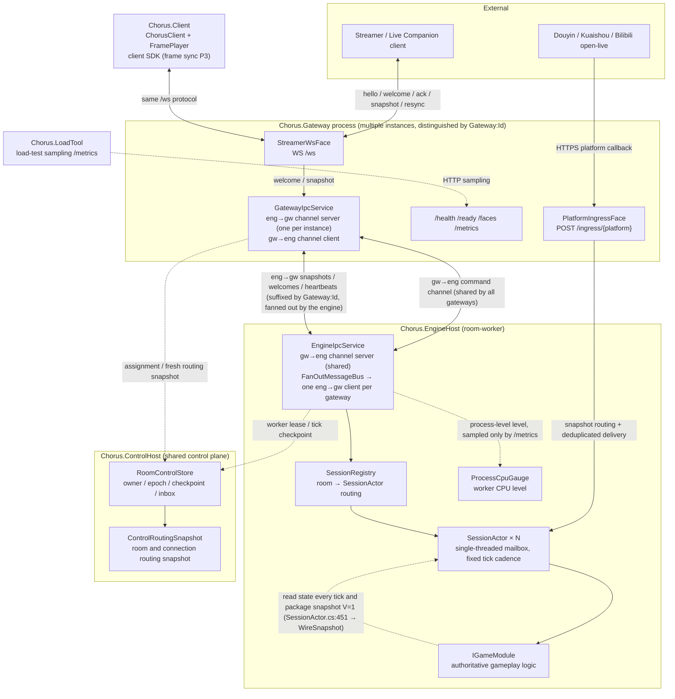

# Current Architecture Overview

Code-verified topology (refreshed 2026-10-19). Standalone `Chorus.Server` runs without the control plane. Durable split mode uses `Chorus.ControlHost` as shared room authority alongside one or more `Chorus.Gateway` instances and `Chorus.EngineHost`; production multi-host failure and capacity gates remain open.

## Split Mode With ControlHost

Solid lines are realtime execution paths; dashed lines are control-plane RPCs and snapshot refreshes rather than per-message calls. Independent-machine failure acceptance remains open.

## Single-Process Form (Default)

`Chorus.Server` packs the Gateway side and the EngineHost side of the diagram above into the same process: `/ingress/{platform}`、`/ws`、`/faces`、`/metrics`、`/sessions`、`/matches` reach `SessionManager` directly via `InProc` routing within the same process, with no IPC hop. `/sessions` and `/matches` are exposed only in the single-process form.

## Component Index (file:line)

| Component | Location |
|---|---|
| Gateway routing table (/ingress, /ws, /ready, etc.) | `src/Chorus.Gateway/Program.cs:100` |
| EngineHost routing table (/health, /metrics) | `src/Chorus.EngineHost/Program.cs:34` |
| Server routing table (including /sessions, /matches) | `src/Chorus.Server/Program.cs:102` |
| `PlatformIngressFace` (rate limiting/size/timeout/verification/deduplication/Tell) | `src/Chorus.Gateway.Core/Faces/PlatformIngressFace.cs` |
| Bilibili open-live bridge (wss → `/ingress/bilibili` signature forwarding, started only when credentials are complete) | `src/Chorus.Adapters.Platforms/Bilibili/BilibiliOpenLiveClient.cs` |
| `StreamerWsFace` (authentication/version gate/ACK rate limiting) | `src/Chorus.Gateway.Core/Faces/StreamerWsFace.cs` |
| `GatewayIpcService` (eng→gw server + gw→eng client) | `src/Chorus.Gateway/GatewayIpcService.cs:149` |
| `EngineIpcService` (gw→eng server + fanout client) | `src/Chorus.EngineHost/EngineIpcService.cs:88` |
| `FanOutMessageBus` (per-gateway publishing, failure aggregation) | `src/Chorus.Messaging/FanOutMessageBus.cs` |
| IPC channel naming (Gateway:Id suffix) | `src/Chorus.Messaging/Ipc/IpcEndpointBuilder.cs:22` |
| `SessionRegistry` (routing + lifecycle) | `src/Chorus.Engine/Session/SessionRegistry.cs:15` |
| `SessionActor` (single-threaded mailbox + fixed tick) | `src/Chorus.Engine/Session/SessionActor.cs:8` |
| `IGameModule` (authoritative gameplay contract) | `src/Chorus.Engine/Abstractions/IGameModule.cs:5` |
| Room assignment / durable authority / routing snapshot | `src/Chorus.Control/RoomControlStore.cs`, `src/Chorus.Control/ControlRoutingSnapshot.cs` |
| Historical `RoomAffinity` / `RoomRouteTable` prototype (not used by ControlHost mode) | `src/Chorus.Engine/Routing/RoomAffinity.cs:12`, same file `:53` |
| Snapshot version V (wire protocol) | `src/Chorus.Protocol/Messages/ServerSnapshot.cs:20` |
| `ProcessCpuGauge` (worker CPU water level) | `src/Chorus.EngineHost/ProcessCpuGauge.cs` |
| `Chorus.LoadTool` (load testing and peak sampling) | `src/Chorus.LoadTool/Program.cs` |

## Snapshot and Restore Contract

The engine produces a wire snapshot every tick (full JSON, schema version `V=1`). In ControlHost mode, a committed tick is also stored as a fenced durable checkpoint and restored by EngineHost on assignment; standalone mode has no durable restart recovery. Independent-host failover remains an open rollout gate. See [multi-machine room architecture](../architecture/multi-machine-rooms.md) and [storage decision](../architecture/room-control-storage.md).

## Related Pages

- [Process Topology Design (Phases and Trigger Conditions)](./process-topology.md)
- [Communication Abstraction and IPC Channel Naming](./ipc.md)
- [Deployment and Security](../reference/deployment.md)
- [Split Mode Guide](../guide/split-mode.md)
