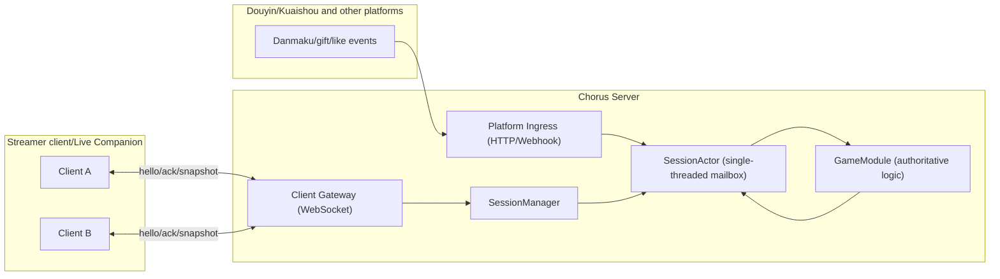

# Architecture Design

## Overall Components

## Core Principles (v1)

- Server-authoritative: the state advances on the server; the client only "aligns + renders"
- The server never pauses: slow endpoints catch up via forced snapshots, without holding back fast endpoints
- Backpressure: a cap on the number of events per tick + merging/downsampling, to avoid "frame explosions"
