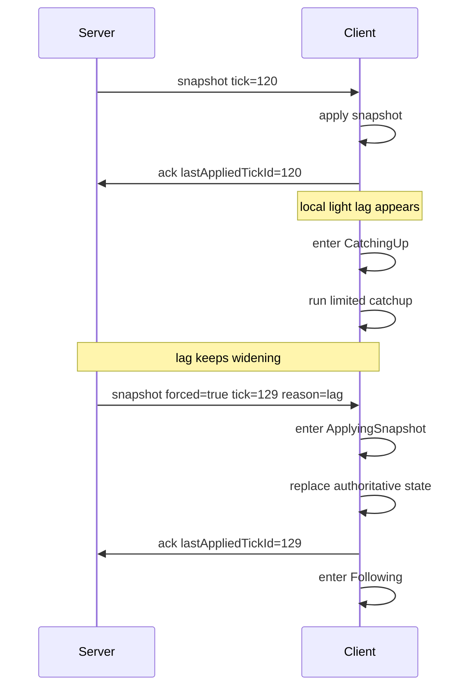

# Client Resync State Machine

This document defines how the client converges, catches up, and resynchronizes around the server-authoritative tick, with the goal of separating "light catching up" from "heavy recovery" and avoiding infinite frame backfill.

It is recommended to read it together with:

- [Frame Sync Design](./frame-sync.md)
- [Frame Sync Best Practices](./frame-sync-best-practices.md)
- [Parameter Tuning](../reference/tuning.md)

## Design Goals

The client state machine needs to address four things:

- Under normal conditions, steadily follow the server-authoritative tick
- When lightly behind, catch up gently without overloading the main thread
- When heavily behind, switch to snapshot recovery quickly
- After recovery, return to the stable following state

## Core Principles

- The client must not consider itself authoritative
- The client must not backfill frames without limit
- The client must not insist on replaying all history when heavily behind
- The client ACK must be based on "applied state", not on "message received"

## Suggested States

The client sync process is suggested to be split into the following states:

1. `Bootstrapping`
2. `Following`
3. `CatchingUp`
4. `ResyncRequired`
5. `ApplyingSnapshot`
6. `Degraded`

## State Definitions

### `Bootstrapping`

Entry conditions:

- Just joined the room
- Just reconnected
- Local has no usable authoritative state yet

Behavior:

- Wait for `welcome`
- Establish authoritative parameters such as `tickDurationMs`, `inputDelayTicks`
- Wait for the first usable snapshot

Exit conditions:

- After successfully applying the first snapshot, transition to `Following`

### `Following`

Entry conditions:

- Local state is basically consistent with the server-authoritative tick

Behavior:

- Advance at the authoritative tick rhythm as normal
- Apply deltas or periodic snapshots
- Send `ack.lastAppliedTickId` after the state has truly been applied

Exit conditions:

- `lagTicks` exceeds the light threshold, transition to `CatchingUp`
- Receive a server forced snapshot, transition to `ApplyingSnapshot`
- No valid sync data received for a long time, transition to `ResyncRequired`

### `CatchingUp`

Entry conditions:

- Lightly behind

Behavior:

- Run a small number of extra logic ticks within a controlled upper limit
- Keep the render thread available; unlimited catching up is not allowed
- Every frame or every second must have a catch-up budget cap

Suggested limits:

- At most `1` extra logic tick backfilled per render frame
- At most `5~10` extra logic ticks backfilled per second

Exit conditions:

- `lagTicks` returns to the safe zone, transition to `Following`
- `lagTicks` keeps widening, transition to `ResyncRequired`
- Forced snapshot received, transition to `ApplyingSnapshot`

### `ResyncRequired`

Entry conditions:

- `lagTicks` exceeds the resync threshold
- `lastAckAgeMs` stays too high
- Local catching up cannot converge in a finite time

Behavior:

- Stop continuing to expand the frame-backfill budget
- Discard stale local recovery plans
- Wait for a forced snapshot or proactively request the latest snapshot

Exit conditions:

- After receiving a usable snapshot, transition to `ApplyingSnapshot`

### `ApplyingSnapshot`

Entry conditions:

- A new authoritative snapshot received

Behavior:

- Atomically replace the local logic state to `snapshot.tickId`
- Clean up already-expired deltas
- Rebuild the subsequent to-be-applied window
- Send ACK after the state is truly complete

Key requirements:

- ACK must be sent after the state is applied
- Do not ACK early at the moment of "starting to process the snapshot"

Exit conditions:

- After the state switch completes, transition to `Following`
- If snapshot application fails, transition to `Degraded`

### `Degraded`

Entry conditions:

- Snapshot application failed
- Local state corrupted
- The sync component entered an abnormal state

Behavior:

- Pause normal sync advancement
- Log the error
- Wait for reinitialization or a full reconnect

Exit conditions:

- After re-obtaining the initialization context and snapshot, transition to `Bootstrapping`

## Recommended Thresholds

The following is a practical default division:

- Light catch-up range: `lagTicks <= 3~5`
- Forced resync range: `lagTicks > 5~10`
- ACK timeout alarm: `lastAckAgeMs > 2 * tickDurationMs * maxLagTicks`

This is not a fixed standard, but it is suitable as an initial value.

> Note: this repo's code `maxLagTicks` defaults to **50** (`src/Chorus.Engine/Session/SessionConfig.cs:8`), far above the recommended range here; the thresholds in this section are for state machine behavior design, and the actual forced resync trigger point is governed by `maxLagTicks`.

## Suggested Events

The state machine typically needs to respond to these events:

- `OnWelcomeReceived`
- `OnSnapshotReceived`
- `OnDeltaReceived`
- `OnRenderFrame`
- `OnAckTimeout`
- `OnLagEvaluated`
- `OnSnapshotApplyFailed`
- `OnReconnect`

The two most critical of these are:

- `OnLagEvaluated`
- `OnSnapshotReceived`

The former decides whether to keep catching up; the latter decides whether to switch to the recovery path directly.

## Recommended Transitions

It can be implemented with the logic below:

1. `Bootstrapping -> Following`
   Condition: successfully applied the first snapshot
2. `Following -> CatchingUp`
   Condition: light lag
3. `CatchingUp -> Following`
   Condition: lag converged
4. `CatchingUp -> ResyncRequired`
   Condition: lag widened or the catch-up budget exhausted
5. `Following -> ApplyingSnapshot`
   Condition: forced snapshot received
6. `ResyncRequired -> ApplyingSnapshot`
   Condition: new snapshot received
7. `ApplyingSnapshot -> Following`
   Condition: snapshot applied successfully
8. `ApplyingSnapshot -> Degraded`
   Condition: snapshot application failed
9. `Degraded -> Bootstrapping`
   Condition: reinitialized

## Sequence Diagram

The diagram below describes the recommended flow of "the client falls behind lightly, fails to converge, and finally switches to forced snapshot recovery":



The two most critical points in this flow are:

- Light lag first goes through limited catching up, not an immediate forced jump
- Once it is judged that convergence is impossible, switch to snapshot directly, and do not continue backfilling the complete history

## A Common Erroneous Flow

The implementation below is very common and the most prone to problems:

1. The client detects that it is behind
2. It starts backfilling many logic frames within a single frame
3. During backfilling it still does full rendering and full presentation computation
4. The main thread becomes more stuck
5. ACK becomes slower
6. The server keeps judging it as more behind
7. The client keeps increasing its catch-up intensity

This is a classic vicious cycle.

The correct approach is:

- Under light lag, only do controlled catching up
- After exceeding the threshold, immediately switch to snapshot recovery

## Correct ACK Semantics

`ack.lastAppliedTickId` means:

- The client has truly completed applying the authoritative state for that tick

It should not mean:

- The client has already received the data for that tick
- The client has already put the message into a queue
- The client plans to apply it later

If ACK is sent too early, the server will mistakenly judge that the client has caught up, causing the recovery strategy to be distorted.

## Rendering Layer Suggestions

When the client logic switches snapshots, there is usually a visual jump, so the presentation layer is suggested to do these compensations:

- Position interpolation
- Easing of HP and UI values
- Soft transitions of animation states
- Smooth camera transitions

Note:

- These compensations can only be done in the presentation layer
- Do not let the visual layer feed back into the logic layer's ack and tick judgment

## Pseudocode Sketch

```text
state = Bootstrapping

onSnapshot(snapshot):
  state = ApplyingSnapshot
  applyAuthoritativeState(snapshot)
  lastAppliedTick = snapshot.tickId
  sendAck(lastAppliedTick)
  state = Following

onUpdate():
  lag = serverTick - lastAppliedTick

  if state == Following and lag > catchupThreshold:
    state = CatchingUp

  if state == CatchingUp:
    runLimitedCatchup()
    if lag <= safeThreshold:
      state = Following
    else if lag > resyncThreshold:
      state = ResyncRequired

  if state == ResyncRequired:
    requestOrWaitSnapshot()
```

Implementation can be finer, but do not change the core principles: catching up has a budget, recovery relies on snapshots.

## Server-Side Support Requirements

For the client state machine to be stable, the server must at least satisfy the following conditions:

- Keep advancing the authoritative tick; do not pause for slow endpoints
- Be able to judge `lagTicks` per client
- Be able to send normal snapshots and forced snapshots
- Be able to avoid repeatedly sending snapshots in short intervals via `resyncCooldownMs`

The `SessionActor` in the current project already has this main chain, so the client implementation should converge around that behavior rather than defining another recovery model on its own.

The server has already exposed diagnostic fields per client that the state machine can consume directly (the `clients[]` of `/sessions`): `lagTicks`、`lastAckAgeMs`、`resyncCount`、`lastResyncAgeMs`、`connectedTickId`、`lastAckTickId` (the `SessionClientDiagnostics` in `src/Chorus.Engine/Session/SessionDiagnostics.cs`).

## Observability Suggestions

The client side should at least expose these metrics:

- The current state machine state
- `lastAppliedTickId`
- `lastReceivedSnapshotTickId`
- The current `lagTicks`
- Number of ticks backfilled per second
- Snapshot application time
- Number of snapshot application failures

If you need to investigate "why it keeps catching up but cannot catch up", these metrics are very critical.

## Summary

The essence of the client resync state machine is to split "convergence under small fluctuations" and "recovery after severe deviation" into two paths.

A stable solution generally satisfies these points:

- Follow the authoritative tick under normal conditions
- Do limited catching up under light lag
- Take a snapshot directly under heavy lag
- ACK reflects only the truly applied state

As long as the client is still trying to "backfill infinitely to complete all history", this state machine is not healthy enough.
