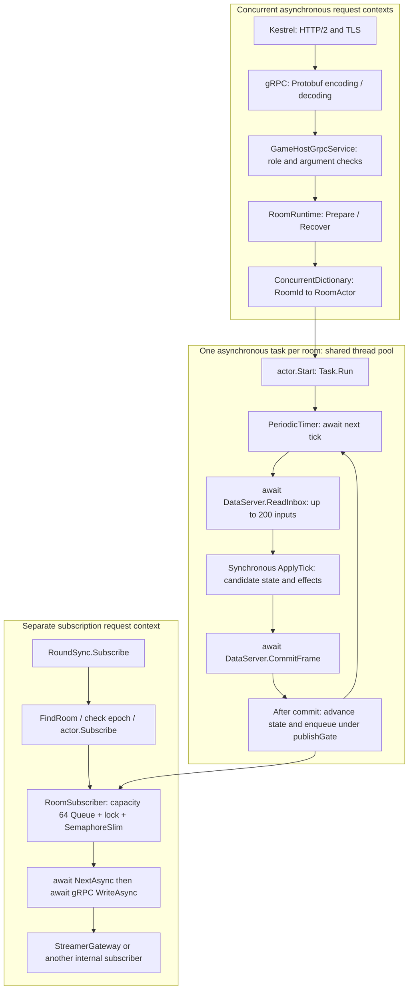

# Current GameServer threading and message model

Verified against `src/Chorus.GameServer` on 2026-10-29. This page describes the existing implementation. Direct event push, an inbound actor mailbox and a composable message pipeline remain target work.

The diagram shows execution contexts, not pinned OS threads. Each room awaits one tick before starting the next; its continuation can run on a different thread-pool thread. Different rooms share CPU, the thread pool, GC and DataServer. There is no application-defined Reactor/EventLoop scheduler or per-room dedicated thread.

## Current entry paths

| Operation | Existing path | Unified inbound mailbox |
|---|---|---|
| Prepare / recover | gRPC service calls RoomRuntime directly | None |
| Subscribe | RoundSync finds the actor and calls Subscribe directly | None |
| Gift / like / client input | Actor pulls persisted inputs through ReadInbox on each tick | None |
| Publish state | Committed tick offers messages to a subscriber queue; its request loop writes them | Outbound queue only |

Program maps GameHost and RoundSync. A room PushEvents service from PlatformGateway is not implemented yet. The published direct-push architecture describes target work, not this current path.

## Synchronization

The concurrent dictionary protects registry operations, not the whole prepare/recover lifecycle. The actor's publishGate protects the committed head and subscriber collection; subscription methods run outside the tick task and acquire that lock. Dispose uses cancellation and a stop flag. Each subscriber has its own locked queue and semaphore signal. Overflow requests a new snapshot baseline and preserves terminal messages.

The tick does not await each subscriber's network write. Serialization, queue offering and lock contention still consume tick time. ApplyTick is synchronous computation on the executing thread; there is no separate business-computation pool or fixed room-to-EventLoop partition.

## Codec, pipeline and room scheduling

These are separate concerns. Kestrel/gRPC provide the current protocol handling and Protobuf codec. Role checks and dispatch are embedded in service methods; there is no explicit composable room-message pipeline. Serial gameplay execution comes from the tick loop, not an inbound mailbox.

A future direct-push implementation must explicitly define decoded envelopes, authorization and epoch checks, RoomId dispatch, bounded mailboxes, tick/control-command scheduling, durable acceptance, serialization across I/O awaits, overload behavior and the close barrier. This current-state document does not prescribe worker counts or claim those mechanisms exist.

Sources: `Program.cs`, `GameHostGrpcService.cs`, `RoomRuntime.cs`, `RoomActor.cs`, `RoundSyncGrpcService.cs`, and `RoomSubscriber.cs` under `src/Chorus.GameServer`.
