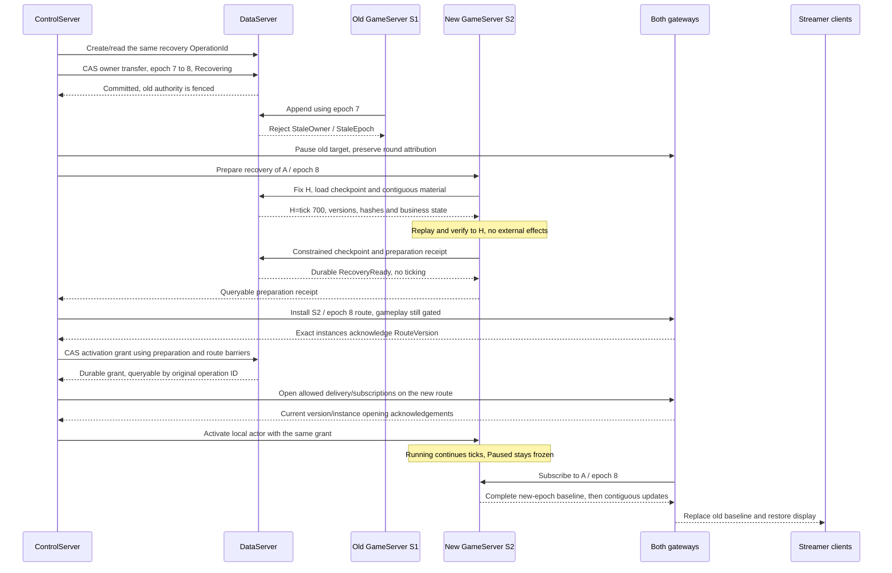

# Complete game-room recovery design

2026-10-29. This document records the redesign's recovery contract, ordering, failure branches and acceptance requirements. **It is a target design, not a claim of complete implementation.** Read the [glossary](../reference/glossary.md) first. Related pages: [architecture](/architecture/architecture), [state synchronization and offline policy](./authoritative-sync.md), [current threading model](./gameserver-threading-current.md).

## 1. Different kinds of recovery

| Scenario | Identity and progress retained | Action | Room ownership epoch |
|---|---|---|---|
| One client disconnects; room remains healthy | Original RoomId, participation and current server state | Authenticate, find original participation, install baseline and subsequent updates | No bump caused by reconnect |
| Business pause/resume | Original room, frozen tick, timers and policy | Persist pause; persist resume after configured readiness | No bump caused by pause |
| GameServer fails or one room stops executing correctly | Original RoomId, committed tick/version and accepted inputs | Fence old executor, rebuild state and reactivate | Advances |
| Planned migration or GM BumpRoomEpoch | Original RoomId and durable history | Authorized, audited rebuild; GM requires explicit recovery | Advances; GM can retain the owner |
| Finished/released room | Frozen result, settlement and closing operation | Return result or continue closing; never restart gameplay | Do not reopen authority just to display history |

In this project a RoomId represents one round. Recovery neither rematches participants nor creates the next round. Rooms have independent tick progress and ownership epochs even when sharing a process and thread pool.

## 2. Invariants

1. At most one executor can append valid new commits for a room. Multiple in-memory actors can temporarily exist, but storage rejects obsolete owner/epoch/status/lease combinations. An advisory stop notification is insufficient.
2. Publish only committed state. Unconfirmed frames, recovery candidates and unverified replay cannot become authoritative client updates.
3. Durably accepted important inputs remain recoverable or receive an explicit terminal disposition. A new epoch neither drops them nor assigns them to a later round.
4. Replay reconstructs state without repeating rewards, asset mutations, platform calls or historical client command receipts. Keep original business idempotency identities across epochs.
5. Ownership, recovery materials, routes, actors and client baselines must identify the corresponding room and generation. Client delta chains cannot cross epochs.
6. Track process liveness, lease renewal, RPC acceptance, route installation and actor activation separately. None alone proves successful gameplay recovery.
7. Preserve business Paused, fault Recovering/Suspended and terminal Finishing distinctions. Recovery cannot silently resume a paused room or execute another tick after a final result.

## 3. Responsibilities

| Component | Recovery responsibility | Boundary |
|---|---|---|
| NodeAgent | Restart/supervise local processes and report process facts | Does not allocate room epochs or declare room recovery |
| ControlServer | Classify faults, select a qualified target, persist recovery operations, coordinate authority/leases/routes/activation and deadlines | Does not replay gameplay; timeout evidence is not proof that the old writer stopped |
| DataServer | Execute transfer, consistent recovery reads, constrained checkpoints and activation transactions; validate ownership/version/lease | Does not select targets, parse platform business events or orchestrate recovery |
| GameServer / RoomRuntime / RoomActor | Load rules, verify/replay material, prepare an actor, activate under a grant and publish committed state | Local existence, restart and endpoint changes cannot grant authority |
| StreamerGateway | Install room routes, rebuild upstream subscriptions and deliver baselines | Does not infer room placement from the login StreamerServer |
| PlatformGateway | Preserve live binding/round attribution, stop obsolete delivery, install routes and retry the original events | Recovery does not itself end the platform session or create new gifts |
| StreamerServer | Authenticate current sessions, recover original participation and expose lifecycle | Does not rematch a recovering participant or relay battle frames |

## 4. Failure detection and target admission

ControlServer distinguishes process silence, actor stalls, temporary persistence failures and module faults. Reports carry process instance, sequence, reception time, last committed tick/time, recovery phase and stop reason. A business-paused room is not faulty merely because its tick is frozen. Temporary slow commits require classified retries, not repeated migrations.

Targets must have valid identity, healthy dependencies, the exact module/configuration packages, recovery support and available capacity/admission. Resolve endpoints from the directory, not client-provided destinations. Transfers validate CoordinatorTerm, expected owner/epoch and database state in a transaction. Database time decides lease expiry; planned transfers require explicit authorization. Every process restart creates a new ProcessInstanceId.

Moving execution to another server preserves RoomId. Same-process recovery must also distinguish the old actor object from the new authority generation.

## 5. Recovery materials and a fixed head

Fix a committed head `H=(RoomId, TickId, StateVersion, StateHash)` and record the new epoch, original business state, module/configuration/schema and operation identity. Use a consistent read view or equivalent immutable recovery cursor; paging cannot mix later commits into the selected head.

| Material | Purpose and validation |
|---|---|
| Valid checkpoint | Payload/hash, tick/version, exact module/config/schema; newest candidate first |
| Contiguous checkpoint-to-H frames | Recorded input references/order, tick/version/hash, random state and required recovery metadata |
| Inputs and participation actually referenced | Rebuild original execution context without loading all unrelated round history |
| Accepted unconsumed inputs and consumption cursor | Process after reaching H, preserving original attribution/order and per-tick budget |
| Pause and gameplay timer state | Preserve logical remaining time, wall-clock deadlines and readiness policy separately |
| Result, settlement and close receipts | Detect result-only/closing recovery instead of restarting battle |

Historical frames may have earlier epochs. Verify and reconstruct them, then establish a baseline under the new epoch; do not rewrite historical epoch fields or splice client deltas across generations. Replay uses recorded deterministic inputs and rules, not current wall time, global randomness or external HTTP responses.

If the latest checkpoint is corrupt, request an earlier candidate and its contiguous tail. Missing frames, hash mismatches, absent packages or exhausted candidates produce visible RecoveryFailed/Suspended. Never skip invalid frames or substitute empty state. Bound transfer sizes, candidate counts, replay work and per-room memory; support cancellation.

## 6. Complete takeover sequence (target)

Example: room A moves from S1/epoch 7 to S2/epoch 8 and restores committed tick 700. Numbers are illustrative. RecoveryReady, RoutesInstalled and Starting describe operation phases; the contract tasks must define their representation rather than assuming these enums already exist.

Ordering requirements:

1. The transfer transaction locks records in the defined order, updates room ownership and room epoch together, preserves original business state and records a receipt. Epochs never decrease. Old commits before transfer belong to H; obsolete executors cannot append after the fence.
2. An unreachable old executor is already fenced even if its stop notice fails. Stale/not-ready delivery must retain original event IDs for retries. Do not acknowledge durability before persistence.
3. Preparation constructs one candidate actor. A dedicated constrained write permits a verified recovery checkpoint under Recovering; ordinary CommitFrame remains forbidden. Do not confirm Active early to bypass this requirement.
4. Bind RecoveryReady to operation, owner instance, epoch, H and package/config hashes. A replacement process cannot inherit a previous instance's readiness receipt without revalidation and coordination.
5. Track installation and opening separately for both gateways, with exact responder sets and route versions. Sending is not acknowledgement. Excluding an obsolete responder needs persistent configuration/lease evidence.
6. Persisting an activation grant does not start the local loop. If opening routes fails, retain Starting and retry the same operation. Before starting, validate current authority and barriers; reject stale delayed activation commands.
7. Between allowed route opening and tick start, inputs eligible for the original round may be durably accepted and wait, without creating effects. GameplayReady requires current actor/phase evidence, not just Active ownership.
8. Restore Paused as paused, with maintenance only; later resume requires gameplay readiness and a durable Resume boundary. Restore terminal state into closing. Recovery does not require all disconnected clients to acknowledge before an otherwise continuing room may advance.

## 7. Permissions and phases (target)

| Phase | Recovery reads | Checkpoint writes | New gameplay frames | Routes/clients | Liveness/deadline |
|---|---|---|---|---|---|
| Recovering | Authorized target, fixed view | Dedicated operation/owner/epoch/head only | Forbidden | Old route invalid; no gameplay readiness | Bounded recovery deadline; heartbeats do not extend forever |
| RecoveryReady / awaiting activation | Verify same head | Same operation idempotently | Forbidden | Route installation allowed; prepared baseline needs explicit permission | Persistent barrier waiting |
| Granted / Starting | Verify as needed | Explicit interface rules | Local start barrier still applies | Confirm opening, then start actor | Continue original operation or govern timeout |
| Running | Normal authorized reads | Normal checkpoint rules | Current owner/epoch/valid lease | Committed baselines and deltas | Actual commit progress |
| Paused | Current paused head | Constrained maintenance/pause operations | Gameplay tick frozen | Paused baseline; configured input disposition | Lease/heartbeat/max-pause deadlines continue |
| Finishing / released | Frozen result and close progress | No recovery rewrite of final outcome | No gameplay restart | Result query; durable fallback when cache is absent | Closing coordinator owns progress |

This matrix guides FIX-TAKE-01/02/03. Ownership status and room business state are different dimensions. A lease does not prove ticking. Authorized historical receipt lookup remains possible; fencing new writes does not erase committed history.

## 8. Unknown commits, inputs and external effects

The final pre-failure CommitFrame may have committed while its response was lost. Trust the fixed durable head: continue after the frame if committed; otherwise its inputs remain unconsumed. In-memory pending candidates are not authoritative. A still-authorized old actor retries the same CommitId with identical content; after fencing it must not invent a new ID to append its old candidate.

Commit frames, consumption, state versions and effects/result receipts atomically. Replay reconstructs state without executing effects again. Retain ledger/settlement idempotency keys. New owners consume accepted pending inputs; senders retry unaccepted inputs with original EventIds. Preserve initial RoomId/RoundGeneration attribution.

PlatformGateway's subscription lifecycle is separate from GameServer recovery. Maintain authorized connections/heartbeats where possible. Revoked authorization or ended platform sessions become explicit business causes handled by gameplay/closing rules. Unknown source or attribution stays explicitly unresolved rather than guessing a new room.

## 9. Client reconnect, catch-up and pause

StreamerServer restores authenticated control and durable participation; StreamerGateway resolves the original room through ControlServer routes. Capture a complete baseline H and register subsequent updates at one publication boundary. Buffer updates during installation with a bound; overflow requests a newer baseline rather than blocking other clients or retaining unlimited history.

Clients check RoomId, epoch, state/base versions and module/config compatibility. A new-epoch snapshot may retain the restored tick number but replaces the old delta chain. ACKs report a particular baseline/readiness/progress, never authority, rewards or permission to bypass barriers.

Single-client disconnection follows the game's continue/pause/automation rule; all-offline behavior uses the original pinned policy. A recovered Paused room resumes only after the configured number of current sessions acknowledge the required epoch/baseline and a durable Resume boundary commits. Preserve max-pause behavior. See the independent [synchronization and pause traces](./authoritative-sync.md).

## 10. Failure decisions

| Failure | Action | Forbidden shortcut |
|---|---|---|
| Transfer committed, response lost | Query original OperationId and current authority | New ID and another epoch bump |
| ControlServer restart | Valid replacement coordinator continues persistent operation/barriers | Rebuild workflow solely from local RPC outcomes |
| Target dies during preparation or after grant | No false Ready; explicitly reassign with a newer epoch after policy/deadline | Revive old epoch or inherit identity after process restart |
| Persistence unavailable | Stop new authoritative commits; retain unknown outcomes and query later | Broadcast candidates or renew authority by local clock |
| Missing package, hash mismatch or frame gap | Visible suspension and documented checkpoint fallback | Skip frames, load defaults or repeat external effects |
| Gateway ACK missing or gateway restarts | Replay version or full snapshot; re-establish responder qualification | Claim routing complete or guess endpoints |
| Result committed; settlement/platform close incomplete | Continue durable closing and return frozen result | Restart ticks, duplicate rewards or destroy early |
| Multiple local actors for one room | Only current authority may commit; retire by object identity | Delayed old cleanup removes replacement actor |

Normal closing remains: final result → delivery-stop confirmation → authorized platform close with resolved outcome → required input/settlement completion → atomic release → authorized destruction. Recovery cannot bypass it. Server migration alone does not end the platform interaction.

## 11. Operations and acceptance

Record recovery ID/cause, room, old/new owner and epoch, H, phase/deadline, checkpoint, replay frames/time/bytes, last error and each gateway's route version/ACK. Use room IDs in bounded diagnostic queries/logs, not unlimited metrics labels. Measure detection, fencing, rebuilding, route completion and first post-recovery commit separately.

The goal is no loss of committed state or acknowledged input from application-process failure while durable storage remains available. This does not promise zero loss after database data loss or receipt of platform events never delivered successfully. Declare and measure recovery budgets against room scale/checkpoint interval/replay cost; illustrative sequences are not a seconds-level SLA.

| Independent scenario | Evidence | Existing TODO |
|---|---|---|
| One client disconnects while another stays online | Same round continues; gap-free baseline; no duplicate rewards | FIX-SYNC-02/03, FIX-U3D-11 |
| Paused room crashes | Pause/timers/policy survive; no ticks before readiness | FIX-SYNC-06/08 |
| Old writer returns after takeover | Old new writes rejected; replacement proceeds | FIX-GM-04, FIX-TAKE-08 |
| Commit response lost | Durable head wins; one input consumption/effect | FIX-FRAME-04 |
| Corrupt latest/all checkpoints | Verified fallback or visible suspension | FIX-READ-04 |
| Kill at transfer/replay/activation boundaries | Persistent convergence; no false Ready or duplicate bump | FIX-TAKE-04/05/08 |
| A→B→A with multiple rooms on each host | No stale-object blockage or impact on other rooms | FIX-ROOM-06, FIX-GM-04 |
| Gateway ACK loss/restart | Rebuild barriers; no premature start | FIX-LINK-08, FIX-REC-01 |
| Crash after final result | Result/closing only; no new battle | FIX-END-12/14 |
| Long-round/batch recovery | Bounded reads/memory and measured budget | FIX-READ-02/03/05, FIX-REC-02 |

## 12. Current implementation and gaps

| Code | Existing foundation | Not established by its existence |
|---|---|---|
| `src/Chorus.DataServer/RedesignFrameStore.cs` | Transactional frames, ownership/lease checks and commit idempotency | Complete recovery coordination or end-to-end correctness |
| `src/Chorus.DataServer/RedesignRoomStore.cs` | Transfer, constrained recovery-head writes and confirmation | Complete dual-gateway barrier and independent actor activation |
| `src/Chorus.DataServer/RedesignRecoveryStore.cs` | Material loading | Consistent bounded candidate/paged recovery |
| `src/Chorus.GameServer/RoomRuntime.cs` | Checkpoint replay, hash verification and actor restoration | Recovery currently starts the actor directly; independent gated activation remains |
| `src/Chorus.ControlServer/TakeoverGrpcService.cs` | Transfer, persistent recovery operations and deadline governance; early pre-recovery Active confirmation removed | Target still needs control-plane readiness receipts and both gateway barriers before local start |
| `src/Chorus.GameServer/RoundSyncGrpcService.cs`, `RoomActor.cs` | Epoch checking, publication boundary, snapshots and bounded subscribers | Universal complete deltas or all reconnect/migration acceptance |

Recheck code before implementation because concurrent work may change it. Reuse FIX-TAKE/READ/ROOM/SYNC/GM/LINK/END rather than building another recovery subsystem. Additional cross-stage routing and capacity acceptance is tracked in repository `todo.md` §22.20.
