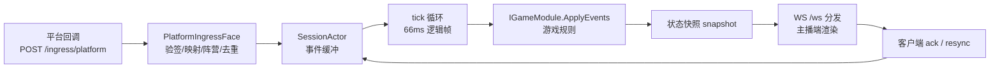

# 架构：分层、决策与取舍

本页回答三个问题：Chorus 怎样分层、为什么这样取舍、这些决策在什么约束下成立。分域细节见：

- 进程拓扑与组件索引：[当前架构总览](./design/architecture-overview.md)
- 组件图与深挖设计：[架构设计](./design/architecture.md)、[帧同步设计](./design/frame-sync.md)、
  [IPC 设计](./design/ipc.md)、[进程拓扑](./design/process-topology.md)
- 逐条决策记录（供复核）：[决策记录](./decisions.md)
- 能力使用说明：[对战](./guide/battle.md)、[匹配](./guide/matchmaking.md)、[排行榜](./guide/leaderboard.md)

## 分层与模块划分

自下而上看，13 个工程分五层（依赖方向只允许向下）：

| 层 | 工程 | 职责 |
|---|---|---|
| 协议 | `Chorus.Protocol` | 消息 record（`ClientHello`/`ServerSnapshot`/…）、JSON 序列化、协议版本策略 |
| 引擎 | `Chorus.Engine` | 会话与 tick 循环（`SessionActor`）、帧历史（`FrameHistory`）、匹配（`Matchmaking`）、模块契约（`Abstractions`） |
| 数据 | `Chorus.Data` | 排行榜存储（`LeaderboardStore`）、数据命令模型 |
| 接入 | `Chorus.Adapters.*`（平台适配）、`Chorus.Gateway.Core`（两面共享实现 + 指标/排行榜 HTTP） | 平台验签/映射；ingress 与 streamer-ws 两个 listener face |
| 宿主与消费方 | `Chorus.Server`（单进程）、`Chorus.Gateway` + `Chorus.EngineHost`（拆分）、`Chorus.Messaging`（IPC）、`Chorus.SampleGame`（参考实现）、`Chorus.Client`（客户端 SDK）、`Chorus.LoadTool`（压测） | 进程装配与外部入口 |

一次观众互动的数据流（单进程形态少一跳 IPC）：

## 两种部署形态，一套边界

同一份代码两种装配：`Chorus.Server` 单进程；`Chorus.Gateway` + `Chorus.EngineHost` 拆分。
两种形态**共享同一对 listener face**（`PlatformIngressFace`、`StreamerWsFace`，位于 `Chorus.Gateway.Core`），
会话状态永远在引擎侧（单进程 `SessionManager`，拆分 `EngineIpcService`），网关不持有会话状态。

> 为什么先做单进程：运维面最小（一个进程、无 IPC），压测表明数百房间量级单 worker 足够
> （todo.md:156：800 房间 + 30k rps 签名事件，`ingested==applied==45287`，峰值 CPU 27.6）。
> 拆分的触发条件与路线见 [进程拓扑](./design/process-topology.md) §4。

## 数据流（一条事件的一生）

以拆分形态为例，每一步都有源码锚点（写法是 `文件:行`，以 main 为准）：

1. 平台回调进入 `POST /ingress/{platform}`（`src/Chorus.Gateway/Program.cs:148`，受 `Gateway:Roles` 门禁）。
2. `PlatformIngressFace` 依次做限流（`:58` 429）、体量上限（`:68` 413）、验签 fail-closed（`:76` 401）、
   平台映射、未知事件拒绝（`:93` 400）、TTL 去重（`:101` 200 duplicated）、阵营归属、会话路由。
3. 网关把事件封装为 `Envelope`（`gw.audienceEvent`）经 IPC 总线发给引擎
   （`src/Chorus.Gateway/GatewayIpcService.cs`，信封见 `src/Chorus.Messaging/`）。
4. 引擎接收循环按类型分发（`src/Chorus.EngineHost/EngineIpcService.cs:294`），写入目标会话缓冲
   （`SessionActor.TryIngestAudienceEventAsync`，`src/Chorus.Engine/Session/SessionActor.cs:190`）。
5. tick 循环（`SessionActor.cs:518`）每 66ms（`SessionConfig.cs:4`）把缓冲事件交给游戏规则：
   `IGameModule.ApplyEvents`（`src/Chorus.Engine/Abstractions/IGameModule.cs:10`）。
6. 模块产出新状态，引擎编码为 `ServerSnapshot`（每 tick 一帧，`SessionConfig.cs:6`），
   近期帧进 `FrameHistory`（字节上限 `SessionConfig.cs:24`）供 resync 重放。
7. 快照沿 eng→gw 总线回网关（`GatewayIpcService.cs:198` 分发 `:213`），再由 WS face 推给客户端。
8. 客户端应用帧后回 `ack`；检测到缺口发 `resync`，引擎从帧历史重放窗口
   （`src/Chorus.Engine/Session/FrameHistory.cs:79`），或直接推 forced 快照对齐（`SessionActor.cs:573`）。

## 关键决策与被放弃的替代方案

每个决策给四样东西：决策、理由、被放弃的替代、成立约束。

### 1. 服务器权威 tick + 快照，而不是帧锁定

- **决策**：引擎固定节拍推进逻辑帧（默认 66ms），客户端不推进游戏逻辑，只渲染服务器快照并对齐。
- **理由**：观众互动（弹幕/礼物）是低频、可乱序、可丢的社交信号，不是竞技输入；锁帧（等最慢端）
  会让一个卡顿观众的客户端拖慢全场，而直播场景本来就要容忍秒级互动延迟。
- **被放弃的替代**：帧锁定 / lockstep（对输入频率敏感、要求全员在线语义）；客户端权威 + 服务器转发
  （无法做排行、反作弊等权威判定）。详见 [帧同步设计](./design/frame-sync.md)。
- **成立约束**：互动延迟可容忍 ≥ 一个 tick + 投递时间；单房间不是竞技级（毫秒级）判定需求。

### 2. 会话状态只在引擎，网关无状态

- **决策**：无论单进程还是拆分，会话与客户端状态只在引擎侧 actor（`SessionActor`）里，
  网关只做验签/映射/去重与转发。
- **理由**：保证两种部署形态语义完全一致（同一对 face 字节级共享）；将来扩网关副本或多 worker 时，
  一致性边界只有一个。
- **被放弃的替代**：网关本地建会话再同步给引擎——两个权威副本，拆分形态下每条规则都要写两遍。
- **成立约束**：单 worker 会话容量上限（`SessionConfig.cs:17` 默认 200，可调）内成立；
  多 worker 是规划中的阶段三（见下「已知边界」）。

### 3. 单进程优先，face 预先切分（而不是一开始就三进程）

- **决策**：listener 代码沉到共享库（face），进程边界后置；现在两种形态都可用。
- **理由**：进程拆分是运维成本，不是功能；先切逻辑边界（face），物理拆分等负载证据。
  触发条件与决策记录见 [进程拓扑](./design/process-topology.md) §4、[决策记录](./decisions.md) D5。
- **被放弃的替代**：day-1 三进程（多两跳延迟与运维面，压测前无收益）；
  永远单进程（单点容量上限，无法水平扩接入面）。

### 4. IPC：UDS 优先的长度前缀 JSON 信封，而不是 gRPC/共享内存

- **决策**：引擎-网关间自管 `Envelope` 消息总线，`Ipc:Transport=Auto` 默认 UDS（`/tmp/chorus/*.sock`），
  回退 named pipe，可选 TCP/HTTP；帧格式 = 4 字节小端长度 + JSON 载荷。
- **理由**：同机拆分的主路径是 UDS（内核直连，无序列化框架开销面）；JSON 信封让协议 record
  直接复用（`Chorus.Protocol` 一套消息定义走 WS 和 IPC 两张网）；长度前缀自描述、无框架依赖。
- **被放弃的替代**：gRPC（多一层代码生成与版本耦合，消息体已有 record 契约）；
  共享内存环形缓冲（延迟最优但复杂度高，评估后暂不实现，见 [共享内存评估](./design/shared-memory-transport.md)）。
- **成立约束**：单机/同 pod 部署；跨机部署走 TCP/HTTP 传输（延迟与吞吐预算需自行评估）。
  通道细节见 [IPC 设计](./design/ipc.md)。

### 5. 无数据库：内存态 + 快照恢复缝（而不是持久化存储）

- **决策**：全部运行态在内存；会话出生时可从快照恢复（`ISnapshotRecoverySource` 缝，
  `src/Chorus.Engine/Abstractions/SnapshotRecovery.cs`），当前生产装配不注册恢复源（恒 null）。
- **理由**：直播互动局的生存期 ≈ 直播场次的生存期，跨重启续局不是当前需求；去掉存储依赖后
  部署面、故障模式、延迟都显著简化。
- **被放弃的替代**：内置 SQLite/Redis 持久化（每次 tick 的写放大与恢复复杂度，
  换来当前不需要的续局能力）。方案对比见 [快照恢复](./design/snapshot-restore.md)（方案 A 已落地）。
- **成立约束**：进程重启 = 局终止（房间榜可由模块恢复路径重建，见 [排行榜](./guide/leaderboard.md)）；
  需要跨重启结算的产品要在外部自行落地。

### 6. 平台接入 fail-closed 验签路由（而不是宽松接入）

- **决策**：每个平台一个命名验证器（`Douyin`/`Kuaishou`/`Bilibili`），路由按平台名选择；
  缺验证器或缺密钥一律拒绝（401），无兜底放行；`Ingress:AllowAll` 仅开发用且启动时大声告警。
- **理由**：ingress 是公网回调面，伪造事件的代价（刷分/刷排行）直接落到游戏经济上。
- **被放弃的替代**：无验签直接收（任何人都可写事件）；统一网关验签（平台签名算法各不相同，
  强行归一会逼出共享密钥反模式）。决策记录 D2–D4。
- **成立约束**：新增平台必须自带验证器与映射器（模板见 [平台适配器契约](./reference/adapter-contract.md)）。

### 7. 游戏规则收敛到 IGameModule（而不是写死在引擎）

- **决策**：引擎只懂帧与投递，玩法是宿主注册的模块（`IGameModuleFactory` → `IGameModule`，
  四个成员：`Name`/`ApplyEvents`/`GetStateSnapshot`/`RestoreState`，`IGameModule.cs:6-24`）。
- **理由**：玩法迭代频率远高于引擎；模块边界同时是快照恢复与测试边界
  （模块可以无引擎单测，参考 `Chorus.SampleGame`）。
- **被放弃的替代**：引擎内 switch 玩法类型（每次新玩法改引擎核心）；
  脚本化玩法（热更灵活但失去编译期契约与 fail-closed 恢复语义）。
- 写法与边界见 [游戏模块](./guide/game-module.md)。

### 8. 排行榜：替换式投影 + 查询分离（而不是实时聚合）

- **决策**：房间/单局榜由引擎侧模块以**替换**语义投影权威分（`UpsertScore`，天然幂等）；
  全局/周期榜走**幂等增量**（`AddDelta`，sourceId 台账去重），留给异步聚合方；查询独立快照、
  冻结即封榜。存储在 `src/Chorus.Data/Leaderboard.cs:40`，读写路径见 [排行榜](./guide/leaderboard.md)。
- **理由**：实时分本来就在会话权威状态里，重复投影不会重复加分；增量台账则保证重放安全。
- **被放弃的替代**：单一累加 API（房间榜重复投影会翻倍，增量榜无去重）；
  每次查询实时重算（查询代价随参与者数线性涨，且名次会因并发事件抖动）。

## 同类约束下的取舍

| 约束维度 | 本架构的表现 | 代价 / 不适用面 |
|---|---|---|
| 规模 | 单 worker 数百房间（800 房 × 3 客户端实测零丢失，峰值 CPU 27.6，todo.md:156） | 多 worker 尚未落地（阶段三） |
| 互动延迟 | 一个 tick（66ms）+ 投递，快照每 tick 一帧 | 不适合毫秒级竞技判定（FPS/格斗） |
| 一致性 | 服务器权威 + fail-closed 接入 + 幂等投影 | 不提供跨重启续局（无持久化） |
| 输入面 | 平台回调 + 主播 WS 只读渲染，客户端无玩法写入 | 观众不能直接发操作指令（防刷面小是优点也是限制） |

一句话：**Chorus 用"牺牲竞技级延迟与持久化，换取观众侧海量低频输入下的强权威与可运维性"**。
如果产品约束变化（需要持久局、需要竞技输入），对应决策（5、1）需要重开。

## 已知边界与后续项

诚实的边界清单（详细数据与修复进展见 `todo.md:156`）：

- **阶段三多 worker 未落地**：单 worker 峰值 CPU 已观测超过 60% 触发线（800 房 + 800 WS + ~1k events/s），
  多 worker 路由/接管机制（`RoomAuthorityRegistry` 等）已有测试级脚手架，接线等用户拍板。
- **网关快照分发并发化**：eng→gw 单 socket + 单锁串行分发，2.65M 快照下丢帧由 resync 补齐（架构级待办）。
- **resync 重放限界**：重放总量无请求级上限，与快照洪流互相放大（架构级待办）。
- **排行榜 `AddDelta` 台账无界**：每榜每 sourceId 一条去重记录，长周期高频源会增长内存；
  实时投影一律用 `UpsertScore`（见 [排行榜](./guide/leaderboard.md) 边界）。
- **匹配无宿主接线**：`Matchmaker` 是库级能力，join/开局的产品语义未定（见 [匹配](./guide/matchmaking.md) 边界）。

## 相关页面

- [当前架构总览](./design/architecture-overview.md)（进程拓扑与组件索引）
- [架构设计](./design/architecture.md) / [帧同步设计](./design/frame-sync.md) / [IPC 设计](./design/ipc.md)
- [对战](./guide/battle.md) / [匹配](./guide/matchmaking.md) / [排行榜](./guide/leaderboard.md)
- [决策记录](./decisions.md) / [接口参考](./reference/api.md)

