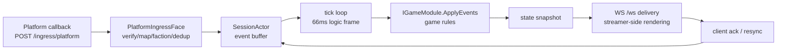

# 架构：分层、决策与权衡

本页回答三个问题：Chorus 如何分层、**为何做这些选择**（放弃了哪些备选），以及这些选择在哪些约束下成立。各详情页各自负责一个领域；本页是地图加推理：

- 进程拓扑与组件索引：[当前架构总览](./design/architecture-overview.md)
- 组件图与深潜：[架构设计](./design/architecture.md)、
  [帧同步设计](./design/frame-sync.md)、[IPC 设计](./design/ipc.md)、
  [进程拓扑](./design/process-topology.md)
- 逐条决策记录（供评审）：[决策日志](./decisions.md)
- 能力用法：[对战](./guide/battle.md)、[匹配](./guide/matchmaking.md)、
  [排行榜](./guide/leaderboard.md)

## 分层与模块拆分

自底向上，13 个项目分属五层（依赖只允许向下）：

| 层 | 项目 | 职责 |
|---|---|---|
| 协议 | `Chorus.Protocol` | 消息记录（`ClientHello`/`ServerSnapshot`/…）、JSON 序列化、协议版本策略 |
| 引擎 | `Chorus.Engine` | 会话与 tick 循环（`SessionActor`）、帧历史（`FrameHistory`）、匹配（`Matchmaking`）、模块契约（`Abstractions`） |
| 数据 | `Chorus.Data` | 排行榜存储（`LeaderboardStore`）、数据命令模型 |
| 摄取 | `Chorus.Adapters.*`（平台适配器）、`Chorus.Gateway.Core`（两面共享实现 + 指标/排行榜 HTTP） | 平台签名校验/映射；入口与主播 ws 监听面 |
| 宿主与消费者 | `Chorus.Server`（单进程）、`Chorus.Gateway` + `Chorus.EngineHost`（分离）、`Chorus.Messaging`（IPC）、`Chorus.SampleGame`（参考游戏）、`Chorus.Client`（客户端 SDK）、`Chorus.LoadTool`（压测工具） | 进程装配与外部入口点 |

一次观众互动的数据流（单进程形态省一跳 IPC）：

## 两种部署形态，一条边界

同一套代码，两个装配：`Chorus.Server` 单进程；`Chorus.Gateway` + `Chorus.EngineHost` 分离。两种形态**共享同一对监听面**（`PlatformIngressFace`、`StreamerWsFace`，在 `Chorus.Gateway.Core`）；会话状态永远在引擎侧（单进程 `SessionManager`，分离 `EngineIpcService`）——网关不持有会话状态。

> 为何先单进程：最小的运维面（单进程、无 IPC），且压测显示单 worker 在数百房间规模足够
> （todo.md:156：800 房间 + 30k rps 签名事件，`ingested==applied==45287`，峰值 CPU 27.6）。
> 分离模式触发条件与路线图：[进程拓扑](./design/process-topology.md) §4。

## 数据流（一个事件的一生）

分离形态，每步带源码锚点（写成 `file:line`，以 main 为准）：

1. 平台回调到达 `POST /ingress/{platform}`（`src/Chorus.Gateway/Program.cs:148`，由 `Gateway:Roles` 门控）。
2. `PlatformIngressFace` 依序应用：限流（`:58` 429）、请求体上限（`:68` 413）、fail-closed 签名校验（`:76` 401）、平台映射、未知事件拒绝（`:93` 400）、TTL 去重（`:101` 200 duplicated）、阵营分配、会话路由。
3. 网关把事件包成 `Envelope`（`gw.audienceEvent`），经 IPC 总线发往引擎（`src/Chorus.Gateway/GatewayIpcService.cs`；信封在 `src/Chorus.Messaging/`）。
4. 引擎接收循环按类型分发（`src/Chorus.EngineHost/EngineIpcService.cs:294`），写入目标会话的缓冲（`SessionActor.TryIngestAudienceEventAsync`，`src/Chorus.Engine/Session/SessionActor.cs:190`）。
5. tick 循环（`SessionActor.cs:518`）每 66ms 把缓冲事件交给玩法规则（`SessionConfig.cs:4`）：`IGameModule.ApplyEvents`（`src/Chorus.Engine/Abstractions/IGameModule.cs:10`）。
6. 模块产出新状态；引擎编码为 `ServerSnapshot`（每 tick 一帧，`SessionConfig.cs:6`）；近期帧进 `FrameHistory`（字节上限 `SessionConfig.cs:24`）供重同步回放。
7. 快照经 eng→gw 总线回网关（`GatewayIpcService.cs:198`，分发 `:213`），然后 WS 面推给客户端。
8. 客户端应用一帧后 ack；检测到缺口时发 `resync`，引擎从帧历史回放窗口（`src/Chorus.Engine/Session/FrameHistory.cs:79`）或推强制快照重新对齐（`SessionActor.cs:573`）。

## 关键决策与被拒备选

每条决策给四件事：决策、理由、被拒备选、成立约束。

### 1. 服务端权威 tick + 快照，而非锁步

- **决策**：引擎按固定节奏（默认 66ms）推进逻辑帧；客户端不推进玩法逻辑——它们渲染服务端快照并对齐。
- **理由**：观众互动（弹幕/礼物）是低频、可重排、可丢弃的社交信号，不是竞技输入。锁步（等最慢对端）会让一个卡顿观众的客户端拖慢整个房间，而直播本就容忍秒级互动延迟。
- **被拒备选**：锁步（对输入频率敏感、需要全员在线语义）；客户端权威 + 服务端中继（无法做权威判定如排行榜或反作弊）。见[帧同步设计](./design/frame-sync.md)。
- **约束**：互动延迟须容忍在 ≥ 一个 tick + 投递时间；单个房间无竞技级（毫秒）判定需求。

### 2. 会话状态只在引擎；网关无状态

- **决策**：单进程与分离两种形态下，会话与客户端状态只在引擎侧 actor（`SessionActor`）；网关只校验、映射、去重与转发。
- **理由**：两种部署形态语义完全一致（共享同一对面，逐字节相同）；将来网关副本或多 worker 时，恰好一条一致性边界。
- **被拒备选**：网关本地建会话再同步到引擎——两份权威拷贝，分离形态下每条规则写两遍。
- **约束**：在单 worker 的会话容量上限内成立（`SessionConfig.cs:17`，默认 200，可调）。ControlHost 模式把房间跨 worker 路由；生产多主机验证仍 open。

### 3. 先单进程，面先行拆分（不是第一天就三进程）

- **决策**：监听代码沉入共享库（面）；进程边界推迟；两种形态今天都可用。
- **理由**：进程拆分是运维成本而非功能；先切逻辑边界（面），物理拆分等负载证据。触发条件与决策记录：[进程拓扑](./design/process-topology.md) §4、[决策日志](./decisions.md) D5。
- **被拒备选**：第一天三进程（多两跳延迟与运维面，压测前无收益）；永远单进程（单点容量天花板，入口面无法横向扩展）。

### 4. IPC：UDS 优先的长度前缀 JSON 信封，而非 gRPC/共享内存

- **决策**：引擎与网关间自管 `Envelope` 消息总线；`Ipc:Transport=Auto` 默认 UDS（`/tmp/chorus/*.sock`），回退命名管道，可选 TCP/HTTP；帧格式 = 4 字节小端长度 + JSON 载荷。
- **理由**：UDS 是同机拆分的主路径（内核直连，无序列化框架开销）；JSON 信封让协议记录直接复用（`Chorus.Protocol` 同一套消息同时服务 WS 与 IPC）；长度前缀自描述、无框架依赖。
- **被拒备选**：gRPC（多一层代码生成与版本耦合，而消息体已有记录契约）；共享内存环形缓冲（延迟最好但复杂度高；已评估并推迟，见[共享内存评估](./design/shared-memory-transport.md)）。
- **约束**：单机/同 pod 部署；跨机部署用 TCP/HTTP 传输（延迟与吞吐预算由部署方评估）。通道细节：[IPC 设计](./design/ipc.md)。

### 5. 受控房间用 ControlHost 检查点；独立模式仍在内存

- **决策**：独立 `Chorus.Server` 把运行态留在内存。配 `Control:Url` 时，EngineHost 以 owner/epoch 围栏提交每房间 tick，ControlHost 存持久检查点；替换 owner 恢复最新已提交检查点。
- **理由**：受控多 worker 房间需要共享权威与可恢复状态，而独立开发保留简单无数据库路径。
- **存储选择**：生产多 worker 选用 PostgreSQL 16+ 主库 + 同步备库；SQLite 仍是开发/单主机默认。Provider 容量与独立主机复制/故障切换在 `todo.md` ROOM-11/12 仍 open。
- **约束**：检查点持久化不提供事件回放，也不证明跨主机 HA。见[房间控制存储](./architecture/room-control-storage.md)与[多机房间](./architecture/multi-machine-rooms.md)。

### 6. 平台入口：fail-closed 签名路由（而非宽容入口）

- **决策**：每平台一个具名校验器（`Douyin`/`Kuaishou`/`Bilibili`）；路由按平台名选择；缺校验器或缺密钥一律拒绝（401），无放行回退；`Ingress:AllowAll` 仅开发，启动时响亮日志。
- **理由**：入口是公开回调面；伪造事件（刷分/刷榜）的成本直接落在游戏经济上。
- **被拒备选**：无校验接受（任何人可写事件）；统一网关校验（平台签名算法不同；强扭一起易入共享密钥反模式）。决策记录 D2–D4。
- **约束**：新平台必须自带校验器与映射器（模板：[平台适配器契约](./reference/adapter-contract.md)）。

### 7. 玩法规则收敛进 IGameModule（不硬编码进引擎）

- **决策**：引擎只懂帧与投递；玩法是宿主注册的模块（`IGameModuleFactory` → `IGameModule`，四个成员：`Name`/`ApplyEvents`/`GetStateSnapshot`/`RestoreState`，`IGameModule.cs:6-24`）。
- **理由**：玩法迭代远快于引擎；模块边界兼作快照恢复边界与测试边界（模块可脱离引擎单测；见 `Chorus.SampleGame`）。
- **被拒备选**：引擎内玩法开关（每个新玩法模式都碰引擎核心）；脚本化玩法（热更灵活，但丢编译期契约与 fail-closed 恢复语义）。
- 如何写一个、边界在哪：[玩法模块](./guide/game-module.md)。

### 8. 排行榜：替换式投影 + 查询分离（而非实时聚合）

- **决策**：房间/比赛榜由引擎侧模块以**替换**语义投影（`UpsertScore`，天然幂等）；全局/周期榜用**幂等增量**（`AddDelta`，sourceId 账本去重）交给异步聚合器；查询读独立快照，冻结榜被密封。存储在 `src/Chorus.Data/Leaderboard.cs:40`；读/写路径：[排行榜](./guide/leaderboard.md)。
- **理由**：实时分数已在权威会话状态里，重投影绝不重复计数；增量账本保回放安全。
- **被拒备选**：单一累加 API（房间榜重投影翻倍、增量榜无去重）；每次查询重算（查询成本随参与者线性增长，并发事件下名次抖动）。

## 约束下的权衡

| 约束 | 本架构 | 代价 / 不适用处 |
|---|---|---|
| 规模 | 历史 800 房间 × 3 客户端运行是功能证据，不是生产容量承诺 | ControlHost 多 worker 路由已接线；ROOM-07/09/11/12 生产门槛仍 open |
| 互动延迟 | 一个 tick（66ms）+ 投递，每 tick 一个快照 | 不用于毫秒级竞技判定（FPS/格斗） |
| 一致性 | 服务端权威 + fail-closed 入口 + 幂等投影 | ControlHost 恢复已提交检查点；独立 Server 无持久重启恢复；两模式都不提供回放 |
| 输入面 | 平台回调 + 主播 WS 渲染只读；客户端不能写玩法 | 观众不能发玩法指令（小块滥用面——既是收益也是限制） |

一句话：**Chorus 用竞技级延迟与确定性回放，换来强权威与海量低频观众输入下的可运维性。** 若产品约束改变（需要持久回放或竞技输入），对应决策（5、1）需重开。

## 已知限制与后续

诚实的限制清单（详细数据与修复进度在 `todo.md:156`）：

- **生产多主机验收仍 open**：ControlHost 分配、owner/epoch 围栏、持久检查点与路由快照已接线。独立机器分区/迁移测试与所选 PostgreSQL 容量/复制门槛在 `todo.md` ROOM-07/09/11/12 仍 open。
- **网关并发快照扇出**：eng→gw 是单 socket + 单锁串行分发；2.65M 快照时掉帧靠重同步恢复（架构级积压）。
- **重同步回放边界**：总回放量无单请求上限，且随快照洪峰放大（架构级积压）。
- **排行榜 `AddDelta` 账本无界**：每榜每 sourceId 一条去重记录；长期高频源增长内存。实时投影应始终用 `UpsertScore`（见[排行榜](./guide/leaderboard.md)限制）。
- **库内 Matchmaker 无宿主接线**：ControlHost 单独暴露主播队列与比赛 API；它与进程内库不同。见[匹配](./guide/matchmaking.md)限制。

## 相关页面

- [当前架构总览](./design/architecture-overview.md)（进程拓扑与组件索引）
- [架构设计](./design/architecture.md) / [帧同步设计](./design/frame-sync.md) / [IPC 设计](./design/ipc.md)
- [对战](./guide/battle.md) / [匹配](./guide/matchmaking.md) / [排行榜](./guide/leaderboard.md)
- [决策日志](./decisions.md) / [API 参考](./reference/api.md)
