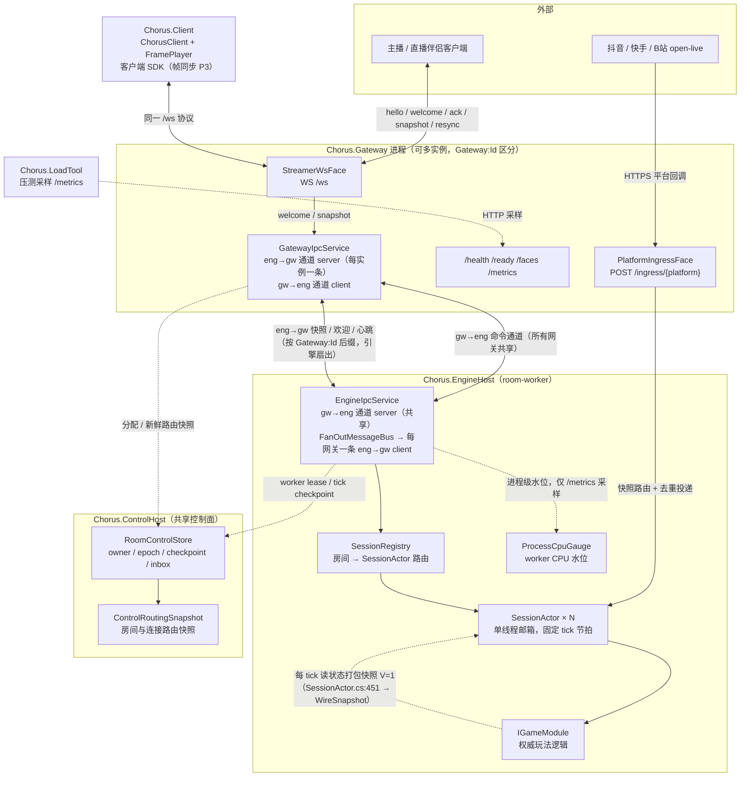

# 当前架构总览

以代码为准的组件与进程拓扑（2026-10-19 更新）。独立运行的 `Chorus.Server` 不启用控制面；启用持久控制面的拆分部署由共享 `Chorus.ControlHost`、一个或多个 `Chorus.Gateway` 和 `Chorus.EngineHost` 组成。生产多机故障与容量门槛仍待验收。

## 启用 ControlHost 的拆分模式

实线表示实时执行通路；虚线表示控制面 RPC/快照刷新等非逐消息通路。独立机器故障验收仍未完成。

## 单进程形态（默认）

`Chorus.Server` 把上图的 Gateway 侧与 EngineHost 侧装进同一进程：`/ingress/{platform}`、`/ws`、`/faces`、`/metrics`、`/sessions`、`/matches` 在同一进程内经 `InProc` 路由直连 `SessionManager`，无 IPC 跳。`/sessions` 与 `/matches` 只在单进程形态暴露。

## 组件索引（file:line）

| 组件 | 位置 |
|---|---|
| Gateway 路由表（/ingress、/ws、/ready 等） | `src/Chorus.Gateway/Program.cs:100` |
| EngineHost 路由表（/health、/metrics） | `src/Chorus.EngineHost/Program.cs:34` |
| Server 路由表（含 /sessions、/matches） | `src/Chorus.Server/Program.cs:102` |
| `PlatformIngressFace`（限流/体积/超时/验签/去重/Tell） | `src/Chorus.Gateway.Core/Faces/PlatformIngressFace.cs` |
| B 站 open-live 桥（wss → `/ingress/bilibili` 签名转发，凭据齐全才启动） | `src/Chorus.Adapters.Platforms/Bilibili/BilibiliOpenLiveClient.cs` |
| `StreamerWsFace`（鉴权/版本门禁/ACK 限流） | `src/Chorus.Gateway.Core/Faces/StreamerWsFace.cs` |
| `GatewayIpcService`（eng→gw server + gw→eng client） | `src/Chorus.Gateway/GatewayIpcService.cs:149` |
| `EngineIpcService`（gw→eng server + 扇出 client） | `src/Chorus.EngineHost/EngineIpcService.cs:88` |
| `FanOutMessageBus`（逐网关发布，失败聚合） | `src/Chorus.Messaging/FanOutMessageBus.cs` |
| IPC 通道命名（Gateway:Id 后缀） | `src/Chorus.Messaging/Ipc/IpcEndpointBuilder.cs:22` |
| `SessionRegistry`（路由 + 生命周期） | `src/Chorus.Engine/Session/SessionRegistry.cs:15` |
| `SessionActor`（单线程邮箱 + 固定 tick） | `src/Chorus.Engine/Session/SessionActor.cs:8` |
| `IGameModule`（权威玩法契约） | `src/Chorus.Engine/Abstractions/IGameModule.cs:5` |
| 房间分配 / 持久权威 / 路由快照 | `src/Chorus.Control/RoomControlStore.cs`、`src/Chorus.Control/ControlRoutingSnapshot.cs` |
| 历史 `RoomAffinity` / `RoomRouteTable` 原型（ControlHost 模式不使用） | `src/Chorus.Engine/Routing/RoomAffinity.cs:12`、同文件 `:53` |
| 快照版本 V（线协议） | `src/Chorus.Protocol/Messages/ServerSnapshot.cs:20` |
| `ProcessCpuGauge`（worker CPU 水位） | `src/Chorus.EngineHost/ProcessCpuGauge.cs` |
| `Chorus.LoadTool`（压测与峰值采样） | `src/Chorus.LoadTool/Program.cs` |

## 快照与恢复契约

引擎每 tick 产出线协议快照（全量 JSON，schema `V=1`）。ControlHost 模式还会把已提交 tick 保存为带 fencing 的持久 checkpoint，并由 EngineHost 在分配时恢复；独立运行模式不提供持久化重启恢复。独立主机接管仍是未完成的 rollout gate。详见[多机房间架构](../../architecture/multi-machine-rooms.md)与[存储决策](../../architecture/room-control-storage.md)。

## 相关页面

- [进程拓扑设计（阶段与触发条件）](./process-topology.md)
- [通信抽象与 IPC 通道命名](./ipc.md)
- [部署与安全](../reference/deployment.md)
- [拆分模式指南](../guide/split-mode.md)
