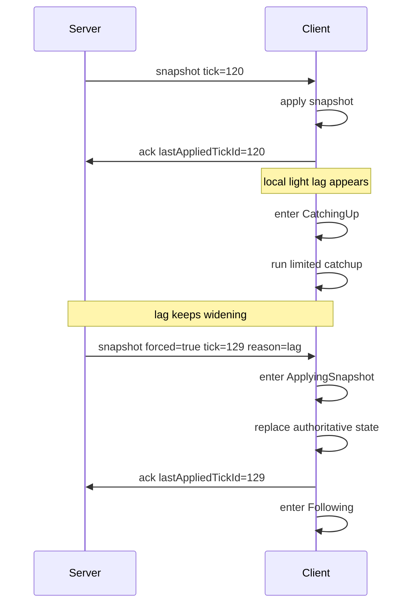

# 客户端重同步状态机

本文定义客户端如何在服务端权威 tick 周围收敛、追赶与重同步，目标是把"轻度追赶"与"重度恢复"分开，避免无限帧回填。

建议与以下文档一起阅读：

- [帧同步设计](./frame-sync.md)
- [帧同步最佳实践](./frame-sync-best-practices.md)
- [参数调优](../reference/tuning.md)

## 设计目标

客户端状态机需要处理四件事：

- 正常情况下稳定跟随服务端权威 tick
- 轻度落后时温和追赶，不过载主线程
- 重度落后时快速切到快照恢复
- 恢复后回到稳定跟随状态

## 核心原则

- 客户端不得自认权威
- 客户端不得无限制回填帧
- 重度落后时不得坚持重放全部历史
- 客户端 ACK 必须基于"已应用状态"，而非"已收到消息"

## 建议状态

客户端同步过程建议拆为以下状态：

1. `Bootstrapping`
2. `Following`
3. `CatchingUp`
4. `ResyncRequired`
5. `ApplyingSnapshot`
6. `Degraded`

## 状态定义

### `Bootstrapping`

进入条件：

- 刚加入房间
- 刚重连
- 本地尚无可用权威状态

行为：

- 等待 `welcome`
- 建立 `tickDurationMs`、`inputDelayTicks` 等权威参数
- 等待首个可用快照

退出条件：

- 成功应用首个快照后，转到 `Following`

### `Following`

进入条件：

- 本地状态与服务器权威 tick 基本一致

行为：

- 按权威 tick 节奏正常推进
- 应用增量或周期快照
- 状态真正应用后发送 `ack.lastAppliedTickId`

退出条件：

- `lagTicks` 超轻度阈值，转 `CatchingUp`
- 收到服务端强制快照，转 `ApplyingSnapshot`
- 长时间无有效同步数据，转 `ResyncRequired`

### `CatchingUp`

进入条件：

- 轻度落后

行为：

- 在受控上限内运行少量额外逻辑 tick
- 保持渲染线程可用；不允许无限追赶
- 每帧或每秒必须有追赶预算上限

建议上限：

- 每渲染帧最多回填 `1` 个额外逻辑 tick
- 每秒最多回填 `5~10` 个额外逻辑 tick

退出条件：

- `lagTicks` 回到安全区，转 `Following`
- `lagTicks` 持续扩大，转 `ResyncRequired`
- 收到强制快照，转 `ApplyingSnapshot`

### `ResyncRequired`

进入条件：

- `lagTicks` 超重同步阈值
- `lastAckAgeMs` 持续过高
- 本地追赶无法在有限时间内收敛

行为：

- 停止继续扩大帧回填预算
- 丢弃过期的本地恢复计划
- 等待强制快照，或主动请求最新快照

退出条件：

- 收到可用快照后，转 `ApplyingSnapshot`

### `ApplyingSnapshot`

进入条件：

- 收到新的权威快照

行为：

- 把本地逻辑状态原子替换到 `snapshot.tickId`
- 清理已过期的增量
- 重建后续待应用窗口
- 状态真正完成后发送 ACK

关键要求：

- ACK 必须在状态应用后发送
- 不得在"开始处理快照"的瞬间提前 ACK

退出条件：

- 状态切换完成后，转 `Following`
- 快照应用失败，转 `Degraded`

### `Degraded`

进入条件：

- 快照应用失败
- 本地状态损坏
- 同步组件进入异常状态

行为：

- 暂停正常同步推进
- 记录错误
- 等待重新初始化或完整重连

退出条件：

- 重新取得初始化上下文与快照后，转 `Bootstrapping`

## 推荐阈值

以下是一个实用默认划分：

- 轻度追赶区间：`lagTicks <= 3~5`
- 强制重同步区间：`lagTicks > 5~10`
- ACK 超时告警：`lastAckAgeMs > 2 * tickDurationMs * maxLagTicks`

这不是固定标准，但适合作初始值。

> 注：本仓库代码 `maxLagTicks` 默认为 **50**（`src/Chorus.Engine/Session/SessionConfig.cs:8`），远高于此处推荐区间；本节阈值是状态机行为设计，实际强制重同步触发点由 `maxLagTicks` 决定。

## 建议事件

状态机通常需要响应这些事件：

- `OnWelcomeReceived`
- `OnSnapshotReceived`
- `OnDeltaReceived`
- `OnRenderFrame`
- `OnAckTimeout`
- `OnLagEvaluated`
- `OnSnapshotApplyFailed`
- `OnReconnect`

其中最关键的两个：

- `OnLagEvaluated`
- `OnSnapshotReceived`

前者决定是否继续追赶；后者决定是否直接切到恢复路径。

## 推荐转换

可用以下逻辑实现：

1. `Bootstrapping -> Following`
   条件：成功应用首个快照
2. `Following -> CatchingUp`
   条件：轻度落后
3. `CatchingUp -> Following`
   条件：落后已收敛
4. `CatchingUp -> ResyncRequired`
   条件：落后扩大或追赶预算耗尽
5. `Following -> ApplyingSnapshot`
   条件：收到强制快照
6. `ResyncRequired -> ApplyingSnapshot`
   条件：收到新快照
7. `ApplyingSnapshot -> Following`
   条件：快照应用成功
8. `ApplyingSnapshot -> Degraded`
   条件：快照应用失败
9. `Degraded -> Bootstrapping`
   条件：已重新初始化

## 时序图

下图描述"客户端轻度落后、无法收敛、最终切到强制快照恢复"的推荐流程：



该流程中最关键的两点：

- 轻度落后先走有限追赶，而非立即强制跳变
- 一旦判定无法收敛，直接切快照，不再继续回填完整历史

## 常见错误流程

以下实现非常普遍且最容易出问题：

1. 客户端检测到自己落后
2. 它在单帧内开始回填大量逻辑帧
3. 回填期间仍做完整渲染与完整表现层计算
4. 主线程更卡
5. ACK 更慢
6. 服务端持续判定它更落后
7. 客户端持续加大追赶强度

这是一个经典恶性循环。

正确做法是：

- 轻度落后只做受控追赶
- 超过阈值后立即切到快照恢复

## 正确的 ACK 语义

`ack.lastAppliedTickId` 的含义：

- 客户端已真正完成该 tick 权威状态的应用

它不应表示：

- 客户端已收到该 tick 的数据
- 客户端已把消息放入队列
- 客户端计划稍后应用

若 ACK 发送过早，服务端会误判客户端已追上，导致恢复策略失真。

## 渲染层建议

客户端逻辑切换快照时通常有视觉跳变，因此表现层建议做这些补偿：

- 位置插值
- 血量与 UI 数值缓动
- 动画状态软过渡
- 相机平滑过渡

注意：

- 这些补偿只能在表现层做
- 不得让视觉层回馈到逻辑层的 ack 与 tick 判定

## 伪代码草图

```text
state = Bootstrapping

onSnapshot(snapshot):
  state = ApplyingSnapshot
  applyAuthoritativeState(snapshot)
  lastAppliedTick = snapshot.tickId
  sendAck(lastAppliedTick)
  state = Following

onUpdate():
  lag = serverTick - lastAppliedTick

  if state == Following and lag > catchupThreshold:
    state = CatchingUp

  if state == CatchingUp:
    runLimitedCatchup()
    if lag <= safeThreshold:
      state = Following
    else if lag > resyncThreshold:
      state = ResyncRequired

  if state == ResyncRequired:
    requestOrWaitSnapshot()
```

实现可以更细，但不要改变核心原则：追赶有预算，恢复靠快照。

## 服务端配合要求

要让客户端状态机稳定，服务端至少要满足以下条件：

- 持续推进权威 tick；不为慢端点暂停
- 能按客户端判定 `lagTicks`
- 能发送正常快照与强制快照
- 能经 `resyncCooldownMs` 避免短间隔内反复发快照

当前项目的 `SessionActor` 已有这条主链，客户端实现应围绕该行为收敛，而不是自创另一套恢复模型。

服务端已暴露可供状态机直接消费的每客户端诊断字段（`/sessions` 的 `clients[]`）：`lagTicks`、`lastAckAgeMs`、`resyncCount`、`lastResyncAgeMs`、`connectedTickId`、`lastAckTickId`（`src/Chorus.Engine/Session/SessionDiagnostics.cs` 的 `SessionClientDiagnostics`）。

## 可观测性建议

客户端侧至少应暴露这些指标：

- 当前状态机状态
- `lastAppliedTickId`
- `lastReceivedSnapshotTickId`
- 当前 `lagTicks`
- 每秒回填的 tick 数
- 快照应用耗时
- 快照应用失败次数

若要排查"为什么一直追却追不上"，这些指标非常关键。

## 总结

客户端重同步状态机的本质是把"小波动下的收敛"与"严重偏差后的恢复"分成两条路径。

一个稳定方案通常满足这些点：

- 正常情况下跟随权威 tick
- 轻度落后做有限追赶
- 重度落后直接取快照
- ACK 只反映真正应用的状态

只要客户端还在尝试"无限回填以补全全部历史"，这个状态机就还不够健康。
