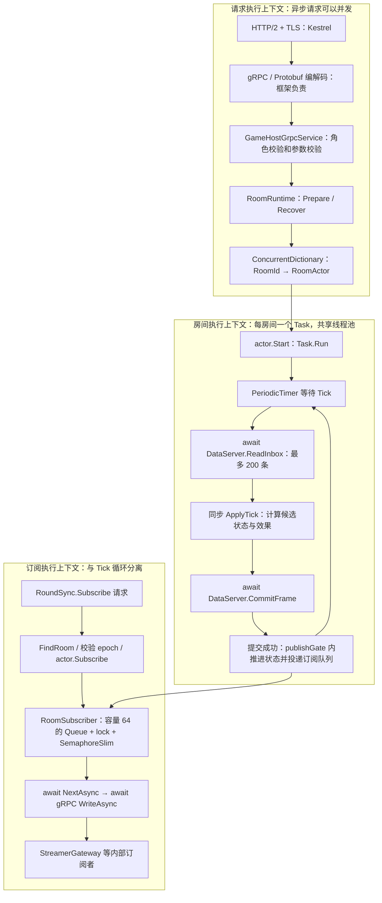

# GameServer 当前线程与消息模型

核对日期：2026-10-29。范围仅为 `src/Chorus.GameServer` 当前代码；本页记录实现事实，不把直接推送、房间邮箱和处理链目标画成现有功能。

## 当前模型

当前为 Kestrel/gRPC 异步请求处理、RoomRuntime 并发注册表、每房间一个串行异步 Tick 任务，以及每订阅者独立发送队列。应用代码没有自建 Reactor/EventLoop 调度器，没有固定房间线程，也没有统一入站 mailbox。

这是执行任务关系图，不是 OS 线程绑定图。`Task.Run` 启动异步任务；`await` 后续可能在其他线程池线程执行。同一房间只在 `await TickOnceAsync` 返回后进入下一轮，因此 Tick 之间逻辑串行；不同房间可以并发，但仍共享 CPU、线程池、GC 和 DataServer。

## 消息怎样进入房间

| 类型 | 当前路径 | 是否进入统一邮箱 |
|---|---|---|
| 准备房间 | gRPC → GameHostGrpcService → RoomRuntime.PrepareRoomAsync → 创建并注册 Actor → Start | 否 |
| 恢复房间 | gRPC → GameHostGrpcService → RoomRuntime.RecoverRoomAsync → 读取恢复材料 → 创建 Actor | 否 |
| 订阅状态 | gRPC → RoundSyncGrpcService → FindRoom → actor.Subscribe | 否；调用方直接进入订阅方法 |
| 礼物、点赞和客户端输入 | 已持久输入 → Actor 每 Tick ReadInbox → 按 BindingId 映射参与者 → ApplyTick | 否；当前为主动拉取 |
| 状态下发 | Tick 提交成功 → RoomSubscriber.Offer → Subscribe 请求循环 WriteAsync | 只有出站队列，不是入站业务邮箱 |

`Program.cs` 只映射 GameHost 与 RoundSync 两个 gRPC 服务。当前没有 PlatformGateway→GameServer 的房间 PushEvents 入口；目标图中的直接投递需要新契约与实现，不能视为已有能力。

## 并发保护和边界

- `ConcurrentDictionary` 保护注册表操作，不会自动串行化同房间 Prepare/Recover，也不会自动保护 Actor 内所有业务状态。
- `RoomActor._publishGate` 保护已提交头部、订阅集合及订阅/发布交错；订阅和取消订阅不经过 Tick 任务。Dispose 通过停止标记与取消令牌结束任务。
- `RoomSubscriber._gate` 保护单订阅者队列；`SemaphoreSlim` 唤醒发送请求。容量为 64，溢出丢弃积压增量并要求全量重建基线，终态消息保留。
- 网络 WriteAsync 位于独立的订阅请求循环，Tick 不等待慢订阅者完成发送。序列化、队列投递和锁竞争仍属于 Tick 成本，不能把它解释为全部发送开销已隔离。
- ApplyTick 是同步计算，运行在当前执行线程上；一个耗 CPU 的模块会占用共享执行资源。目前没有独立的业务计算线程池或按房间固定分片的 EventLoop。

## 与编解码／责任链思路的对应关系

编解码、请求处理链和房间串行调度是不同层面。当前 HTTP/2/TLS、Protobuf 编解码由 Kestrel/gRPC 框架承担；身份校验和分发写在具体服务方法里，没有显式的可组合房间消息处理链。业务串行化来自 Tick 循环，而不是网络事件循环或 mailbox。

后续直接推送设计至少要另行确定：解码后的消息信封、来源/租户/epoch 校验顺序、RoomId 分发、有界入站邮箱、Tick 与控制命令的调度关系、持久接受回执、I/O 等待期间的串行语义、过载背压和关闭屏障。这些尚未实现，本页不预先指定 Reactor 数量或业务线程数量。

## 代码依据

- `src/Chorus.GameServer/Program.cs`：Kestrel、AddGrpc、单例 RoomRuntime 与服务映射。
- `GameHostGrpcService.cs`：Prepare/Recover 直接调用 Runtime。
- `RoomRuntime.cs`：房间注册表、创建、恢复及 Actor.Start。
- `RoomActor.cs`：Task.Run、PeriodicTimer、ReadInbox、ApplyTick、CommitFrame 与 publishGate。
- `RoundSyncGrpcService.cs`：订阅请求及发送循环。
- `RoomSubscriber.cs`：出站队列、容量和唤醒机制。
