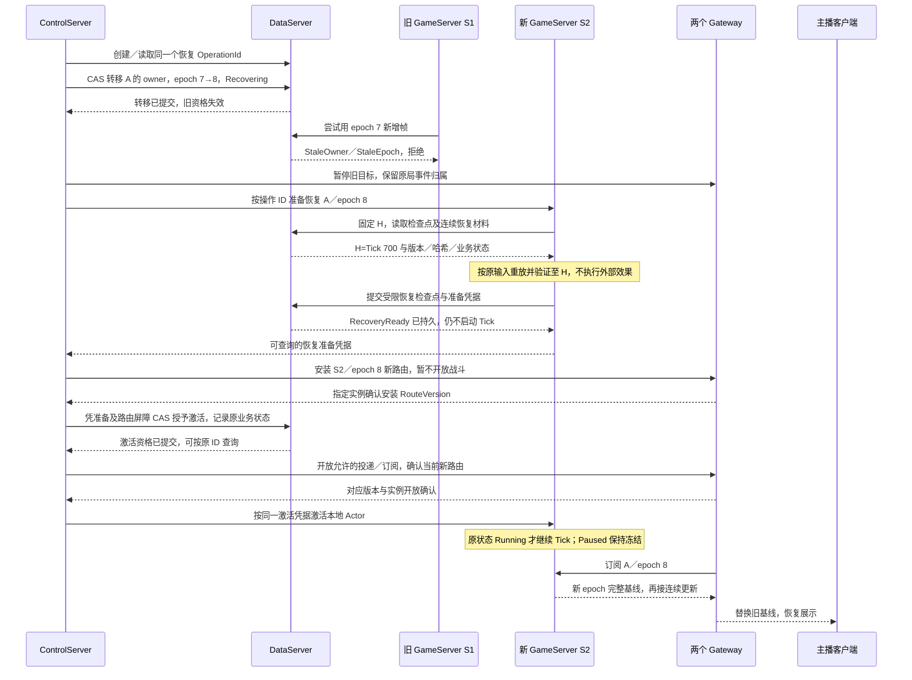

# 游戏房间恢复完整方案

2026-10-29。本文记录当前重设计的恢复目标、正常时序、异常分支和验收依据。**目标方案，不是全部已实现的声明。** 先读[术语表](../reference/glossary.md)，配套[架构方案](/architecture/architecture)、[状态同步与离线策略](./authoritative-sync.md)、[线程模型现状](./gameserver-threading-current.md)。

## 1. 恢复什么，不恢复什么

| 场景 | 保留的身份与进度 | 处理方式 | 房间所有权代次 |
|---|---|---|---|
| 一个主播客户端掉线，房间仍健康 | 原 RoomId、参与关系及服务端当前进度 | 认证重连、找回原局、快照基线与后续增量 | 不因重连推进 |
| 玩法选择暂停／恢复 | 原房间与冻结 Tick、计时器及暂停规则 | 持久暂停；达到就绪条件后持久恢复 | 不因暂停推进 |
| GameServer 退出／失联或单房执行失效 | 原 RoomId、最后已提交 Tick、状态版本和已接受输入 | 隔离旧执行者，重建并重新激活房间 | 推进 |
| 计划迁移或 GM 单房 BumpRoomEpoch | 原 RoomId 及持久历史 | 明确授权和审计；新代次重建，GM 场景显式恢复 | 推进；GM 可保持 owner 不变 |
| 已终局／已释放的房间 | 冻结结果、结算及关闭操作 | 查询结果或继续收尾，不重启战斗 | 不为了展示历史结果重开执行权 |

一个 RoomId 在本项目中对应一局，恢复不是重新匹配，也不是新建下一局。每个房间的 Tick 和所有权代次独立；共享进程和线程池不要求共享游戏进度。

## 2. 不可破坏的约束

1. 同一房间同一时刻最多一个合法新增提交者。可能同时存在两个内存 Actor，但旧 owner／旧 epoch／失效租约必须在存储事务中被拒绝，不能依赖旧进程收到通知后自觉停止。
2. 客户端只看已提交状态。未确认帧、恢复中候选状态和未验证重放不得发布为有效战斗状态。
3. 对外已持久接受的重要输入必须可继续处理或有明确终态处置；不能因换 epoch 丢失，也不能重新归到下一局。
4. 重放只重建状态，不重复发奖、资产变更、平台调用或历史客户端命令回执。相同业务操作保留原幂等身份，不能把新 epoch 拼成新的奖励／礼物身份。
5. ownership、恢复材料、路由、Actor 及客户端基线的房间和代次必须对应；不能跨 epoch 拼接客户端增量链。
6. 进程存活、租约续期、恢复 RPC 返回、路由安装和房间已启动分别记录。不得用其中一个代替其他条件。
7. 业务 Paused、故障 Recovering/Suspended、终局 Finishing 是不同状态；故障重启不能把暂停房间自动变成战斗，也不能让终局房间再算一帧。

## 3. 各进程职责

| 组件 | 恢复职责 | 边界 |
|---|---|---|
| NodeAgent | 拉起／监督本机 GameServer，报告进程事实 | 不分配 RoomEpoch，不宣告房间已恢复 |
| ControlServer | 判断故障、选择合格目标、持久协调恢复操作、授权和续租、同步路由、激活及超时治理 | 不执行玩法重放；心跳超时只是证据，不是旧写已停止的证明 |
| DataServer | 执行所有权转移、固定恢复读取视图、受限恢复检查点及激活事务，校验 owner/epoch/版本/租约 | 不选择目标、不解析平台业务、不编排恢复 |
| GameServer / RoomRuntime / RoomActor | 加载规则、校验并重放材料、准备新 Actor、按凭据激活串行循环和发布已提交状态 | 不能凭本地对象、重启或新 endpoint 自授写权限 |
| StreamerGateway | 安装房间 owner/epoch 路由，重建上游订阅，向客户端发送新基线 | 不用主播登录所在 StreamerServer 猜测房间位置 |
| PlatformGateway | 维护原直播挂载／对局归属，暂停旧目标、切换已确认路由、重试原事件 | 不因恢复调用平台结束，不因 epoch 变化重复算礼物 |
| StreamerServer | 校验当前控制会话与参与关系，重连找回原局，更新可见生命周期 | 不重新为恢复中的有效参与者排队，不中转战斗帧 |

## 4. 故障判定与目标准入

ControlServer 区分进程失联、Actor 停滞、存储暂时不可用和玩法异常。报告包含 ProcessInstanceId、报告序号、接收时间、房间最后提交 Tick／时间、恢复阶段和停止原因。业务暂停不按“Tick 没前进”误判为故障。短暂慢提交先按故障分类退避，不立即触发反复迁移。

目标实例必须身份合法、依赖可用、具备精确模块／配置包及恢复能力，容量和调度状态允许。目录动态解析 endpoint，不从客户端请求取可信地址。所有权转移受当前 CoordinatorTerm、ExpectedOwner/ExpectedEpoch 及数据库事务保护；租约到期由数据库时间判断，主动迁移则需明确授权。新进程必有新 ProcessInstanceId。

房间迁移不意味着“主播换房间”：原 RoomId 不变；在同一进程内恢复同一房间也必须区分旧 Actor 对象和新权威代次。

## 5. 恢复材料与固定边界

一次恢复首先固定已提交头 `H=(RoomId, TickId, StateVersion, StateHash)`，记录本次新 RoomEpoch、模块／配置／schema 版本、原业务状态和操作身份。读取采用一致视图或等价的不可变恢复游标；分页不得混入后续数据。

| 材料 | 用途与校验 |
|---|---|
| 有效检查点 | 状态 payload、哈希、Tick/版本、模块版本、配置哈希、schema；优先最新候选 |
| 检查点至 H 的连续帧 | 固定输入引用／顺序、Tick、版本、状态哈希、随机状态及必要恢复信息 |
| 帧实际引用的输入与参与关系 | 重建原执行上下文，不把整局所有无关输入全部载入 |
| 已接受但未消费的输入及消费游标 | 重放到 H 后再按原归属、顺序和预算处理；不能混进历史帧 |
| 暂停与玩法计时状态 | 区分逻辑剩余时间和墙钟期限，保留暂停／恢复就绪规则 |
| 结果与结算／结束凭据 | 判断是否只需返回结果和继续收尾，而非启动战斗 |

恢复头 H 可能由旧 epoch 的历史帧组成，这是合法的：服务器验证并重建这些已提交历史，再形成新 epoch 的恢复基线；不能篡改旧帧 epoch，也不能向客户端直接拼接两代增量。重放必须按历史确定性输入和规则进行，不能使用当前墙钟、全局随机数或外部 HTTP 返回值补算历史。

最新检查点损坏时，按需回退更早候选并补足连续帧；缺帧、哈希不符、包缺失或所有候选失效时明确 RecoveryFailed/Suspended。不能跳过坏帧或以默认空状态“恢复成功”。传输、候选数量、重放工作量和单房恢复内存均有上限及可取消行为。

## 6. 故障接管完整时序（目标）

下面使用旧 owner=S1、新 owner=S2、房间 A、旧 epoch=7、新 epoch=8、固定头 Tick=700 举例。数字只是例子。RecoveryReady、RoutesInstalled、Starting 等是操作阶段的说明名，需由契约任务落实，不声称当前协议已有同名枚举。

具体约束：

1. 转移事务按固定锁序更新 room ownership 与 game.room 的 epoch，保存原业务状态和操作回执。新代次只能前进；事务前成功的旧提交包含在固定头中，事务后旧执行者不得新增提交。
2. 旧目标即使无法收到暂停通知，也已失去写权限。旧路由调用可返回过期／未就绪并重试；重要输入尚未持久接受时不得回复成功或静默丢弃。
3. 准备恢复只构建一个候选 Actor。恢复快照写是 Recovering 下的专用受限操作，不开放普通 CommitFrame，不借提前 Confirm Active 绕过限制。
4. RecoveryReady 凭据绑定 OperationId、owner、epoch、H、包／配置哈希。目标重启后旧凭据不能授权新的进程实例直接启动，必须重新校验和协调。
5. 路由安装与开放分别追踪两个 Gateway 的确切确认者集合和版本，不用“发出通知”当作 ACK。缺一个确认不能宣称整个恢复可用；不相关实例如何排除必须有持久配置／租约依据。
6. 持久激活资格与启动本地循环分开。授予资格后若开放路由失败，保持 Starting／暂停推进并重试原操作；本地 Actor 不因 ownership 已 Active 自动开跑。循环启动前仍验证当前资格与屏障，不接受迟到的旧激活命令。
7. 开放路由至启动 Tick 的短暂间隔允许符合原局输入窗口的输入先持久接收并等待，但不提前产生玩法效果。GameplayReady 以当前 Actor 和阶段证据报告，不由 ownership Active 单独推断。
8. 原状态 Paused 时，只恢复暂停基线和维护任务，后续须走玩法就绪／Resume 边界；原状态终局时转收尾分支。故障恢复本身不要求所有离线客户端 ACK 后才允许原本应继续运行的房间推进。

## 7. 权限与恢复状态矩阵（目标）

| 阶段 | 读取恢复材料 | 写恢复检查点 | 新增普通帧 | 新路由／客户端 | 活性与期限 |
|---|---|---|---|---|---|
| Recovering | 当前授权 owner 可读固定视图 | 仅指定操作、owner/epoch、校验头 | 禁止 | 旧路由失效，不能宣告战斗就绪 | 有恢复期限，心跳不无限延期 |
| RecoveryReady／待激活 | 可核验同一恢复头 | 同操作幂等，不覆盖别的恢复 | 禁止 | 可安装路由；准备基线须有明确权限，不算已运行 | 等待持久屏障，失败可查询 |
| 已获激活资格／Starting | 按需核验 | 按明确接口约束 | 本地循环仍受启动屏障约束 | 分别确认路由开放，再启动目标 Actor | 超时按操作继续或重新治理 |
| Running | 按正常权限 | 正常检查点规则 | 当前 owner/epoch/有效租约下允许 | 已提交基线及增量 | 按实际提交进度监测 |
| Paused | 可读取当前暂停头 | 受限维护／暂停接口 | 不推进玩法 Tick | 暂停快照；输入按固定策略处置 | 租约、心跳与最大暂停期限继续 |
| Finishing／已释放 | 只读冻结结果及收尾状态 | 不以恢复接口改写终局 | 禁止重开战斗 | 查询结果；缓存不足回持久结果入口 | 由结束协调器推进收尾 |

该表是 FIX-TAKE-01/02/03 的落地要求，不修改其他章节的安全约束。ownership 的状态与房间业务状态不同；租约续期只保证资格期限，不代表 Tick 已启动。旧已完成操作的回执查询可按权限返回，不能把“拒绝旧新增写”误解成删除历史回执。

## 8. 未确认帧、输入与外部副作用

故障前最后一个 CommitFrame 可能“数据库成功，回执丢失”。恢复以固定持久头为准：若该帧已提交，就从其后继续；若未提交，其输入仍待消费。原 Actor 的 pending 候选状态不是新的权威来源，不能根据 RPC 超时推断数据库没有提交。旧实例仍持有资格时，重试必须使用原 CommitId 和完全相同的请求；被隔离后不得换 ID 强行提交旧候选。

每次提交原子处理帧、消费记录、状态版本及效果／结果凭据。重放重建同一状态但不再执行效果；已提交流水及结算操作继续使用原幂等键。已持久接受的事件由新 owner 接续，未接受的事件由发送方保留原 EventId 重试；首次固定的 RoomId／RoundGeneration 不变。

PlatformGateway 的平台连接生命周期与 GameServer 故障恢复分开。尽可能维护合法订阅及心跳；如果平台已撤权或场次结束，形成独立业务原因并按玩法／关闭流程处理，不能假装还有平台资格。无法证明来源或原局归属的事件明确待处理，不猜测新房间。

## 9. 客户端重连、追赶与业务暂停

客户端重连先由 StreamerServer 恢复当前认证会话及持久参与关系，StreamerGateway 根据 ControlServer 路由找到原 RoomId。服务端以同一发布边界选取完整快照 H 并接续 H 之后的更新；安装期间的增量有界缓存，溢出重新取新基线，不能阻塞其他主播或无限堆积。

客户端校验 RoomId、RoomEpoch、StateVersion、BaseVersion、模块／配置兼容。新 epoch 的完整基线可沿用恢复后的 Tick 数字，但必须替换旧增量链。ACK 只表示指定基线准备或进度，不能凭客户端自报恢复权威状态、补发奖励或解锁未满足的房间屏障。

单主播断线时，其他主播和房间按玩法继续／暂停／托管；全员离线使用原局钉住的策略。故障恢复若还原 Paused，达到原配置就绪人数、验证当前会话／epoch／基线并持久提交 Resume 后才继续 Tick；最大暂停期限按原规则处理。具体暂停时序见[帧同步文档](./authoritative-sync.md)。

## 10. 失败与重试决策

| 中断／故障 | 处理 | 不能做什么 |
|---|---|---|
| 转移成功但响应丢失 | 按原 OperationId 查询回执与当前权威后继续 | 用新 ID 再 bump 一次 |
| ControlServer 中途重启 | 新协调者凭有效 term 读取同一操作和屏障继续 | 只凭本地 RPC 结果重走全流程 |
| 新 GameServer 在准备／激活后崩溃 | 不宣告 Ready；期限后显式再分配并推进新 epoch | 回退旧 epoch 或让重启的新实例继承旧资格 |
| 数据库／DataServer 不可用 | 停止新权威提交，保留未知结果，恢复后查同一操作 | 广播未提交候选，或仅靠本地时钟续租 |
| 包缺失、重放哈希不符、恢复帧缺口 | 保持挂起，记录材料／阶段，按规定候选回退 | 跳帧、默认空状态、重放历史外部效果 |
| 路由 ACK 缺失／Gateway 重启 | 原版本重放或全量快照重装；更新应答者资格并留证据 | 宣布路由同步成功或直接猜 endpoint |
| 已有最终结果但结算／平台关闭未完成 | 恢复持久结束操作，返回冻结结果 | 再启动 Tick、重复发奖、提前销毁 |
| 发现同一房间多个 Actor | 当前权威只允许一个；旧对象按身份清理 | 旧清理回调删除新 Actor |

正常终局仍按：最终结果提交 → 停止旧局投递并确认 → 获准调用平台并确定结果 → 重要输入／结算完成 → 原子释放 → 授权销毁。恢复不跳过此屏障；单纯换 GameServer 也不触发一次平台结束。

## 11. 运维与验收

记录 RecoveryOperationId、原因、RoomId、旧／新 owner 与 epoch、H、阶段、期限、检查点、重放帧数／耗时／字节、最后错误和各 Gateway 的 RouteVersion/ACK。高基数房间 ID 用于诊断查询和日志，不无界扩展指标标签。报告故障发现、隔离、重建、路由完成和首个恢复提交的分段耗时。

已提交且保存在可用持久存储中的状态／已确认输入，目标是不因应用进程故障丢失；不承诺数据库自身丢失后的零数据损失，也不承诺平台尚未成功送达的数据已被接受。恢复时间目标需按房间规模、检查点间隔、重放成本及故障环境事先声明并实测，本方案不凭示意时序给出秒级 SLA。

| 独立验收场景 | 通过依据 | 对应现有 TODO |
|---|---|---|
| 单客户端断线，另一端在线 | 原局继续，重连基线无隙且不重复奖励 | FIX-SYNC-02/03、FIX-U3D-11 |
| 暂停房间故障重启 | Paused、计时器及策略恢复；未就绪不 Tick | FIX-SYNC-06/08 |
| 接管后旧实例恢复写入 | 旧新增帧／快照被拒，新 owner 可接续 | FIX-GM-04、FIX-TAKE-08 |
| 提交成功但回执丢失 | 以持久头恢复，每输入／效果一次 | FIX-FRAME-04 |
| 最新快照损坏／全部不可用 | 可验证回退或明确挂起，不伪成功 | FIX-READ-04 |
| 转移／恢复／激活各阶段 kill | 持久操作可继续，无假 Ready 或重复 bump | FIX-TAKE-04/05/08 |
| A→B→A，同进程多个房间 | 旧对象不挡新代；其他房间不受影响 | FIX-ROOM-06、FIX-GM-04 |
| Gateway ACK 丢失／重启 | 路由屏障可重建，未满足不启动 | FIX-LINK-08、FIX-REC-01 |
| 已终局后 GameServer 崩溃 | 只查询结果／继续收尾，不重开战斗 | FIX-END-12/14 |
| 长局／批量恢复 | 单次读取及内存有界，报告恢复预算和实测 | FIX-READ-02/03/05、FIX-REC-02 |

## 12. 当前代码与目标差距

| 当前代码依据 | 已有基础 | 尚不能据此宣称完成 |
|---|---|---|
| `src/Chorus.DataServer/RedesignFrameStore.cs` | 事务提交、owner/epoch/租约校验及提交幂等 | 整个恢复协调及平台／客户端端到端正确性 |
| `src/Chorus.DataServer/RedesignRoomStore.cs` | 房间所有权转移、受限恢复头写入及确认接口 | 双 Gateway 路由屏障与独立 Actor 激活的完整闭环 |
| `src/Chorus.DataServer/RedesignRecoveryStore.cs` | 恢复材料读取 | 固定一致视图、候选按需读取和大规模有界传输 |
| `src/Chorus.GameServer/RoomRuntime.cs` | 检查点重放、哈希校验和恢复 Actor | 当前恢复成功会直接 Start；尚缺路由屏障后的独立激活 |
| `src/Chorus.ControlServer/TakeoverGrpcService.cs` | 转移、持久恢复操作、超时治理；已移除恢复前的 Active 确认 | 当前由目标恢复并确认后直接启动；仍需控制面准备凭据及双 Gateway 屏障 |
| `src/Chorus.GameServer/RoundSyncGrpcService.cs`、`RoomActor.cs` | epoch 校验、发布门、快照及有界订阅队列 | 通用完整状态增量、所有重连／迁移场景验收 |

同一轮中代码可能继续变化，实施前须重新核对。既有 FIX-TAKE、FIX-READ、FIX-ROOM、FIX-SYNC、FIX-GM、FIX-LINK 和 FIX-END 任务继续作为交付清单；本文补充的跨阶段路由恢复屏障和容量验收见 `todo.md` §22.20。不创建第二套恢复实现。
